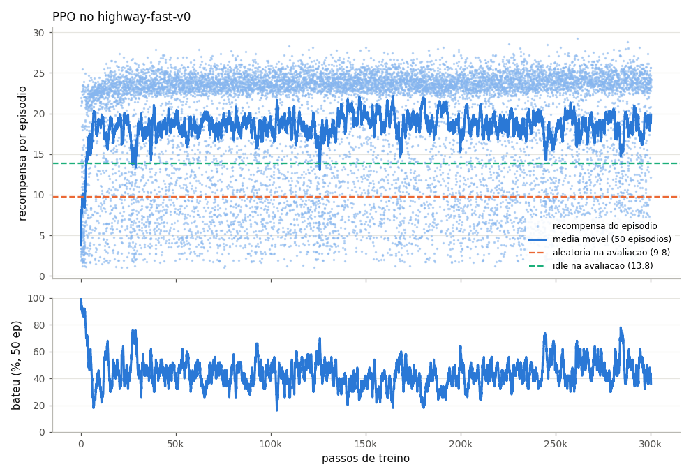
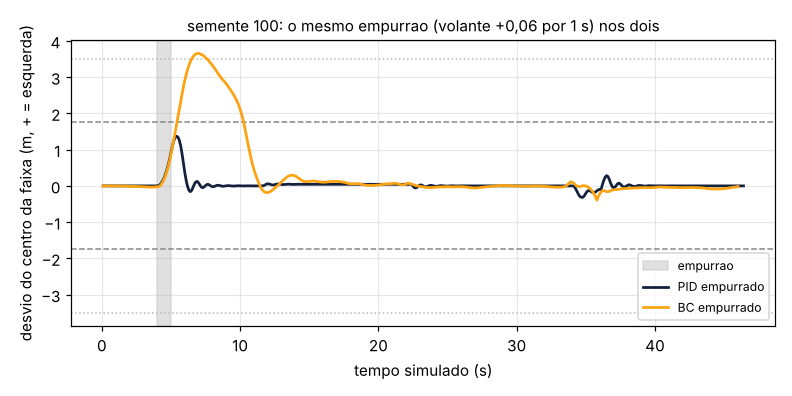

# Aula 18 — O TP5 de uma vez: quatro frentes e a linha de base de cada uma

**Terça, 17/11/2026 · sala SJ205 · Etapa 9 (09/11–21/11)**

[:material-file-pdf-box: Slides da Aula 18 (PDF)](apresentacao-aula18.pdf){ .md-button .md-button--primary }
[:material-chart-line: PPO no highway-env](../../exemplos/aula18-ppo/index.md){ .md-button }
[:material-steering: PID × Behavioral Cloning](../../exemplos/aula18-pid-bc/index.md){ .md-button }
[:material-robot-industrial: MoveIt 2 com o Panda](../../exemplos/aula18-moveit/index.md){ .md-button }

!!! info "Como esta página funciona"
    Em sala eu **demonstrei** o caminho no meu ambiente, e vocês observaram. **O que é para rodar no seu ambiente está na [tarefa da semana](#a-tarefa-da-semana)**, como uma sequência ordenada para fazer em casa, no seu ritmo — é lá que a aula acontece para cada um.

    O TP5 foi aberto **inteiro** hoje, em visão geral: uma demonstração curta de cada uma das quatro frentes, menos profundidade em cada. As seções dos blocos 1 a 4 descrevem **o que foi mostrado e o que observar**; cada uma se sustenta sozinha e diz o que pressupõe.

## Cenas dos últimos episódios

**Na Aula 17** o item 2 do TP4 fechou com uma sessão gravada de verdade: o `vigia` interrompeu o goal, o bag tocou sem o robô e a régua leu o que aconteceu — e registrou o atalho do limiar de 0,75 m. O MetaDrive subiu para o item 3, sem placa nenhuma, e o detector da Aula 13 achou zero ali até ser ajustado e **declarado**. A mesma rede foi treinada duas vezes para o item 4, e a linha de base e a matriz denunciaram a rede que decora.

Duas pendências daquela aula foram fechadas **depois** dela, no meu WSL2, em 10/11: a árvore `com_espera.xml` **carregou** num `bt_navigator` de verdade, e o teclado do `rotular.py` **respondeu**. A página da Aula 17 e os READMEs dos dois exemplos já dizem isso.

Os conceitos de antes que a aula de hoje vai usar:

- **Ação com objetivo, resultado e cancelamento** é a Aula 8. O MoveIt 2 é contratado exatamente assim: um objetivo na ação `/move_action`, um resultado com um código.
- **A linha de base** é a Aula 17: quanto acerta quem nem olha a imagem. Hoje ela tem três formas — o carro que não decide nada, o volante parado e o braço sem a caixa.
- **A métrica declarada antes de medir** é a Aula 9. A régua do PID e do BC é uma função só, escrita antes de qualquer controlador passar por ela.
- **Venvs que não se misturam** é a Aula 17: o do MetaDrive e o da rede. Hoje entra um terceiro, o do PPO.
- **A mesma semente não dá a mesma tabela em outra máquina** — a Aula 17 mediu isso. Hoje vale para o treino do PPO e para o BC dirigindo.

## A ideia da aula em uma frase

**O número só vale com linha de base.** Setenta por cento de episódios concluídos não diz nada sozinho; ao lado do IDLE — o carro que mantém a faixa e a velocidade e não decide nada —, que conclui dez por cento, diz que a política reduziu as batidas de nove para três em dez. As quatro frentes do TP5 têm a mesma pergunta — *como eu sei que funcionou?* — e a mesma resposta: **a métrica, a linha de base e quantos episódios**.

## O que você sai sabendo hoje, e o que isso vale no seu projeto

| A capacidade | No seu projeto |
|---|---|
| disparar um treino longo de RL, ler a velocidade dele e fazer a conta antes de planejar a semana | o item que mais atrasa entrega roda sozinho enquanto você faz o resto |
| avaliar uma política contra duas linhas de base, nos mesmos episódios, sem sortear a ação | "o PPO bate 30%" vira uma frase que se sustenta |
| medir um controlador e uma rede na **mesma** régua, e achar a coluna que separa os dois | a tabela PID × BC compara controladores, e não cenários |
| subir um braço no MoveIt 2, pôr um objeto na cena e ler o que o planejador respondeu | a evidência do item 1 é a tabela com e sem o objeto, não um print bonito |
| dizer o que dá e o que não dá para comparar entre dois simuladores | o gráfico de barras do relatório diz o que mede — e o que não mede |

## O que foi demonstrado, onde está na tarefa, e quando vence

As datas estão nesta tabela e em [Gates de cada TP](../../recursos/gates-tps.md) — elas são **referência para consultar**, não o assunto da aula. A tarefa está na ordem **do que demora**, não na ordem da aula.

| Bloco demonstrado | O que você faz em casa | Gate | Vence em |
|---|---|---|---|
| Abertura: o TP4 fecha | [passo 7](#passo-7-o-item-2-em-marcha-e-o-tp4-entregue) da tarefa | G4.7 | **21/11 até 12h** |
| 1. PPO: o treino, a curva e as linhas de base | [passos 1 e 6](#passo-1-o-ambiente-do-ppo-e-o-treino-de-300-mil-passos-disparado) | G5.5 | 26/11 |
| 2. PID × Behavioral Cloning | [passos 3, 4 e 5](#passo-3-o-pid-medido-na-regua) | G5.2 · G5.3 · G5.4 | 21/11 · 23/11 · 25/11 |
| 3. MoveIt 2 | [passo 2](#passo-2-moveit-2-a-caixa-tres-poses-suas-com-e-sem-ela) | G5.1 | 20/11 |
| 4. A validação, e a comparação honesta | [passo 7](#passo-7-o-item-2-em-marcha-e-o-tp4-entregue) | G5.0 · G5.6 | 14/11 (já venceu) · 26/11 |

A entrega do TP5 é na sexta, **27/11** — PDF, GitHub, vídeo de até 5 minutos e ZIP. Entre hoje e ela há **uma** terça de aula.

## Pegar o material

Este é o bloco que abre o seu trabalho em casa. Ele define as três variáveis da disciplina e copia os três exemplos de hoje para dentro do seu projeto — e o pacote do MoveIt para o `src/` do seu workspace.

```bash
# ── uma vez por terminal ──────────────────────────────
export PB_USER=seu-usuario-github          # ← troque pelo seu usuário do GitHub
export PB_DIR="$HOME/projeto-pb-$PB_USER"
export PB_WS="$PB_DIR/ros2_ws"
mkdir -p "$PB_WS/src"

# a cópia antiga sai antes: cp -r sobre pasta existente ANINHA. A guarda é o
# próprio encadeamento com &&: se o clone falhar, nada é apagado.
cd /tmp && rm -rf pb-a18 && \
  git clone --depth 1 https://github.com/Prof-Dacio-INFNET/PBRoboticos_prof_dacio.git pb-a18 && \
  rm -rf "$PB_DIR/aula18-ppo" "$PB_DIR/aula18-pid-bc" "$PB_DIR/aula18-moveit" "$PB_WS/src/aula18_moveit" && \
  cp -r pb-a18/exemplos/aula18-ppo "$PB_DIR/" && \
  cp -r pb-a18/exemplos/aula18-pid-bc "$PB_DIR/" && \
  cp -r pb-a18/exemplos/aula18-moveit "$PB_DIR/" && \
  cp -r pb-a18/exemplos/aula18-moveit/aula18_moveit "$PB_WS/src/"
```

**Cuidado com o que mora dentro das pastas dos exemplos.** O bloco apaga e recria `aula18-ppo/` e `aula18-pid-bc/`. Por isso a tarefa grava o treino do PPO em `$PB_DIR/ppo-treino`, **fora** dela; e o seu dataset, o seu modelo e os seus resultados do BC moram dentro de `aula18-pid-bc/` — copie-os para `docs/evidencias/tp5/` assim que saírem (a tarefa diz quando), e não rode este bloco de novo sem guardar `dataset/` e `modelo/`.

Os três ambientes Python ficam em `$PB_DIR`, fora dos exemplos: `.venv-rl` (o PPO, criado no passo 1), `.venv-metadrive` e `.venv-cnn` (os da Aula 17). Se você ainda não tem os dois últimos, os blocos estão nos passos 3 e 6 da [tarefa da Aula 17](../etapa09-aula17/index.md#a-tarefa-da-semana).

!!! tip "A linha `: \"${PB_WS:?...}\"` que aparece nos blocos seguintes"
    Ela confere que as variáveis existem **neste** terminal. Um bloco que começa com ela supõe que o mesmo terminal já rodou um bloco que define as variáveis; um terminal novo começa sempre pelas três variáveis — e, se for chamar `ros2`, pelas duas linhas de `source`.

!!! warning "O que rodou onde — leia antes de confiar em qualquer número"
    **Na nuvem** (um servidor Linux de 2 núcleos, sem placa de vídeo, com outros processos disputando a CPU, em 14 e 15/11): o treino do PPO inteiro, todas as avaliações, o PID em todas as varreduras, o dataset do PID, o treino do BC e o BC dirigindo com renderização por software. **Na minha máquina** (WSL2, Ubuntu 22.04, GPU pelo WSLg), no ensaio de 15/11: o venv do PPO e um treino curto, o PID nas duas varreduras, o dataset do PID, o treino do BC, o BC dirigindo os 10 episódios e o empurrão — os números de lá estão ao lado dos da nuvem em cada bloco. A parte ROS 2 do exemplo do MoveIt rodou **só na minha máquina, em 16/11**: o demo do Panda subiu, a caixa entrou na cena, e as três poses deram `SUCCESS` com a caixa, em três execuções seguidas — o que ainda não foi visto está dito no bloco 3. **No WSL2 de vocês: ninguém viu ainda.** Os READMEs dos exemplos separam, linha a linha, o que foi visto do que não foi — e a pilotagem **humana** do dataset não foi feita por ninguém.

---

## O TP4 fecha esta semana

Três lembretes, e só três; o resto está no [passo 7 da Aula 17](../etapa09-aula17/index.md#passo-7-o-relatorio-e-a-entrega).

1. **A ordem no repositório:** tudo na `main`, a branch `entrega-tp4` igual à `main`, e a tag `tp4` empurrada.
2. **O Moodle é a entrega oficial:** o PDF do relatório, o ZIP do código e os links — bag, vídeo e modelo, testados numa janela anônima. Se o avaliador não consegue abrir, não existe.
3. **O prazo do TP4 é sábado, 21/11, ao meio-dia** — não à meia-noite.

---

## Bloco 1 — PPO primeiro, porque é o que demora

**Pressupõe:** nada no ar; o PPO é um processo Python sem ROS 2. **Para fazer: passos 1 e 6 da [tarefa](#a-tarefa-da-semana).** O exemplo é o [`aula18-ppo`](../../exemplos/aula18-ppo/index.md).

### O ambiente, e a linha que poupa 3 GB

O PPO vai num venv próprio, `$PB_DIR/.venv-rl`, criado com `uv`, Python 3.10 e **sem** `--system-site-packages` — como o da rede da Aula 17: ele nunca importa ROS 2. A linha que mais importa é o `--torch-backend cpu`. Sem ela, o `uv` resolve o torch do PyPI, que no Linux vem com CUDA: **17 pacotes a mais** e uns **3 GB** de download, para uma rede de 256×256 que roda em CPU. Com ela, o venv pronto ocupa 977 MB.

### O treino curto, e a conta que ele permite

Em sala, um treino de 3000 passos rodou ao vivo, só para a turma ver a linha de progresso — uma por intervalo, com os **passos por segundo** e a estimativa de término:

```text
passos     512/3000   34.1 passos/s  decorrido 0min 15s  falta ~1min 13s  ultimos 20 ep: recompensa 9.11, bateu 90%
fim: 3072 passos em 1min 34s (32.6 passos/s); modelo em /tmp/demo-a18/modelo_final.zip
```

Essas linhas são da nuvem. Na minha máquina, o mesmo treino curto fez **57,8 passos/s** e terminou em 53 s — quase o dobro. O alvo de 3000 vira 3072 porque o SB3 completa a coleta de 768 passos — e o de 300 mil vira 300 288.

**300 mil passos não são 30 minutos.** O enunciado diz "≈30 min CPU"; isso exigiria uns 167 passos por segundo. Na nuvem, o treino inteiro levou **2 h 58 min**, a **28 passos/s**. Na minha máquina, o de 300 mil rodou a **55 passos/s**, estáveis: aos 57 min estava em 188 mil passos, e a previsão total dava **1 h 31 min**. Nenhuma das duas chega perto de 30 minutos. O gargalo é o **simulador**, que é Python puro: sozinho, com ações aleatórias e sem rede nenhuma, ele fez 35 passos/s ali. Mais threads no torch não ajudam; dois ambientes em paralelo deram 31,9 contra 28,1. **A conta é sua:** 300 000 divididos pelos passos/s da **sua** linha, em horas. É por isso que o treino é o **passo 1** da tarefa — com `nohup`, checkpoint a cada 20 mil passos, e o resto do TP5 enquanto ele roda.

### A curva, e por que ela para cedo

A curva da amostra (`amostra/ppo-curva.png`, a figura que o G5.5 pede):



A recompensa sobe de **8,9 para 18,8** nos primeiros 8 a 10 mil passos — uns 6 minutos de treino — e fica plana. Os outros 290 mil passos não mudaram a média. O motivo está na fórmula: a recompensa do `highway-fast-v0` vai de 0 a 1 **por passo**, em 30 passos; um passo sem batida vale pelo menos 0,67, então sobreviver os 30 passos devagar já rende uns 22, e ir rápido acrescenta no máximo 8. **Quem paga é a sobrevivência**, e a política aprendeu exatamente isso.

### Caso — o modelo pronto contra as duas linhas de base

O modelo de 300 mil passos da amostra, avaliado em 10 episódios (sementes 1000 a 1009, nunca as do treino) junto com duas linhas de base nos **mesmos** episódios — a **aleatória**, que sorteia uma das 5 ações, e o **IDLE**, que mantém a faixa e os 90 km/h e não decide nada:

```text
  politica          concluiu   colidiu   vel_media (km/h)  recompensa
  ppo                 70%       30%      86.1 +-  7.1       21.50 +-  5.33
  aleatoria           10%       90%      83.4 +-  9.1        9.75 +-  6.42
  idle                10%       90%      87.4 +-  1.8       13.82 +-  6.28
```

Na minha máquina, o mesmo `.zip` nas mesmas sementes deu **exatamente esta tabela**, linha a linha, em 12 a 14 s — e o sorteio da seção seguinte, os mesmos 60% / 40%. Com o highway-env, semente e modelo iguais, a avaliação se repetiu entre as duas máquinas; é o que se observou nelas, não uma garantia (com a câmera do MetaDrive, na Aula 17, não se repetiu).

**O que a política aprendeu:** vai para a faixa da direita uma vez, no começo, e fica lá 99% do tempo; depois alterna acelerar e frear — `SLOWER` é a ação mais escolhida — e não ultrapassa ninguém. **O IDLE não é "não fazer nada" seguro:** ele não freia para o carro da frente e bate em 9 de 10. E ele **corre mais** que o PPO (87,4 contra 86,1 km/h). A frase certa para o relatório é "bateu três vezes menos que o IDLE, andando um pouco mais devagar". A errada é "aprendeu a dirigir": ele ainda bate em 3 de 10.

### Caso — o mesmo arquivo, sorteando a ação

O `model.predict(obs)` do Stable Baselines3 tem `deterministic=False` como **padrão**: sem o argumento, a avaliação sorteia a ação, como no treino. O `avaliar.py --estocastico` mostra o efeito. Na nuvem, nos mesmos 10 episódios, o mesmo `.zip` foi de 30% para **40%** de batidas; nos 50 episódios da amostra, de **32% para 56%**. É também por isso que a curva de treino mostra mais batidas que a avaliação: no treino o PPO sorteia, para explorar.

### Quantos episódios bastam

Dez episódios separam o PPO do IDLE em qualquer bloco: em 50 episódios, em blocos de 10, o PPO bateu `3 4 3 3 3` e o IDLE `9 10 9 8 10`. Dez episódios **não** separam dois checkpoints do mesmo treino. Com 50 episódios cada, seis checkpoints deram de **16% a 32%** de batidas — e o modelo **final** foi o que mais bateu. Os intervalos de 95% mal se separam: os dados sugerem que mais treino não melhorou, e não provam. E **recompensa só se compara com a mesma configuração**: o mesmo modelo avaliado no `highway-v0` "melhora" a recompensa (29,16 contra 21,50) só porque o episódio dele tem 40 s, e não 30.

---

## Bloco 2 — PID × Behavioral Cloning: uma régua só, e o empurrão

**Pressupõe:** os venvs do MetaDrive e da CNN da Aula 17. **Para fazer: passos 3, 4 e 5 da [tarefa](#a-tarefa-da-semana).** O exemplo é o [`aula18-pid-bc`](../../exemplos/aula18-pid-bc/index.md).

### A régua comum

O `avaliar.py` é o **único** lugar que decide como se mede. O PID e o BC só dizem o que fazer a cada passo; os dois passam pela mesma função, com as mesmas sementes (100 a 109), o mesmo mapa (`SCSCS`: reta, curva, reta, curva, reta) e as mesmas colunas. As decisões do cenário estão declaradas no topo do arquivo, antes de medir:

- **Sem tráfego.** Os dois controladores usam o mesmo acelerador proporcional, que **não freia** para o carro da frente. Com tráfego, a coluna `colidiu` mede a falta de freio, não a direção: o mesmo PID com `--trafego 0.1` bate em 10 de 10.
- **`colidiu` e `saiu_da_pista` são colunas separadas.** O enunciado fala em colisões; o MetaDrive encerra o episódio nos dois casos. Diga no relatório como contou.
- **O PID lê o estado do simulador; o BC só vê a imagem.** O PID é a linha de base com percepção perfeita. A linha de base **mais burra** é o volante parado na média do dataset: sai da pista em 7 s.

### Caso 1 — o PID medido, nos dois jeitos de errar

Sem o termo de rumo (`--olhar 0`), sobra um P puro sobre o desvio, e **nenhum Kp funciona**: dez de dez fora da pista em todos, com uma oscilação que cresce na entrada da curva até tocar a linha contínua. O volante muda o **rumo**, e o rumo muda o desvio; um P sobre o desvio só descobre que passou do centro depois. Com o termo de rumo (olhar 5 m à frente, o padrão), o PID conclui 10 de 10 com erro lateral médio de **0,021 m** a 38 km/h.

O segundo jeito de errar passa na régua:

```text
controlador                          concluiu   saiu  bateu      vel km/h         rota     erro lat m  var dir
kp=0.5 ki=0 kd=0 olhar=5 v=40          10/10    0/10   0/10  38.0 +-  0.3 0.990+-0.002  0.021+- 0.004    0.010
kp=0.5 ki=0 kd=0.3 olhar=5 v=40        10/10    0/10   0/10  33.5 +-  0.3 0.990+-0.003  0.151+- 0.012    0.398
```

Com `Kd = 0,3`, "para amortecer", 10 de 10 concluem — e o volante alterna `+0,50, −0,40, +0,50…` a cada passo, na curva. O carro filtra isso; o **rótulo** do dataset não, e a rede treinada nele ficou em MAE 0,139 contra 0,143 de "sempre a média". **O professor do BC tem de ser suave, não só correto**, e a coluna `var_direcao` mede isso. Duas armadilhas a mais estão no exemplo: a 60 km/h, os ganhos de 40 km/h deixam 6 de 10 saírem da pista; e chamar o `simple-pid` sem `dt=` faz 1 de 10 concluir, porque ele passa a medir o tempo pelo relógio do computador.

### Caso 2 — o dataset, e a rede que parece ótima

O dataset da aula — 1000 quadros pilotados pelo **PID**, que serve para a aula e **não** para a entrega — lido pelo `histograma.py` antes de treinar:

```text
| abs(direcao) < 0.02 | 644 quadros (64%) |
| esquerda (>= 0.02) / direita (<= -0.02) | 81 / 275 |
```

**64% é volante parado**, a curva deste mapa pede só 0,06 a 0,08 de volante, e há três vezes mais curva à direita que à esquerda. O `histograma.py` é **apoio, não veredito**: relata o que achou no `acoes.csv`, não diz se o dataset serve.

A rede — a CNN da Aula 17 virada regressão, uma saída, a direção — treinada nesse dataset com a divisão **por episódio**: no episódio que ela nunca viu, erra **0,006** de volante em média na nuvem e, na minha máquina, **0,007** numa execução e **0,006** na seguinte — treinar de novo com a mesma semente deu pesos idênticos na nuvem, mas no meu WSL2 variou na terceira casa —, contra **0,029** da linha de base "sempre a média" nas duas. Quatro a cinco vezes melhor. Por qualquer número de validação, é um bom modelo. Ela treina no venv da CNN e exporta os pesos para um `.npz`; no venv do MetaDrive, a mesma conta roda em NumPy puro — os dois venvs nunca se misturam.

Na régua, contra o PID e o volante parado — os mesmos scripts e as mesmas sementes nas duas máquinas, cada BC treinado nos quadros da própria máquina:

| medida | PID (igual nas duas) | BC, nuvem | BC, minha máquina | volante parado em −0,009 (nuvem) |
|---|---|---|---|---|
| concluiu | **10 de 10** | **8 de 10** | **10 de 10** | 0 de 10 |
| saiu_da_pista | 0 de 10 | 2 de 10 | 0 de 10 | 10 de 10 |
| colidiu | 0 de 10 | 0 de 10 | 0 de 10 | 0 de 10 |
| vel_media (km/h) | 38,0 ± 0,3 | 37,7 ± 1,3 | 38,1 ± 0,3 | 28,9 ± 0,3 |
| erro_lat_medio_m | **0,021 ± 0,004** | **0,116 ± 0,068** | **0,083 ± 0,033** | 1,031 ± 0,017 |
| var_direcao | 0,010 | 0,008 | 0,009 | 0 |

**Na minha máquina, a tabela de 10 episódios não separa o PID do BC:** 10 de 10 contra 10 de 10, na mesma velocidade. Na nuvem, o BC perdeu 2 de 10. Mesmos scripts, mesmas sementes, renderização diferente: os pixels mudam, a rede treinada neles muda, e a tabela muda — a lição da Aula 17 de novo. Pelo que o enunciado pede — conclusão de rota, colisões, velocidade média —, os dois ficam perto nas duas máquinas. **O que separa os dois nas duas é o que o enunciado não pede:** o erro lateral (o BC anda de 4 a 5,5 vezes mais longe do centro) e, sobretudo, o empurrão.

### Caso 3 — o empurrão

A régua tem uma opção para provocar o primeiro erro: `--empurrao 0.06` força o volante a +0,06 do passo 40 ao 49 — um segundo, na primeira reta —, qualquer que seja o controlador. Na semente 100:



O **PID** sai 1,37 m do centro e está de volta uns 2 s depois. O **BC**, com o mesmo empurrão, continua indo para a esquerda depois que o volante volta para ele: **3,65 m** no segundo 7 — em cima do centro da faixa vizinha, a 3,5 m —, e só volta no segundo 10. Ele chega ao fim, e a régua conta "concluiu". Dos 1000 quadros do dataset, **nenhum** está a mais de 0,47 m do centro: a rede nunca viu o carro torto na faixa, e para ela a faixa vizinha parece tanto uma faixa quanto a dela. **É a deriva de distribuição, medida:** o MAE de validação diz como a rede imita o piloto **onde o piloto esteve**, e nada sobre onde o carro vai parar depois do primeiro erro.

A figura acima é a da nuvem. Na minha máquina, o mesmo empurrão, na mesma semente: o PID a **1,37 m** do centro, o BC a **3,42 m** — de novo na faixa vizinha —, e os dois chegam ao fim. **É o resultado que se repete nas duas máquinas**, e por isso é ele, e não a tabela de 10 episódios, que sustenta a conclusão do bloco.

### Para a entrega: você pilota

O enunciado pede **pilotagem humana**, e é ela que vai para a entrega. O `coletar.py` tem dois modos: `humano-terminal` (as teclas vêm do terminal, a janela do MetaDrive só mostra a estrada — o recomendado no WSL2) e `humano-janela` (W A S D com o foco na janela). **Nenhum dos dois foi dirigido por uma pessoa ainda** — vocês são os primeiros, e o que acontecer é informação. Saia do centro de propósito e volte, em alguns trechos, e conte no relatório: é exatamente o que o BC da aula não viu.

Duas armadilhas foram reproduzidas no exemplo, com o sintoma literal: canais trocados (**BGR × RGB**) num lado só — a validação ainda parece boa e, na pista, 0 de 3 —; e **esquecer o `/255`** na direção — volante todo à esquerda, fora da pista em 2 s.

**A velocidade com câmera.** Na nuvem, com renderização por software, o dataset de 1000 quadros levou 34 min e o BC nos 10 episódios, 58 min. Na minha máquina, com GPU pelo WSLg: o dataset em **68 s** e o BC nos 10 episódios em **2 min 37 s**. O seu fica em algum lugar entre os dois: meça na sua.

---

## Bloco 3 — MoveIt 2: o braço que planeja, e a caixa que ele contorna

**Pressupõe:** ROS 2 Humble e os quatro pacotes do `apt`. **Para fazer: passo 2 da [tarefa](#a-tarefa-da-semana).** O exemplo é o [`aula18-moveit`](../../exemplos/aula18-moveit/index.md), e a referência rápida é a [cheatsheet do MoveIt 2](../../cheatsheets/moveit.md).

!!! warning "A parte ROS 2 deste exemplo rodou uma vez, na minha máquina"
    O exemplo foi escrito numa máquina sem ROS 2, lendo a fonte das versões Humble do MoveIt, e testado com dublês. **No meu WSL2, em 16/11:** o demo subiu (RViz2 a 31 fps, sem ajuste de vídeo); o `cena` pôs a caixa; o `tres_poses`, com a caixa, deu `SUCCESS` em `ready`, A, B e C, no planejamento e na execução, nas três execuções — com trajetórias diferentes a cada vez. O ensaio também achou um **defeito**, já corrigido: a comparação sem a caixa terminava com o braço **dentro** do volume da caixa, e tudo depois falhava com `START_STATE_INVALID`. No WSL2 de vocês, ninguém viu ainda.

### O que é o MoveIt 2

O MoveIt 2 **não é uma biblioteca que você chama: é um nó que você contrata.** O `move_group` planeja — o OMPL acha o caminho, o solver KDL resolve a cinemática inversa, e o verificador de colisão confere cada estado. Os nós do exemplo são clientes da ação `/move_action` e do serviço `/apply_planning_scene`, o mesmo gesto das Aulas 7, 8 e 15. Quem move o braço é o `ros2_control`, aqui com **hardware falso** (`mock_components`), que devolve como posição medida exatamente a comandada. O robô é o **Panda**, que os pacotes do MoveIt trazem prontos pelo `apt` — sem Setup Assistant.

As quatro palavras do que está na tela: **planning group** (o MoveIt planeja um grupo de juntas, `panda_arm`, as 7 do braço; a garra é outro); **IK** (você diz onde quer a ponta, ela acha os ângulos — infinitos para 7 juntas, nenhum fora do alcance); **colisão** (a cena é o que alguém declarou; o MoveIt não enxerga nada); **plan × execute** (planejar calcula a trajetória; executar a entrega ao controlador).

### Caso 1 — a IK feita com o mouse

O RViz2 do demo **não traz** o painel que move o braço com o mouse: na árvore *Displays* há só *Grid*, *MarkerArray*, *Trajectory* e *PlanningScene*. Você o acrescenta, em 10 segundos, a cada vez que sobe o demo: **Add** (embaixo de *Displays*) > aba *By display type* > `moveit_ros_visualization` > **MotionPlanning** > **OK**, e confira *Planning Group* = `panda_arm`. O passo a passo, com o que fazer se o marcador não aparecer, está no [exemplo](../../exemplos/aula18-moveit/index.md#mover-o-braco-com-o-mouse-o-painel-motionplanning). Aí surge um braço laranja: é o **estado objetivo**. Arrastar a bolinha azul dele é a IK resolvendo a cada movimento; *Plan* anima a trajetória sem mexer o braço; *Execute* a manda ao controlador. Arrastado para longe demais, o laranja para de acompanhar: ali não há IK. E a pose onde a garra chegou se lê com `tf2_echo panda_link0 panda_link8` — **pose que o braço alcançou tem IK e não colide: é válida por construção**. É assim que se acha uma pose nova quando A, B ou C falham na sua máquina.

### Caso 2 — com e sem a caixa, e a pose proibida

O nó `cena` põe uma caixa de 10 × 20 × 40 cm, 40 a 50 cm à frente do robô — um **Collision Object**. O nó termina, e a caixa fica: ela mora na cena do `move_group`. O `tres_poses` leva o braço a `ready` (por juntas, sem IK) e depois a três poses da garra:

| Alvo | Onde | Por quê |
|---|---|---|
| A | (0,45; 0,30; 0,35) m | à esquerda da caixa |
| B | (0,45; −0,30; 0,35) | à direita: de A para B, a reta atravessa a caixa |
| C | (0,45; 0,00; 0,60) | em cima dela, a garra 10 cm acima |
| D | (0,45; 0,00; 0,30), só com `com_proibida:=true` | **dentro** da caixa |

Com `comparar:=true`, ele tira a caixa, roda a lista, **volta o braço ao `ready`**, põe a caixa, roda de novo e imprime as duas rodadas lado a lado — **o braço sem a caixa é a linha de base do item 1**. A volta ao `ready` existe porque a última pose da rodada sem a caixa é a D, **dentro** do volume onde a caixa vai aparecer: sem ela, a caixa nasce em cima do braço.

**Com a caixa, o braço não bate nela: ele a contorna.** "Não encostou na caixa" é o resultado. O que mostra que a caixa pesou é o **caminho**: o *Show Trail* do display *Trajectory*, com e sem ela. E **uma execução não prova** que o caminho ficou mais longo: na minha máquina, com a caixa, a ida de A a B deu 2,16, 4,36 e 2,71 rad em três execuções; sem ela, 1,88 e 2,40. O sorteio do OMPL é maior que o efeito da caixa nessas poses — a frase do relatório é a faixa de várias execuções, com e sem a caixa.

Visto em 16/11: sem a caixa, os cinco alvos com `SUCCESS`, D inclusive. Pela leitura da fonte do Humble, D com a caixa deve falhar com `GOAL_STATE_INVALID (-27)` ou `TIMED_OUT (-6)` — e **não** com `NO_IK_SOLUTION`, porque pela `/move_action` a IK roda dentro do planejamento. <!-- ENSAIO-A18 -->A rodada com a caixa depois da correção, e o código com que D falha, ainda não foram vistos: o defeito escondeu os dois no ensaio. O que a reexecução e a sala mostrarem entra aqui.<!-- /ENSAIO-A18 -->

### Caso 3 — rodar de novo

O OMPL **sorteia**: duas execuções iguais dão trajetórias diferentes — outro número de pontos, outro tempo, outro comprimento. Na minha máquina, a pose A deu 38, 25 e 31 pontos em três execuções seguidas. Não é defeito. Com e sem a caixa, a frase do relatório é **a diferença que se repete**, não a de uma execução — a mesma lição das três imagens em cem da semana passada.

### O item 1 no relatório, e no seu projeto

Prints ou vídeo das três poses com a caixa visível e o *Show Trail* ligado; a tabela que o `tres_poses` imprime, com e sem a caixa; e, numa frase sua, o que mudou e o que o código da pose proibida quer dizer. Os três juntos são a evidência; nenhum sozinho é. **Sem braço no projeto** — o caso de quase todos, com base diferencial —, o caminho é o Panda como o manipulador do seu cenário (o braço que pega o que o seu robô trouxe), dito com todas as letras, com a caixa trocada pelo que o seu robô encontra. **Com braço**, o Setup Assistant gera a configuração — e custa de um a dois dias. O **pick-and-place** está no exemplo como roteiro (`pegar_e_soltar`), com o cubo anexado à garra: no meu ensaio ele pôs o cubo na cena e parou no passo 2, por causa do defeito acima; **do passo 2 em diante, ninguém o executou**, nem eu. É assunto da próxima aula.

---

## Bloco 4 — A validação, e a comparação honesta

**Pressupõe:** nada. **Para fazer: passo 7 da [tarefa](#a-tarefa-da-semana).**

### Item 2: o que cada opção exige

A sua opção já está registrada no `docs/decisoes.md`, com plano B — o G5.0 venceu em 14/11. O que cada uma exige, pelo enunciado e por [Simulação × hardware real](../../recursos/simulado-vs-hardware.md):

| | Opção A — robô físico | Opção B — drone PX4 simulado |
|---|---|---|
| o que o enunciado pede | Raspberry Pi com motores, câmera e navegação; fotos e vídeo | PX4 com ROS 2 em simulação: missão de waypoints, desvio de obstáculo em 3D, ROS 2 bag |
| conta como demonstrada | o vídeo do robô **percebendo e se movendo** de verdade | o vídeo da missão cumprida, e o bag que a reproduz sem o simulador |
| a régua | escopo menor e desempenho inferior são aceitos, **com a dificuldade documentada**; hardware tem reconhecimento adicional | o caminho sem desculpas: dele se espera mais profundidade |
| evidência | link do vídeo em `docs/evidencias/tp5/` | link do vídeo e o bag em `docs/evidencias/tp5/` |

**Dito com todas as letras: a disciplina não tem, hoje, exemplo verificado nem para o PX4 simulado nem para a Raspberry Pi.** O que eu aceito como evidência em cada opção, e se haverá material para a próxima aula, sai no Moodle. Enquanto isso: **grave evidência no dia em que funciona** — o robô que funcionou na terça e queimou na quinta ainda vale, se está gravado. Opção A sem o hardware funcionando: acione o plano B **no mesmo dia** e registre. Mudar de opção não tira nota; mudar sem escrever, tira.

### PID × BC × PPO: o que não se compara

O enunciado pede um gráfico de barras e a análise crítica dos três. O PID e o BC rodam no **MetaDrive**; o PPO, no **highway-env**. Dois simuladores, duas estradas, dois carros, dois tráfegos — e não há conserto para isso dentro do TP5. **Não se compara:**

- **a recompensa** — cada simulador tem a sua fórmula; a do highway-env paga sobreviver, a do MetaDrive paga avanço na rota. Não estão na mesma escala nem na mesma unidade;
- **a velocidade média como desempenho** — de 72 a 108 km/h numa autoestrada reta lá; curvas a 40 km/h aqui. Ela descreve o que cada um fez, não qual é melhor;
- **a colisão em número absoluto** sem dizer contra o quê — 20 carros em 3 faixas lá; nenhum aqui, onde bater é bater em objeto, e sair da pista é outra coluna.

"O PPO bateu menos que o BC" é uma frase que não se sustenta.

### O que dá para pôr lado a lado, com a ressalva escrita

- **taxas em N episódios** — conclusão e colisão: frações sem unidade, em degraus de 10% com 10 episódios;
- **a fração do episódio concluída** — `passos / 30` no highway-env, `fracao_rota` no MetaDrive;
- **cada um contra as linhas de base do próprio simulador** — a comparação mais honesta: "o PPO reduziu a colisão de 90% (IDLE) para 30% no highway-env; o BC concluiu as mesmas rotas que o PID no MetaDrive, mas, empurrado igual, foi 2,5 vezes mais longe do centro" é uma frase que se sustenta — com os números de quem a escreve.

Os dois exemplos gravam as mesmas sete primeiras colunas — `episodio,semente,concluiu,colidiu,vel_media,passos,recompensa` — para o gráfico sair de um script só. **Mesmas colunas não quer dizer mesma tarefa**, e o título do gráfico diz isso. E vale o que as Aulas 16 e 17 ensinaram: **a régua também é código**, e **a mesma semente não dá a mesma tabela em outra máquina** — diga onde cada número rodou.

---

## A tarefa da semana

**É aqui que a aula acontece para você.** Os passos estão na ordem **do que demora**, não na da aula: o treino do PPO roda sozinho por horas, e por isso vem primeiro; o MoveIt vem depois porque é o próximo gate.

| | |
|---|---|
| **O que fazer** | o treino de 300 mil passos disparado e a velocidade anotada; o MoveIt com três poses suas, com e sem um objeto; o PID medido em 10 episódios; 1000 quadros pilotados **por você**, com o histograma; o BC medido na mesma régua, com o empurrão; o PPO avaliado contra as duas linhas de base, com a curva e as barras; a opção do item 2 em marcha; e o TP4 entregue |
| **O que usar** | `treinar_ppo.py`, `avaliar.py` e `curva.py` (em `aula18-ppo`); `pid.py`, `avaliar.py`, `coletar.py`, `histograma.py`, `treinar_bc.py`, `dirigir_bc.py` e `trajetorias.py` (em `aula18-pid-bc`); o pacote `aula18_moveit` (`cena` e `tres_poses`) e o demo do Panda |
| **Como adequar ao seu projeto** | a caixa vira o que o **seu** robô encontra, e as poses são as **suas**; o dataset é pilotado **por você**; a comparação diz em que simulador cada número rodou |
| **Como saber que terminou** | o [passo 8](#passo-8-como-saber-que-terminou) |

São seis terminais, com os nomes da aula: **A — o treino do PPO**, **B — a avaliação do PPO**, **C — o MetaDrive e a rede**, **D — o braço**, **E — a pose e a cena**, **F — as poses**. **A, B e C são terminais comuns**: não chamam `ros2`, abrem só com as três variáveis, e nenhum ativa venv — os Pythons dos venvs são chamados pelo caminho. **D, E e F chamam `ros2`**: todo terminal novo desses abre com as variáveis **e** as duas linhas de `source`. A tarefa os usa fora da ordem alfabética porque começa pelo que demora.

Todas as evidências vão para `docs/evidencias/tp5/`. Crie a pasta uma vez, em qualquer terminal com as variáveis: `mkdir -p "$PB_DIR/docs/evidencias/tp5/moveit"`.

### Passo 1 — O ambiente do PPO, e o treino de 300 mil passos disparado

**Pressupõe:** o material baixado. Nada no ar. **Observe:** a linha `+cpu ... False` e, no log, os passos por segundo.

**Terminal A — o treino do PPO.** Terminal novo, comum:

```bash
# ── Terminal A: uma vez por terminal ──────────────────
export PB_USER=seu-usuario-github          # ← troque pelo seu usuário do GitHub
export PB_DIR="$HOME/projeto-pb-$PB_USER"
export PB_WS="$PB_DIR/ros2_ws"
cd "$PB_DIR"
command -v uv >/dev/null || { curl -LsSf https://astral.sh/uv/install.sh | sh; . ~/.bashrc; }
test -x "$PB_DIR/.venv-rl/bin/python" || uv venv --python 3.10 .venv-rl
uv pip install --python .venv-rl/bin/python --torch-backend cpu stable-baselines3 highway-env gymnasium matplotlib
"$PB_DIR/.venv-rl/bin/python" -c "import torch, stable_baselines3, highway_env, gymnasium; print(torch.__version__, stable_baselines3.__version__, gymnasium.__version__, torch.cuda.is_available())"
```

**O que tem de aparecer:** uma linha terminando em `+cpu 2.9.2 1.4.0 False` (ou versões vizinhas). O `test -x ... ||` só cria o venv se ele não existir: colar o bloco de novo, com o treino rodando, **não** recria o venv embaixo dele (sem a guarda, o `uv` pergunta `replace it?` — e um `yes` apaga o ambiente que o treino está usando). **Se a instalação começar a baixar `nvidia-cublas`, `nvidia-cudnn`...**, faltou o `--torch-backend cpu`: `Ctrl+C`, apague o `.venv-rl` e repita. **Se aparecer `unexpected argument '--torch-backend'`**, o `uv` é antigo: `uv self update` e repita a linha.

Agora o treino, em segundo plano. Ele grava em `$PB_DIR/ppo-treino`, **fora** da pasta do exemplo. No mesmo Terminal A:

```bash
# ── Terminal A ──
: "${PB_WS:?defina PB_USER, PB_DIR e PB_WS — o bloco está no topo desta página}"
cd "$PB_DIR/aula18-ppo"
mkdir -p "$PB_DIR/ppo-treino"
nohup "$PB_DIR/.venv-rl/bin/python" treinar_ppo.py --saida "$PB_DIR/ppo-treino" > "$PB_DIR/ppo-treino/treino.log" 2>&1 &
```

Pode fechar o Terminal A. No WSL2, **não** desligue o Windows nem rode `wsl --shutdown`: isso mata o treino.

**Terminal B — a avaliação do PPO** (por enquanto, o acompanhamento). Terminal novo, comum. Uma linha por minuto; `Ctrl+C` sai do `tail` sem parar o treino:

```bash
# ── Terminal B: uma vez por terminal ──────────────────
export PB_USER=seu-usuario-github          # ← troque pelo seu usuário do GitHub
export PB_DIR="$HOME/projeto-pb-$PB_USER"
export PB_WS="$PB_DIR/ros2_ws"
tail -f "$PB_DIR/ppo-treino/treino.log"
```

**O que tem de aparecer:** depois de um minuto, `passos N/300000  X passos/s  decorrido 1min 00s  falta ~...`. **Anote o X** e o `falta`: vão para o relatório. Na nuvem foram 28 passos/s e 2 h 58 min; na minha máquina, 52,7 passos/s e uns 1 h 30 min. **Se o treino parar** (o notebook dormiu), retome do último checkpoint — o bloco está em [Treinar, no exemplo](../../exemplos/aula18-ppo/index.md#treinar). **Se o prazo apertar**, treine o que der e diga no relatório quantos passos foram: nesta configuração a curva fica plana muito antes de 300 mil.

Agora vá para o passo 2 enquanto ele roda.

### Passo 2 — MoveIt 2: a caixa, três poses suas, com e sem ela

**Pressupõe:** ROS 2 Humble e o material baixado. **Observe:** `You can start planning now!`, a caixa verde no RViz2, e as duas rodadas lado a lado.

**Terminal D — o braço.** Terminal novo, com ROS. Primeiro, uma vez por máquina, os quatro pacotes — num bloco **só para o `apt`**, porque ele não pode ser interrompido:

!!! warning "Terminal do VS Code: espere o prompt assentar antes de colar"
    Ao abrir, o terminal integrado do VS Code pode injetar um `^C` seguido de `source .../activate` (a ativação automática do venv Python) — e esse `^C` mata o que estiver rodando. Foi assim que a minha instalação do MoveIt morreu aos 7% no ensaio. Espere o prompt assentar antes de colar, ou rode a instalação num terminal do Ubuntu fora do VS Code. E terminal que chama `ros2` não deve ter venv ativado: se o prompt começar com `(nome-do-venv)`, abra outro. Se quiser, a opção `python.terminal.activateEnvironment` do VS Code desliga essa ativação.

```bash
# ── Terminal D: uma vez por terminal ──────────────────
export PB_USER=seu-usuario-github          # ← troque pelo seu usuário do GitHub
export PB_DIR="$HOME/projeto-pb-$PB_USER"
export PB_WS="$PB_DIR/ros2_ws"
source /opt/ros/humble/setup.bash
sudo apt update
sudo apt install -y ros-humble-moveit ros-humble-moveit-resources-panda-moveit-config \
  ros-humble-ros2-control ros-humble-ros2-controllers
```

Na minha máquina, além do `ros-humble-desktop`, o `apt` anunciou **91 pacotes, 18,9 MB de download e 109 MB em disco**. São quatro nomes, e não um, porque o do Panda não traz o `move_group` e o MoveIt não traz os controladores.

Com o prompt de volta, a conferência, no mesmo Terminal D. Ela diz `PARE` se o `apt` não terminou:

```bash
# ── Terminal D ──
: "${PB_WS:?defina PB_USER, PB_DIR e PB_WS — o bloco está no topo desta página}"
test "$(apt list --installed 2>/dev/null | grep -cE '^ros-humble-(moveit|moveit-resources-panda-moveit-config|ros2-control|ros2-controllers)/')" = 4 && echo "MoveIt instalado" || echo "PARE: o apt nao terminou; rode o bloco anterior de novo"
```

**O que tem de aparecer:** `MoveIt instalado`. **Se aparecer `PARE`**, não siga: cole o bloco do `apt` de novo e espere o prompt voltar — o `apt` aproveita o que já baixou.

Agora a compilação do pacote do exemplo, no mesmo Terminal D:

```bash
# ── Terminal D ──
: "${PB_WS:?defina PB_USER, PB_DIR e PB_WS — o bloco está no topo desta página}"
cd "$PB_WS" && colcon build --packages-select aula18_moveit
source "$PB_WS/install/setup.bash"
ros2 pkg executables aula18_moveit
```

**O que tem de aparecer:** `aula18_moveit cena`, `aula18_moveit pegar_e_soltar` e `aula18_moveit tres_poses`.

Agora o braço. No mesmo Terminal D — o launch ocupa o terminal até o `Ctrl+C`:

```bash
# ── Terminal D (já com o source) ──
ros2 launch moveit_resources_panda_moveit_config demo.launch.py
```

**O que tem de aparecer:** o RViz2 com o Panda em pé e, no terminal, os três *spawners* terminando (`joint_state_broadcaster`, `panda_arm_controller`, `panda_hand_controller`); o `move_group` imprime `You can start planning now!`. Antes de ele subir, os outros terminais esperam e, passados 20 s, desistem dizendo o que conferir. **Se o RViz2 abrir preto ou vazio** (na minha máquina não abriu: 31 fps sem ajuste), o socorro do exemplo tem a linha. **Se faltar um pacote**, o socorro do [exemplo](../../exemplos/aula18-moveit/index.md#socorro-rapido) diz qual pela mensagem. Ao `Ctrl+C`, `exit code -11` do `move_group` e do `rviz2` é do encerramento e não afeta nada.

O RViz2 abre **sem** o painel que move o braço. Acrescente-o: **Add** (embaixo de *Displays*) > aba *By display type* > `moveit_ros_visualization` > **MotionPlanning** > **OK**; confira *Planning Group* = `panda_arm`. Arraste o marcador do braço laranja, clique *Plan* e depois *Execute* — é o caso 1 da aula, na sua tela. Se o marcador não aparecer, ou um nome não bater com a sua tela, o [passo a passo do exemplo](../../exemplos/aula18-moveit/index.md#mover-o-braco-com-o-mouse-o-painel-motionplanning) tem o que conferir.

**Terminal E — a pose e a cena.** Terminal novo, com ROS, com o D no ar. Primeiro, a caixa:

```bash
# ── Terminal E: uma vez por terminal ──────────────────
export PB_USER=seu-usuario-github          # ← troque pelo seu usuário do GitHub
export PB_DIR="$HOME/projeto-pb-$PB_USER"
export PB_WS="$PB_DIR/ros2_ws"
source /opt/ros/humble/setup.bash
source "$PB_WS/install/setup.bash"
ros2 run aula18_moveit cena
```

**O que tem de aparecer:** o nó dizendo que a cena foi aplicada e terminando; no RViz2, uma caixa verde à frente do robô; com o painel *MotionPlanning* acrescentado, a aba *Scene Objects* dele lista o nome `caixa`. **Para o seu projeto**, troque a caixa pelo que o seu robô encontra — uma prateleira, uma mesa — com `-p centro:=` e `-p tamanho:=` (o README do exemplo tem os parâmetros), e diga no relatório o que ela representa.

**Terminal F — as poses.** Terminal novo, com ROS, com o D no ar e a caixa na cena. Primeiro as poses do exemplo, com e sem a caixa, e a pose proibida — a saída vai também para a evidência:

```bash
# ── Terminal F: uma vez por terminal ──────────────────
export PB_USER=seu-usuario-github          # ← troque pelo seu usuário do GitHub
export PB_DIR="$HOME/projeto-pb-$PB_USER"
export PB_WS="$PB_DIR/ros2_ws"
source /opt/ros/humble/setup.bash
source "$PB_WS/install/setup.bash"
mkdir -p "$PB_DIR/docs/evidencias/tp5/moveit"
ros2 run aula18_moveit tres_poses --ros-args -p comparar:=true -p com_proibida:=true 2>&1 | tee "$PB_DIR/docs/evidencias/tp5/moveit/comparacao-exemplo.txt"
```

**O que tem de aparecer:** duas rodadas, `SEM a caixa` e `COM a caixa`; entre elas, a linha `(servico) o braco esta no ready` — a volta que impede a caixa de nascer em cima do braço; e a tabela lado a lado. O esperado: `ready`, A, B e C com `SUCCESS (1)` nas duas; D falhando com a caixa, com `GOAL_STATE_INVALID (-27)` ou `TIMED_OUT (-6)` — e o Terminal D dizendo `Invalid goal state` ou `Timed out`; **nenhuma** linha `START_STATE_INVALID`. Os radianos de A a B **não** precisam crescer com a caixa numa execução: o sorteio do OMPL é maior que o efeito dela (veja o caso 2). **Se aparecer `START_STATE_INVALID` em tudo**, o braço está dentro de um objeto: a linha `olhe:` diz a saída. **Se A, B ou C falharem na sua máquina**, não procure o erro: troque a pose, como abaixo. **Se D falhar com outro código**, não é defeito seu: anote o código e o que o Terminal D disse, e poste no fórum — é informação nova.

**As suas três poses.** Arraste o marcador no RViz2 até onde você quer a garra, clique *Plan & Execute*, e leia onde ela chegou. No Terminal E (o `cena` já terminou):

```bash
# ── Terminal E ──
: "${PB_WS:?defina PB_USER, PB_DIR e PB_WS — o bloco está no topo desta página}"
ros2 run tf2_ros tf2_echo panda_link0 panda_link8
```

A linha `Translation: [x, y, z]` é a pose; `Ctrl+C` para parar. Repita para três lugares, anote os nove números e rode a comparação com eles no Terminal F — troque os números pelos seus, **sempre com ponto decimal** (`0.0`, nunca `0`):

```bash
# ── Terminal F ──
: "${PB_WS:?defina PB_USER, PB_DIR e PB_WS — o bloco está no topo desta página}"
ros2 run aula18_moveit tres_poses --ros-args -p comparar:=true -p poses:="[0.45, 0.30, 0.35, 0.45, -0.30, 0.35, 0.45, 0.0, 0.60]" 2>&1 | tee "$PB_DIR/docs/evidencias/tp5/moveit/comparacao.txt"
```

Rode **pelo menos três vezes**, trocando o nome do arquivo do `tee`: o OMPL sorteia, e o que vai para o relatório é a **faixa** com e sem a caixa, não uma execução. Com o *Show Trail* do display *Trajectory* ligado, tire um print por pose — com a caixa visível — e salve em `docs/evidencias/tp5/moveit/`. **Os prints, a tabela e a sua frase sobre o que mudou** são a evidência do item 1.

### Passo 3 — O PID medido na régua

**Pressupõe:** o venv do MetaDrive (Aula 17). Nada no ar. **Observe:** o `-0.5` da conferência e a linha do PID com 10 episódios.

**Terminal C — o MetaDrive e a rede.** Terminal novo, comum. O `simple-pid` vai **no venv do MetaDrive**, que é onde o PID dirige:

```bash
# ── Terminal C: uma vez por terminal ──────────────────
export PB_USER=seu-usuario-github          # ← troque pelo seu usuário do GitHub
export PB_DIR="$HOME/projeto-pb-$PB_USER"
export PB_WS="$PB_DIR/ros2_ws"
ls "$PB_DIR/.venv-metadrive/bin/python" "$PB_DIR/.venv-cnn/bin/python"
uv pip install --python "$PB_DIR/.venv-metadrive/bin/python" simple-pid
"$PB_DIR/.venv-metadrive/bin/python" -c "from simple_pid import PID; print(PID(1, 0, 0, setpoint=0)(0.5, dt=0.1))"
```

**O que tem de aparecer:** os dois caminhos listados, e `-0.5` — o sinal do `simple-pid`, a primeira coisa a conferir quando o carro vira para o lado errado. **Se um dos venvs não existir**, crie-o pela tarefa da [Aula 17](../etapa09-aula17/index.md#a-tarefa-da-semana) (passos 3 e 6).

Agora a régua, para o PID e para a linha de base do volante parado. No Terminal C:

```bash
# ── Terminal C ──
: "${PB_WS:?defina PB_USER, PB_DIR e PB_WS — o bloco está no topo desta página}"
mkdir -p "$PB_DIR/docs/evidencias/tp5"
cd "$PB_DIR/aula18-pid-bc"
"$PB_DIR/.venv-metadrive/bin/python" avaliar.py --controlador pid --saida resultados/pid
"$PB_DIR/.venv-metadrive/bin/python" avaliar.py --controlador constante --direcao -0.009 --saida resultados/constante
cp resultados/pid-resumo.md "$PB_DIR/docs/evidencias/tp5/pid.md"
```

**O que tem de aparecer:** o PID com 10 de 10 concluídos e erro lateral médio perto de 0,02 m; a constante saindo da pista nos 10. Sem câmera, cada um leva segundos. **Se o PID sair da pista**, rode antes `pid.py` sem argumentos e compare com a tabela do [exemplo](../../exemplos/aula18-pid-bc/index.md#1-o-pid-o-controlador-que-ve-o-estado). O `pid.md` é a evidência do PID: acrescente a ele uma frase sobre o que a régua mede e o que ela **não** mede (sem tráfego, `colidiu` separado de `saiu_da_pista`).

### Passo 4 — O dataset de 1000 quadros, pilotado por você

**Pressupõe:** o passo 3, e uma janela pelo WSLg (`echo $DISPLAY` dá `:0`). **Observe:** a linha que o script reescreve no terminal, com o volante e o desvio.

No Terminal C, com o **foco no terminal** — as teclas vêm dele; a janela do MetaDrive só mostra a estrada:

```bash
# ── Terminal C ──
: "${PB_WS:?defina PB_USER, PB_DIR e PB_WS — o bloco está no topo desta página}"
cd "$PB_DIR/aula18-pid-bc"
"$PB_DIR/.venv-metadrive/bin/python" coletar.py --piloto humano-terminal --quadros 1000 --saida dataset
```

As teclas: `a` ou seta esquerda gira o volante 0,02 para a esquerda; `d` ou seta direita, para a direita; `s` ou espaço centraliza; `w` e `x` mudam a velocidade-alvo em 5 km/h; `q` ou `Ctrl+C` grava e sai. O volante **fica onde você deixou**: as curvas deste mapa pedem de 3 a 10 toques, e na saída da curva, `s`. **Saia do centro de propósito e volte, em alguns trechos** — e conte quantos no relatório. **Ninguém dirigiu este modo ainda**: se uma tecla não responder, tente com o foco na janela e no terminal, e poste no fórum o que aconteceu. O plano B é o `--piloto humano-janela`, com W A S D e o foco na **janela** do MetaDrive.

Depois, o histograma. No Terminal C:

```bash
# ── Terminal C, com o dataset gravado ──
: "${PB_WS:?defina PB_USER, PB_DIR e PB_WS — o bloco está no topo desta página}"
cd "$PB_DIR/aula18-pid-bc"
wc -l dataset/acoes.csv
python3 histograma.py --pasta dataset --md "$PB_DIR/docs/evidencias/tp5/dataset.md" --png "$PB_DIR/docs/evidencias/tp5/histograma.png"
```

**O que tem de aparecer:** `1001 dataset/acoes.csv` — o cabeçalho e mil quadros —, e o relatório do histograma. **Leia as três coisas que a aula leu:** quanto é volante parado, a escala das curvas, e esquerda × direita. O `dataset.md` é a evidência do dataset; o histograma relata o que achou, e quem decide se a distribuição presta é você.

### Passo 5 — O BC treinado e medido na mesma régua, e o empurrão

**Pressupõe:** o passo 4. **Observe:** a linha de base antes do MAE; e, na régua, a coluna `erro_lat_medio_m`.

O treino roda no **venv da CNN**. No Terminal C:

```bash
# ── Terminal C ──
: "${PB_WS:?defina PB_USER, PB_DIR e PB_WS — o bloco está no topo desta página}"
cd "$PB_DIR/aula18-pid-bc"
"$PB_DIR/.venv-cnn/bin/python" treinar_bc.py --pasta dataset --saida modelo --comparar-divisao
```

**O que tem de aparecer**, depois das linhas de `oneDNN`: a linha de base "sempre a média" e as duas divisões com o MAE no episódio separado. **Se o MAE da rede não ficar abaixo da linha de base**, a rede não aprendeu nada que sirva — olhe o histograma de novo antes de mexer na rede. **Se aparecer `um episodio so`**, o dataset tem um episódio só: grave mais.

Agora o BC dirigindo, na mesma régua, e o empurrão nos dois. Com câmera, cada episódio do BC leva de segundos a minutos, conforme a sua máquina desenha — dispare e vá fazer outra coisa. No Terminal C:

```bash
# ── Terminal C ──
: "${PB_WS:?defina PB_USER, PB_DIR e PB_WS — o bloco está no topo desta página}"
cd "$PB_DIR/aula18-pid-bc"
"$PB_DIR/.venv-metadrive/bin/python" dirigir_bc.py --modelo modelo/pesos.npz --saida resultados/bc
"$PB_DIR/.venv-metadrive/bin/python" avaliar.py --controlador pid --episodios 1 --empurrao 0.06 --trajetoria resultados/traj-pid-empurrao.csv
"$PB_DIR/.venv-metadrive/bin/python" dirigir_bc.py --modelo modelo/pesos.npz --episodios 1 --empurrao 0.06 --trajetoria resultados/traj-bc-empurrao.csv
python3 trajetorias.py --csv resultados/traj-pid-empurrao.csv resultados/traj-bc-empurrao.csv --nome PID BC --empurrao --png "$PB_DIR/docs/evidencias/tp5/empurrao.png"
cat resultados/pid-resumo.md resultados/bc-resumo.md resultados/constante-resumo.md > "$PB_DIR/docs/evidencias/tp5/comparativo.md"
cp -r modelo "$PB_DIR/docs/evidencias/tp5/modelo-bc"
```

**O que tem de aparecer:** o resumo do BC em 10 episódios, a figura do empurrão e o `comparativo.md` com as três tabelas. **O `comparativo.md` não está pronto ainda:** é o rascunho da tabela PID × BC que o G5.4 pede. Escreva nele a tabela lado a lado e as frases — pelo que o enunciado pede (conclusão, colisões, velocidade) **e** pela coluna que separa os dois, e o que o empurrão mostrou. **Se o BC sair da pista em quase tudo**, confira primeiro as duas armadilhas medidas: canais (BGR × RGB) e o `/255`, no [exemplo](../../exemplos/aula18-pid-bc/index.md#as-armadilhas-com-o-sintoma-literal). **Se o BC não couber em 10 episódios no seu tempo**, diga quantos rodou.

### Passo 6 — O PPO avaliado contra as duas linhas de base

**Pressupõe:** o treino do passo 1 terminado — ou o último checkpoint, declarado. **Observe:** o RESUMO das três políticas e o que cada uma fez.

No Terminal B (`Ctrl+C` no `tail`, se ele ainda estiver rodando), primeiro a conferência de que o treino terminou:

```bash
# ── Terminal B ──
: "${PB_WS:?defina PB_USER, PB_DIR e PB_WS — o bloco está no topo desta página}"
test -f "$PB_DIR/ppo-treino/modelo_final.zip" && echo "treino terminou" || echo "PARE: o treino ainda nao terminou (veja o tail do treino.log)"
```

**Com `PARE`, não cole o bloco seguinte:** ele falharia com `FileNotFoundError: ... modelo_final.zip.zip` (o SB3 acrescenta `.zip` quando não acha o arquivo) e, em cascata, o `curva.py` sem `resumo.csv`. Espere o treino, ou troque `modelo_final.zip` pelo último checkpoint, como diz o fim deste passo. Com `treino terminou`, no mesmo Terminal B:

```bash
# ── Terminal B ──
: "${PB_WS:?defina PB_USER, PB_DIR e PB_WS — o bloco está no topo desta página}"
cd "$PB_DIR/aula18-ppo"
ls "$PB_DIR/ppo-treino"
"$PB_DIR/.venv-rl/bin/python" avaliar.py --modelo "$PB_DIR/ppo-treino/modelo_final.zip" --saida "$PB_DIR/ppo-treino/avaliacao"
"$PB_DIR/.venv-rl/bin/python" curva.py --monitor "$PB_DIR/ppo-treino/monitor.csv" --linhas-de-base "$PB_DIR/ppo-treino/avaliacao/resumo.csv" --saida "$PB_DIR/docs/evidencias/tp5/ppo-curva.png"
"$PB_DIR/.venv-rl/bin/python" curva.py --barras "$PB_DIR/ppo-treino/avaliacao/resumo.csv" --saida-barras "$PB_DIR/docs/evidencias/tp5/ppo-barras.png"
```

**O que tem de aparecer:** o RESUMO com `ppo`, `aleatoria` e `idle` nos mesmos 10 episódios, e as duas figuras. **Se o treino não terminou**, troque `modelo_final.zip` pelo último arquivo de `"$PB_DIR/ppo-treino/checkpoints"` e diga no relatório quantos passos ele tem. **Se as batidas do PPO ficarem perto das do IDLE**, é resultado, não defeito — escreva-o. E **não** avalie sorteando a ação, nem em outro ambiente que não o do `config_ambiente.json` do treino.

**O modelo chegou ao GitHub?** Muito `.gitignore` traz a regra `*.zip`, e ela engole o `modelo_final.zip` calada: no seu computador tudo funciona, e no clone do avaliador o modelo não existe. Aconteceu com o modelo da amostra deste exemplo — passou em todos os testes locais e faltou no primeiro clone. Depois de commitar, no Terminal B:

```bash
# ── Terminal B ──
: "${PB_WS:?defina PB_USER, PB_DIR e PB_WS — o bloco está no topo desta página}"
cd "$PB_DIR"
git check-ignore -v ppo-treino/modelo_final.zip
git ls-files | grep modelo
```

**O que tem de aparecer:** a primeira linha **sem saída nenhuma** (o arquivo não é ignorado), e a segunda listando o `ppo-treino/modelo_final.zip`. **Se a primeira imprimir** algo como `.gitignore:18:*.zip  ppo-treino/modelo_final.zip`, há duas saídas: acrescentar ao `.gitignore`, **depois** da regra, a exceção `!ppo-treino/modelo_final.zip`, e commitar de novo; ou deixar o modelo fora do repositório e pôr no relatório o link dele, testado numa janela anônima. O mesmo vale para o `pesos.npz` do BC.

### Passo 7 — O item 2 em marcha, e o TP4 entregue

**Pressupõe:** a opção do item 2 registrada no `docs/decisoes.md`. **Observe:** o plano B escrito.

**O item 2.** Releia a sua entrada do `docs/decisoes.md` e a coluna da sua opção na tabela do [bloco 4](#item-2-o-que-cada-opcao-exige). Comece pelo que a sua máquina já roda, e **grave evidência no dia em que funcionar** — o vídeo vai por link em `docs/evidencias/tp5/`. Se a opção travar, acione o plano B no mesmo dia e registre, com data e motivo. A disciplina não tem exemplo verificado para nenhuma das duas opções: o que eu aceito como evidência sai no Moodle.

**O TP4.** A ordem da entrega é a de sempre, a do [Git — fluxo e tags](../../cheatsheets/git-cheatsheet.md). Em qualquer terminal com as variáveis:

```bash
# ── qualquer terminal, com tudo commitado na dev ──
: "${PB_WS:?defina PB_USER, PB_DIR e PB_WS — o bloco está no topo desta página}"
cd "$PB_DIR"
git checkout main && git merge dev && git push
git checkout entrega-tp4 && git merge --ff-only main && git push
git tag tp4 && git push origin tp4
git checkout dev
git tag --list | grep tp4
```

E depois, **no Moodle**: o PDF do relatório, o ZIP do código e os links — **até o meio-dia de sábado, 21/11**. Se aparecer `pathspec 'entrega-tp4' did not match`, a branch não foi criada: `git switch -c entrega-tp4` e repita.

### Passo 8 — Como saber que terminou

Em qualquer terminal com as variáveis:

```bash
# ── qualquer terminal ──
: "${PB_WS:?defina PB_USER, PB_DIR e PB_WS — o bloco está no topo desta página}"
tail -2 "$PB_DIR/ppo-treino/treino.log"
ls "$PB_DIR/docs/evidencias/tp5/moveit"
head -12 "$PB_DIR/docs/evidencias/tp5/pid.md"
wc -l "$PB_DIR/aula18-pid-bc/dataset/acoes.csv"
cat "$PB_DIR/docs/evidencias/tp5/comparativo.md"
ls "$PB_DIR/docs/evidencias/tp5"
```

Você terminou quando tem, nesta ordem:

1. o treino com a linha `fim: ... passos em ...`, e os passos/s anotados;
2. em `docs/evidencias/tp5/moveit/`, as duas comparações (a do exemplo e a sua), e um print por pose com a caixa visível;
3. o `pid.md`, com o PID em 10 episódios;
4. o `dataset.md` e o histograma de **1000 quadros pilotados por você**;
5. o `comparativo.md` com a tabela PID × BC e as suas frases, e a figura do empurrão;
6. a `ppo-curva.png` e as barras, com o PPO ao lado das duas linhas de base;
7. o item 2 em marcha, com evidência gravada; e o TP4 no Moodle.

Nenhuma dessas linhas diz que está certo: dizem que existe. O certo é o relatório lido com o enunciado do lado. Travou num passo e o observado não bate com nada desta página? Os socorros dos exemplos — [PPO](../../exemplos/aula18-ppo/index.md#socorro-rapido), [PID × BC](../../exemplos/aula18-pid-bc/index.md#socorro-rapido), [MoveIt 2](../../exemplos/aula18-moveit/index.md#socorro-rapido) — cobrem os sintomas conhecidos. Se não estiver lá, poste no fórum do Moodle a saída do comando e o passo em que você está.

## Desafio — o BC aprende a voltar?

Opcional, e responde-se medindo. **Pressupõe:** o passo 5.

Grave um **segundo** dataset em que você sai do centro de propósito e volta, em vários trechos — e só isso de diferente. Treine o BC nele, com a mesma semente, numa pasta à parte, e rode o empurrão de novo nas mesmas sementes da régua. No Terminal C:

```bash
# ── Terminal C ──
: "${PB_WS:?defina PB_USER, PB_DIR e PB_WS — o bloco está no topo desta página}"
cd "$PB_DIR/aula18-pid-bc"
"$PB_DIR/.venv-metadrive/bin/python" coletar.py --piloto humano-terminal --quadros 1000 --saida dataset-volta
"$PB_DIR/.venv-cnn/bin/python" treinar_bc.py --pasta dataset-volta --saida modelo-volta
"$PB_DIR/.venv-metadrive/bin/python" dirigir_bc.py --modelo modelo-volta/pesos.npz --episodios 3 --empurrao 0.06 --saida resultados/bc-volta-empurrao
"$PB_DIR/.venv-metadrive/bin/python" dirigir_bc.py --modelo modelo/pesos.npz --episodios 3 --empurrao 0.06 --saida resultados/bc-empurrao
```

A pergunta: **o erro lateral máximo depois do empurrão caiu? E o erro médio sem empurrão, mudou?** Ninguém mediu isso ainda. A resposta é uma tabela de duas linhas — e ela vale mais no relatório do que mais uma época de treino.

## Para a próxima aula

**A Aula 19 é a aterrissagem do TP5**, a última terça antes da entrega: o enunciado lido item por item, com o pick-and-place e o relatório comparativo. Tragam o **treino rodando ou terminado**, as **três poses com a caixa**, a **tabela PID × BC** — e o que travou, com a mensagem inteira. As datas estão na [tabela](#o-que-foi-demonstrado-onde-esta-na-tarefa-e-quando-vence) e em [Gates de cada TP](../../recursos/gates-tps.md).
