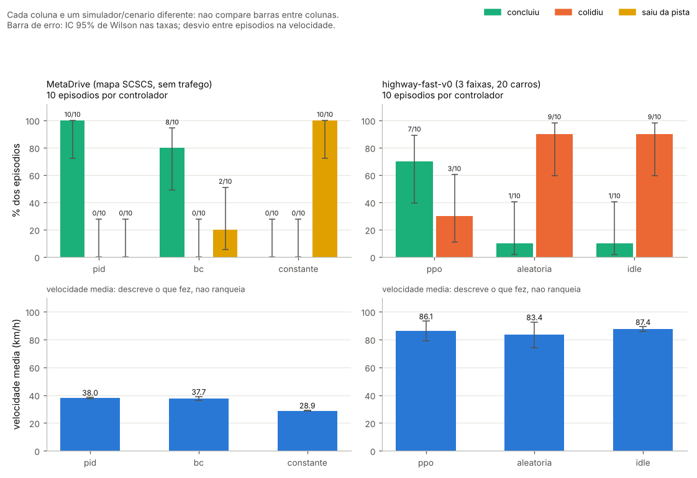

# Aula 19 — Aterrissagem do TP5, item por item

**Terça, 24/11/2026 · sala SJ205 · Etapa 10 (23/11–05/12)**

[:material-file-pdf-box: Slides da Aula 19 (PDF)](apresentacao-aula19.pdf){ .md-button .md-button--primary }
[:material-chart-bar: O comparativo PID × BC × PPO](../../exemplos/aula19-comparativo/index.md){ .md-button }
[:material-robot-industrial: MoveIt 2 com o Panda](../../exemplos/aula18-moveit/index.md){ .md-button }

!!! info "Como esta página funciona"
    Em sala eu **demonstro** no meu ambiente, e vocês observam. **O que é para rodar no seu ambiente está na [tarefa da semana](#a-tarefa-da-semana)**, como uma sequência ordenada **na ordem do que falta entregar** — é lá que a aula acontece para cada um.

    Não há assunto novo: é a última terça antes da entrega do TP5, e o enunciado é lido **item por item**. Cada item tem a mesma anatomia — **o que ele pede**, com as palavras dele; **o que a evidência tem de mostrar** a quem não estava na sua máquina; **os três casos mais prováveis de entrega incompleta**, com o sintoma e o conserto; e **o que o relatório diz**. Cada seção se sustenta sozinha e diz o que pressupõe.

## Cenas dos últimos episódios

**Na Aula 18** o TP5 abriu inteiro, e as quatro frentes rodaram. O PPO mostrou que 300 mil passos levam **horas**, não 30 minutos, e que, contra o IDLE — o carro que mantém a faixa e não decide nada —, a política bate 3 vezes em 10 onde ele bate 9. O PID e o BC passaram pela mesma régua do MetaDrive: pelo que o enunciado pede, quase empatam; o **empurrão** separa os dois. O MoveIt 2 subiu no meu WSL2 com o Panda, a caixa entrou na cena e as três poses deram `SUCCESS` com ela.

**O que ficou pela metade:** a rodada **com** a caixa da comparação, o código com que a pose proibida falha, e o **pick-and-place** além do primeiro passo. O pick-and-place não é um extra: o item 1 do enunciado começa com ele, e é por ele que a aula de hoje começa.

Os conceitos de antes que a aula de hoje vai usar:

- **A linha de base** é das Aulas 17 e 18: quanto faz quem não decide nada. Hoje ela aparece em cada item — o braço sem a caixa, o volante parado, a aleatória e o IDLE.
- **N episódios e o intervalo** vêm da Aula 9: 8 de 10 não é 80% — é "algo entre 49% e 94%". Hoje o intervalo vai para o gráfico de barras.
- **A cena é o que alguém declarou** é da Aula 18: o MoveIt não enxerga; ele lê a cena. O pick-and-place mexe nela duas vezes — para prender o cubo à mão e para soltá-lo.
- **O bag reproduz a sessão sem o robô** é das Aulas 16 e 17: é a evidência que outra pessoa toca de novo. Hoje ele é o critério da validação.
- **Branch de entrega, tag e Moodle** são das Aulas 10 e 14: a fotografia que o avaliador clona.

## A ideia da aula em uma frase

**Evidência é o que outra pessoa consegue conferir.** Quem corrige o TP5 não estava na sua máquina. O pick-and-place que funcionou e não deixou a saída do terminal e o rastro no RViz2, o BC que concluiu as rotas e não deixou o histograma do dataset, o PPO que treinou e não deixou os passos declarados, o robô que andou e não deixou o bag — nenhum deles existe para a correção.

## O que você sai sabendo hoje, e o que isso vale no seu projeto

| A capacidade | No seu projeto |
|---|---|
| ler cada item do enunciado como rubrica: o que ele pede e o que a evidência tem de mostrar | você sabe, antes de postar, o que o avaliador vai procurar em cada item |
| rodar o pick-and-place e saber o que a anexação muda | o item 1 deixa de ser "três poses" e passa a ser o item inteiro |
| pôr o intervalo numa taxa de 10 episódios | "o BC é pior que o PID" vira uma frase que se sustenta — ou que você deixa de escrever |
| desenhar o gráfico de barras por simulador | a comparação PID × BC × PPO diz o que mede, e o que não mede |
| declarar o que não foi feito | a validação simulada e o PPO curto valem, porque estão escritos |
| fechar uma entrega que se confere de fora | branch, tag e links abrem para quem não é você |

## O que a aula cobre, onde está na tarefa, e quando vence

As datas estão nesta tabela e em [Gates de cada TP](../../recursos/gates-tps.md) — **referência para consultar**, não o assunto da aula. A tarefa está **na ordem do que falta entregar**.

| Bloco da aula | O que você faz em casa | Gate | Vence em |
|---|---|---|---|
| Abertura: as três decisões | — (valem para a entrega) | G5.5 · G5.6 | 26/11 |
| Item 1 — MoveIt 2 e o pick-and-place | [passo 1](#passo-1-item-1-as-tres-poses-com-a-caixa-e-o-pick-and-place-ate-onde-for) | G5.1 | 20/11 (já venceu) |
| Item 3 — BC × PID | [passo 2](#passo-2-item-3-o-dataset-a-regua-e-o-empurrao) | G5.2 · G5.3 · G5.4 | 21/11 · 23/11 · 25/11 |
| Item 4 — PPO, e a comparação dos três | [passos 3 e 4](#passo-3-item-4-o-ppo-avaliado-com-os-passos-declarados) | G5.5 · G5.4 | 26/11 · 25/11 |
| Item 2 — a validação | [passo 5](#passo-5-item-2-a-evidencia-da-opcao-escolhida-com-a-declaracao) | G5.6 | 26/11 |
| Fecho: a análise crítica e a entrega | [passos 4 e 6](#passo-6-a-entrega) | G5.7 | **27/11** |

A entrega do TP5 é na **sexta, 27/11**: no Moodle, o PDF do relatório, o link do GitHub, o vídeo no YouTube de até 5 minutos e o ZIP. Gate vencido não é nota perdida: é o [`[!]` da escada de recuperação](../../recursos/gates-tps.md#escada-de-recuperacao-o-que-fazer-quando-um-gate-vence), e a regra dela é a mesma de sempre — entregue o que funciona e **declare** o que não funciona.

## As três decisões desta semana

Elas estão escritas em [Gates de cada TP](../../recursos/gates-tps.md#tp5-manipulacao-aprendizado-e-validacao) e valem para a entrega:

1. **Validação, opção B: vale uma demonstração simulada simples, declarada**, no lugar do drone PX4. A disciplina não tem exemplo verificado de PX4 nem de Raspberry Pi. O critério: o robô, no simulador, recebendo a missão e percorrendo **3 ou mais waypoints** do começo ao fim, sem intervenção, no vídeo, com o `ros2 bag info` da sessão; no repositório, o bag (ou o link dele) e o **gráfico da trajetória gerado do bag**, com os waypoints marcados; e, no relatório, **o que foi simulado, o que do enunciado não foi feito, e por quê**. A opção A continua como está, e o robô real tem reconhecimento adicional.
2. **PPO com menos de 300 mil passos vale, se declarado**: o relatório diz quantos passos foram treinados e os passos por segundo medidos. A curva e a avaliação em 10 episódios ou mais **com as linhas de base** continuam obrigatórias, com qualquer número de passos.
3. **Scripts bastam**, no TP4 e no TP5: tabelas, curvas e figuras saem dos scripts que estão no repositório, com o comando que as gera. Notebook não é exigido; um notebook executado de ponta a ponta continua aceito.

## Pegar o material

O exemplo novo é o [`aula19-comparativo`](../../exemplos/aula19-comparativo/index.md). Este bloco define as três variáveis e copia **só ele** — não toca nas pastas da Aula 18, onde estão o seu dataset, o seu modelo e os seus resultados:

```bash
# ── uma vez por terminal ──────────────────────────────
export PB_USER=seu-usuario-github          # ← troque pelo seu usuário do GitHub
export PB_DIR="$HOME/projeto-pb-$PB_USER"
export PB_WS="$PB_DIR/ros2_ws"
mkdir -p "$PB_DIR"

# a cópia antiga sai antes: cp -r sobre pasta existente ANINHA. A guarda é o
# próprio encadeamento com &&: se o clone falhar, nada é apagado.
cd /tmp && rm -rf pb-a19 && \
  git clone --depth 1 https://github.com/Prof-Dacio-INFNET/PBRoboticos_prof_dacio.git pb-a19 && \
  rm -rf "$PB_DIR/aula19-comparativo" && \
  cp -r pb-a19/exemplos/aula19-comparativo "$PB_DIR/"
ls "$PB_DIR/aula19-comparativo"
```

**O que tem de aparecer:** `README.md  amostra  comparar.py  testar.py`. O `comparar.py` roda com o `python3` do sistema e o matplotlib do `apt` — os mesmos do `histograma.py` da Aula 18. Não escreva a sua análise dentro de `aula19-comparativo/`: a tarefa grava em `docs/evidencias/tp5/`.

**O seu `aula18_moveit` é o corrigido?** A volta ao `ready` — a correção que impede a caixa de nascer em cima do braço — entrou no exemplo em 16/11. No mesmo terminal:

```bash
# ── o mesmo terminal ──
: "${PB_WS:?defina PB_USER, PB_DIR e PB_WS — o bloco está no topo desta página}"
grep -c voltar_ao_ready "$PB_WS/src/aula18_moveit/aula18_moveit/tres_poses.py"
```

**Um número maior que zero:** é o corrigido; pule o bloco seguinte. **`0`, ou `No such file`:** o seu é anterior, ou não existe — rode o bloco seguinte, que recopia **só o MoveIt** (as suas evidências estão em `docs/evidencias/tp5/`, fora dele) e recompila:

```bash
# NAO RODE se o grep acima deu um numero maior que zero
: "${PB_WS:?defina PB_USER, PB_DIR e PB_WS — o bloco está no topo desta página}"
source /opt/ros/humble/setup.bash
mkdir -p "$PB_WS/src" && cd /tmp && rm -rf pb-a19m && \
  git clone --depth 1 https://github.com/Prof-Dacio-INFNET/PBRoboticos_prof_dacio.git pb-a19m && \
  rm -rf "$PB_DIR/aula18-moveit" "$PB_WS/src/aula18_moveit" && \
  cp -r pb-a19m/exemplos/aula18-moveit "$PB_DIR/" && \
  cp -r pb-a19m/exemplos/aula18-moveit/aula18_moveit "$PB_WS/src/"
cd "$PB_WS" && colcon build --packages-select aula18_moveit
```

!!! tip "A linha `: \"${PB_WS:?...}\"` que aparece nos blocos seguintes"
    Ela confere que as variáveis existem **neste** terminal. Um bloco que começa com ela supõe que o mesmo terminal já rodou um bloco que define as variáveis; um terminal novo começa sempre pelas três variáveis — e, se for chamar `ros2`, pelas duas linhas de `source`.

!!! warning "O que rodou onde — leia antes de confiar em qualquer número"
    **Os números do BC × PID e do PPO** são os da Aula 18: na nuvem (2 núcleos, sem placa de vídeo) e na minha máquina (WSL2, Ubuntu 22.04), lado a lado onde diferem. **O `comparar.py`** rodou num container Linux e num ambiente com as versões do `apt` do Ubuntu 22.04 (Python 3.10, matplotlib 3.5.1, NumPy 1.21.5) — não no `apt` de verdade. **O MoveIt 2** rodou na minha máquina em 16/11: o demo, a caixa, as três poses com ela (três vezes) e a rodada **sem** a caixa da comparação. <!-- ENSAIO-A19 -->**Até esta página ser publicada, ninguém executou o pick-and-place além do primeiro passo**, nem a rodada com a caixa da comparação depois da correção, nem o painel *MotionPlanning* acrescentado à mão. O que o ensaio da véspera e a sala mostrarem entra aqui.<!-- /ENSAIO-A19 --> **A pilotagem humana do `coletar.py`** não tinha sido feita por ninguém na Aula 18. **No WSL2 de vocês:** o número que vale é o da sua tela.

---

## Item 1 — MoveIt 2: o pick-and-place é o item

**Pressupõe:** o MoveIt instalado e o `aula18_moveit` compilado (passo 2 da [tarefa da Aula 18](../etapa09-aula18/index.md#passo-2-moveit-2-a-caixa-tres-poses-suas-com-e-sem-ela)). **Para fazer: [passo 1](#passo-1-item-1-as-tres-poses-com-a-caixa-e-o-pick-and-place-ate-onde-for) da tarefa.**

> *MoveIt 2 — pick-and-place com Collision Object, `ros2_control`, cinemática inversa no RViz2; ≥3 poses destino evitando colisões.*

### O que a evidência tem de mostrar

Cada termo do enunciado tem um lugar na tela e uma linha no relatório:

| O enunciado diz | Onde aparece | O que vai para a entrega |
|---|---|---|
| **Collision Object** | a caixa do `cena` — ou o objeto do **seu** cenário —, verde no RViz2, e na aba *Scene Objects* | o print com o objeto visível, e a frase sobre o que ele representa |
| **`ros2_control`** | o `panda_arm_controller` e o `panda_hand_controller`, com hardware falso | uma frase: quem executa a trajetória, e o que muda com um robô de verdade |
| **cinemática inversa no RViz2** | o braço laranja do painel *MotionPlanning* acompanhando o marcador; a pose lida com o `tf2_echo` | uma frase sua sobre o que é IK e onde ela acontece |
| **≥3 poses destino evitando colisões** | a tabela do `tres_poses`, com e sem o objeto, e o rastro (*Show Trail*) | a tabela de várias execuções e um print por pose com o rastro |
| **pick-and-place** | o `pegar_e_soltar`: o cubo pego de um lado da caixa e deixado do outro | a saída do terminal até onde foi, e o print do cubo do outro lado |

### O pick-and-place do exemplo: 14 passos, sem física

O `pegar_e_soltar` do [`aula18-moveit`](../../exemplos/aula18-moveit/index.md#pick-and-place-o-roteiro-para-a-tarefa) faz o pick-and-place em 14 passos:

| Passo | O que acontece |
|---|---|
| 1 | um cubo de 4 cm (`peca`) entra na cena, no chão, em (0,45; −0,30) — a `caixa` continua lá |
| 2 | o braço vai ao `ready`, por juntas |
| 3 | a garra abre (0,035 por dedo) |
| 4 e 5 | 10 cm acima do cubo; depois a pegada, com os dedos na altura dele |
| 6 | a garra fecha em volta do cubo |
| 7 | **anexar**: o cubo passa a fazer parte da mão (`AttachedCollisionObject`) |
| 8 a 10 | sobe, leva para (0,45; +0,30) — **do outro lado da caixa** — e desce |
| 11 e 12 | a garra abre e o cubo é **solto**: volta à cena onde a mão o deixou |
| 13 e 14 | recua e volta ao `ready` |

**Sem física** quer dizer que nada cai e a garra não sente o cubo. O que faz o cubo ir junto com a mão é a **anexação**: a partir do passo 7 ele é parte do robô para o verificador de colisão, e o planejador desvia da caixa **com o cubo na mão**. Sem ela, o braço levaria a mão vazia e o cubo ficaria no chão da cena. O parâmetro `ate_passo:=N` para no passo N — é assim que se depura um passo de cada vez. Se um passo falha, a linha dele traz um `olhe:` com o que conferir, e o roteiro **para ali**: sem a pegada, anexar prenderia à mão um cubo que está no chão.

Em sala, o roteiro roda no meu ambiente, até onde o ensaio da véspera permitir. O formato do que ele imprime é este — uma linha por passo, e uma contagem no fim:

```text
passo  1 cena        cena: success = True
passo  2 ready       planejamento SUCCESS (1), execucao SUCCESS (1)
passo  3 abrir       garra -> 0.035: reached_goal = True
...
ultimo passo cumprido: N de 14. Isto conta respostas do move_group e do controlador da garra; se o cubo foi parar onde devia, quem diz e o RViz2.
```

A última frase é do próprio script, e é o critério de evidência do item: **a contagem diz que o MoveIt respondeu; quem diz que o cubo foi parar do outro lado é o RViz2**. A entrega leva os dois.

### Caso 1 — três poses, e nenhum objeto na cena

**O sintoma:** prints do braço em três lugares, e a cena vazia — ou a caixa só no desenho do relatório. **Por que não basta:** "evitando colisões", sem nada para evitar, não mostra o planejador desviando de nada. **Como se confere:** a caixa no print, o `success = True` do `cena` no terminal, a aba *Scene Objects* do painel. **O conserto:** o `cena` **antes** das poses, com o objeto do seu cenário — uma prateleira, uma mesa — pelos parâmetros `centro` e `tamanho`; e a linha de base: a mesma lista com e sem o objeto, pelo `comparar:=true` do `tres_poses`.

### Caso 2 — o print do destino, e nenhuma palavra sobre o caminho

**O sintoma:** três prints do braço parado na pose final, sem o rastro e sem a tabela. Com a caixa, o braço **não encosta nela: contorna** — e quem mostra isso é o **caminho**, não o destino. **O conserto:** *Show Trail* no display *Trajectory*, e a tabela que o terminal imprime, com e sem a caixa. E **uma execução não prova** que o caminho mudou: no meu ensaio de 16/11, com a caixa, a ida de A a B deu 2,16, 4,36 e 2,71 rad em três execuções; sem ela, 1,88 e 2,40. O sorteio do OMPL é maior que o efeito da caixa nessas poses. A frase do relatório é **a faixa de várias execuções**, não o número de uma.

### Caso 3 — "IK compreendida", sem uma frase sobre a IK

**O sintoma:** o relatório diz que usou cinemática inversa e não diz o que ela é, nem onde aconteceu. A correção cobra *"MoveIt 2: cinemática inversa, planejamento, colisão compreendidos"* — e compreensão se mostra em texto. **IK:** você diz onde quer a ponta, ela acha os ângulos das 7 juntas; no exemplo, ela roda **dentro** do planejamento, e se **vê** no braço laranja do painel acompanhando o marcador — arrastado para longe demais, ele para de acompanhar. **A pose dentro da caixa tem de falhar, e isso não é defeito:** não existe postura do braço que ponha a garra ali sem atravessar a caixa. O código previsto pela leitura da fonte do Humble é `GOAL_STATE_INVALID (-27)` ou `TIMED_OUT (-6)` — **não** `NO_IK_SOLUTION`: havia IK; não havia postura sem colisão. Explicar o código da pose que falhou vale mais que mais uma pose que deu certo.

### O item 1 no relatório

- **A cena:** o que a caixa (ou o seu objeto) representa no seu cenário, e onde ela está.
- **As poses:** as suas três, a tabela com e sem o objeto em várias execuções, e um print por pose com o rastro.
- **O pick-and-place:** até que passo foi, a saída do terminal, e o print do cubo do outro lado da caixa. **Se parou num passo:** qual, com que código, e o que você tentou — é evidência, não confissão. Entregar só as três poses sem dizer que o pick-and-place parou é o que custa.
- **IK, planejamento e colisão:** uma frase sua para cada um, com o que apareceu na sua tela.
- **O sistema global:** o Panda como o manipulador do seu sistema — o que ele pegaria, de onde e para onde, no cenário do seu robô —, dito com todas as letras.

---

## Item 3 — Behavioral Cloning × PID: a mesma régua, e o empurrão

**Pressupõe:** o `aula18-pid-bc` e os venvs do MetaDrive e da CNN. **Para fazer: [passo 2](#passo-2-item-3-o-dataset-a-regua-e-o-empurrao) da tarefa.**

> *Behavioral Cloning vs PID — 1.000 frames de pilotagem humana no MetaDrive; CNN prevendo ação de direção; PID com simple-pid; comparação em 10 episódios (conclusão de rota, colisões, velocidade média).*

### O que a evidência tem de mostrar

- **O dataset:** o `acoes.csv` com 1000 quadros, a coluna `piloto` — que o `coletar.py` grava em cada linha —, e o histograma das direções no `dataset.md`.
- **A rede:** o erro no episódio que ela nunca viu, ao lado da linha de base "sempre a média".
- **A régua:** PID, BC e o volante parado nas mesmas sementes (100 a 109), com as três colunas do enunciado — e o cenário declarado.
- **E a coluna que o enunciado não pede**, e que separa os dois: o erro lateral — e o empurrão.

A régua da Aula 18, nas duas máquinas, com o intervalo de 95% de Wilson ao lado da conclusão:

| medida | PID | BC, nuvem | BC, minha máquina |
|---|---|---|---|
| concluiu | 10 de 10 (72% a 100%) | 8 de 10 (49% a 94%) | 10 de 10 (72% a 100%) |
| saiu_da_pista | 0 de 10 | 2 de 10 | 0 de 10 |
| colidiu | 0 de 10 | 0 de 10 | 0 de 10 |
| vel_media (km/h) | 38,0 | 37,7 | 38,1 |
| erro_lat_medio_m | 0,021 | 0,116 | 0,083 |
| empurrão de 0,06, semente 100 | 1,37 m | 3,65 m | 3,42 m |

**Pelas três colunas do enunciado, 10 episódios não separam o BC do PID**: os intervalos se sobrepõem, nas duas máquinas. O que separa, nas duas, é o erro lateral e o empurrão — o PID volta ao centro uns 2 s depois; o BC vai à faixa vizinha.

### Caso 1 — o dataset de reta, e a rede que acerta o zero

**O sintoma:** erro de validação ótimo, e o carro saindo da pista na curva. **A causa provável:** quase todos os quadros com o volante parado — o dataset do PID da aula tinha **64%** com |direção| < 0,02, e três vezes mais curva à direita que à esquerda. **Como se confere:** o histograma e o `dataset.md`, ao lado do erro da linha de base. **O conserto:** pilotar as curvas dos dois lados, e **sair do centro de propósito e voltar**, em alguns trechos — e dizer quantos trechos de volta você gravou: é exatamente o que o BC da aula nunca viu (nenhum quadro do dataset do PID está a mais de 0,47 m do centro). Sem tempo de gravar de novo, o `treinar_bc.py --espelhar` junta ao treino as curvas do outro lado — diga que usou.

### Caso 2 — a tabela empata, e o relatório conclui "equivalentes"

**O sintoma:** 10 de 10 nos dois, e a frase "o BC é tão bom quanto o PID". Com 10 episódios, 10 de 10 é "entre 72% e 100%": a tabela não separa os dois — e **também não prova que são iguais**. **O conserto:** o empurrão nos dois, na mesma semente, com a figura no relatório. A frase que se sustenta, com os seus números: *"concluíram as mesmas rotas; empurrado igual, o BC foi 2,5 vezes mais longe do centro"*.

### Caso 3 — o dataset não é o que o relatório diz

**O sintoma:** "pilotagem humana" no relatório, e `piloto = pid` no `acoes.csv`. A coluna `piloto` é gravada pelo `coletar.py` em cada linha: quem abre o CSV lê quem pilotou cada quadro. O parente próximo é o preparo que difere entre treinar e dirigir: **BGR × RGB** num lado só — a validação ainda parece boa, e na pista são 0 de 3 — e o **`/255` esquecido** — o volante todo para um lado, fora da pista em 2 s. **O conserto:** o CSV entregue é o que o relatório descreve, e o preparo é **um só** (`rede.preparar`), importado pelos dois lados.

### O item 3 no relatório

- **O dataset:** quem pilotou, quantos quadros e episódios, o histograma e o que ele mostra.
- **A rede:** o erro no episódio separado ao lado da linha de base, e onde o treino rodou.
- **A régua:** PID, BC e volante parado nas mesmas 10 sementes, com o cenário declarado — sem tráfego, mapa `SCSCS`.
- **As colisões do enunciado:** a régua separa `colidiu` (bater) de `saiu_da_pista`; diga como contou.
- **O empurrão:** a figura, e a frase sobre o que a validação não mostrou.
- **Onde cada número rodou:** a mesma régua deu outra tabela em outra máquina.

---

## Item 4 — PPO, e os três lado a lado

**Pressupõe:** o treino do PPO terminado — ou o último checkpoint, declarado — e os CSVs da régua do item 3. **Para fazer: [passos 3 e 4](#passo-3-item-4-o-ppo-avaliado-com-os-passos-declarados) da tarefa.**

> *PPO — Stable Baselines3 em highway-env, 300k steps (≈30 min CPU); comparação com BC; gráfico de barras e análise crítica PID × BC × PPO no relatório final.*

### O que a evidência tem de mostrar

- **A curva de recompensa do seu treino**, com os passos e os passos/s declarados. Medidos na Aula 18: 300 mil passos em 2 h 58 min na nuvem (28 passos/s), e a 55 passos/s na minha máquina — e a recompensa plana depois de uns 10 mil passos. **Menos de 300 mil vale, se declarado.**
- **A política avaliada em 10 episódios ou mais**, sem sortear a ação, contra a **aleatória** e o **IDLE** nos mesmos episódios.
- **O gráfico de barras** com os três — e a análise crítica.

### O gráfico de barras, com a barra de erro que o enunciado não pede

O enunciado pede o gráfico de barras; o intervalo, não. Sem ele, 8 de 10 contra 10 de 10 parece uma diferença, e 7 de 10 contra 1 de 10 parece uma certeza. O [`aula19-comparativo`](../../exemplos/aula19-comparativo/index.md) junta os CSVs das duas réguas numa tabela com o **intervalo de 95% de Wilson** em cada taxa, desenha as barras **um simulador por coluna**, e grava um **esqueleto** da análise crítica, com as perguntas e sem as respostas. Ele é **apoio, não veredito**: relata o que achou (`achei`, `não achei`, `olhe:`), não decide quem ganhou, não valida a entrega e não substitui o enunciado.

Em sala, ele roda três vezes no meu ambiente, com os CSVs da amostra (os dos dois exemplos da Aula 18, medidos na nuvem). A primeira, a amostra inteira:

```text
| controlador | n  | concluiu | IC 95%     | colidiu | IC 95%    | saiu da pista | IC 95%     |
| pid         | 10 | 10/10    | 72% a 100% | 0/10    | 0% a 28%  | 0/10          | 0% a 28%   |
| bc          | 10 | 8/10     | 49% a 94%  | 0/10    | 0% a 28%  | 2/10          | 6% a 51%   |
| constante   | 10 | 0/10     | 0% a 28%   | 0/10    | 0% a 28%  | 10/10         | 72% a 100% |
| ppo         | 10 | 7/10     | 40% a 89%  | 3/10    | 11% a 60% | -             | -          |
| aleatoria   | 10 | 1/10     | 2% a 40%   | 9/10    | 60% a 98% | -             | -          |
| idle        | 10 | 1/10     | 2% a 40%   | 9/10    | 60% a 98% | -             | -          |
```

(Colunas resumidas: a tabela inteira traz o grupo, a velocidade média e as sementes, e está no [README do exemplo](../../exemplos/aula19-comparativo/index.md#a-amostra-o-que-sai).)



**Como ler a figura.** Cada coluna é um simulador, com o nome e o tráfego no título: as barras de uma coluna se comparam entre si; as de colunas diferentes, não. Em cima, as taxas — concluiu, colidiu, saiu da pista —, com a contagem escrita em cima de cada barra; a barra de erro é o intervalo de Wilson, e **0 de 10 ainda é "entre 0% e 28%"**, não "nunca". Por que não o desvio-padrão: para 8 de 10, ele daria 80% ± 42%, uma barra que passa de 100%. Embaixo, a velocidade média: em km/h nos dois simuladores, e mesmo assim **descreve, não ranqueia**.

**Dez episódios sugerem; cinquenta separam.** Na amostra, o PPO conclui 7 de 10 (40% a 89%) e o IDLE 1 de 10 (2% a 40%): os intervalos **se tocam por um fio** (39,7% e 40,4%). Pelo critério conservador — intervalos que não se tocam —, 10 episódios **sugerem** a diferença, e não a separam. Com 50 episódios (`amostra/highway-50/`), o PPO conclui 34 de 50 (54% a 79%) e o IDLE 4 de 50 (3% a 19%), e os intervalos ficam longe um do outro. Intervalos que se tocam **não provam que os dois são iguais**: dizem que esses episódios, sozinhos, não bastam. Cinco vezes mais episódios dão um intervalo com cerca de metade da largura.

**A recusa.** Pedida a recompensa (`--recompensa`) sem dizer em que simulador cada controlador rodou, o script responde `recuso: sem --grupo nao sei se estes controladores rodaram no mesmo simulador, e recompensa so se compara dentro de um`, sai com código 2 e não desenha nada. A recompensa do MetaDrive é quase os metros andados na rota; a do highway-env vai de 0 a 1 por passo, em 30 passos. Não estão na mesma escala nem na mesma unidade.

### Caso 1 — a comparação sem régua

**O sintoma:** o PPO sozinho com "70% de conclusão", sem a aleatória nem o IDLE ao lado. Sem linha de base o número não diz o que a política aprendeu: no mesmo cenário, o IDLE conclui 1 de 10. **O outro lado do mesmo erro** é comparar entre simuladores: a recompensa dos três no mesmo eixo, ou "o PPO bateu menos que o BC" — o PID e o BC rodam no MetaDrive, sem tráfego; o PPO, no `highway-fast-v0`, com 20 carros. **O conserto:** cada um contra as linhas de base do **próprio** simulador, na mesma figura, em colunas separadas. A frase que se sustenta: *"no highway-env, o PPO reduziu a colisão de 9 em 10 (IDLE) para 3 em 10"* — com os seus números.

### Caso 2 — a avaliação que não diz como foi feita

**Avaliar sorteando a ação:** o `model.predict(obs)` do Stable Baselines3 tem `deterministic=False` como padrão. Medido na Aula 18: o mesmo `.zip` foi de **32% para 56%** de batidas em 50 episódios, só por sortear. **Treinar menos sem dizer quantos:** o treino parou antes, e o relatório fala em "300k steps". **O conserto:** os passos e os passos/s do seu `treino.log`, a avaliação do `avaliar.py` (que não sorteia), e as sementes. Nesta configuração a curva ficou plana em uns 10 mil passos: **treino curto declarado é resultado**.

### Caso 3 — o modelo que não chegou ao GitHub

**O sintoma:** tudo roda na sua máquina, e no clone do avaliador o `modelo_final.zip` não existe. **A causa:** a regra `*.zip` do `.gitignore` engole o modelo calada — aconteceu com o modelo da amostra do exemplo, que passou em todos os testes locais e faltou no primeiro clone. **Como conferir:** `git check-ignore -v` no caminho do modelo (sem saída nenhuma é o certo) e `git ls-files` — o bloco está no [passo 3](#passo-3-item-4-o-ppo-avaliado-com-os-passos-declarados). **O conserto:** a exceção `!caminho/do/modelo.zip` **depois** da regra, ou o link do modelo no relatório, testado numa janela anônima. O mesmo vale para o `pesos.npz` do BC e para cada CSV de avaliação que vira barra.

### O item 4 e a comparação no relatório

- **O treino:** passos, passos/s, quanto tempo e em que máquina — e a curva.
- **A avaliação:** PPO, aleatória e IDLE nos mesmos episódios, sem sortear, com as sementes.
- **O que a política aprendeu de fato:** em que faixa fica, quantas vezes freia — o `avaliar.py` imprime isso.
- **O gráfico de barras:** um simulador por coluna, as taxas com intervalo, gerado pelo script.
- **A comparação com o BC:** o que dá para dizer entre simuladores — cada um contra a sua linha de base — e o que não dá.

---

## Item 2 — A validação: o que foi demonstrado, e o que foi declarado

**Pressupõe:** a opção registrada no `docs/decisoes.md`, com plano B. **Para fazer: [passo 5](#passo-5-item-2-a-evidencia-da-opcao-escolhida-com-a-declaracao) da tarefa.**

> *Validação — Opção A: robô físico com Raspberry Pi (motores + câmera + navegação; fotos e vídeo). Opção B: drone PX4 + ROS 2 em simulação (waypoints, desvio 3D, ROS2 Bag).*

**A disciplina não tem exemplo verificado de PX4 nem de Raspberry Pi** — daí a decisão desta semana: na opção B, vale uma **demonstração simulada simples, declarada**, inclusive o robô simulado do seu próprio projeto. O caminho mais curto é o que vocês já fizeram no TP4: a navegação por **3 ou mais waypoints** com o nó `rota` da [Aula 15](../../exemplos/aula15-nav2/index.md), a sessão em bag e o gráfico da trajetória tirado do bag, como no [passo 2 da Aula 17](../etapa09-aula17/index.md#passo-2-o-seu-bag-gravar-tocar-com-clock-e-a-regua-sobre-ele).

| | Opção A — robô físico | Opção B — drone PX4 | Opção B — demonstração simulada simples |
|---|---|---|---|
| no vídeo | o robô real percebendo e se movendo | a missão de waypoints cumprida, com o desvio em 3D | o robô, no simulador, percorrendo 3 ou mais waypoints do começo ao fim, sem intervenção, e o `ros2 bag info` da sessão |
| no repositório | fotos, e o link do vídeo em `docs/evidencias/tp5/` | o bag (ou o link) e o link do vídeo | o bag (ou o link) e o **gráfico da trajetória gerado do bag**, com os waypoints marcados |
| a régua | escopo menor e desempenho inferior aceitos, com a dificuldade documentada; **reconhecimento adicional** pelo hardware | o enunciado inteiro | o que foi feito, **declarado** — abaixo |

### O que tem de estar declarado

1. **O que foi simulado:** o simulador, o robô e o mundo.
2. **O que do enunciado não foi feito:** o PX4, o voo e o desvio de obstáculo em 3D — o que mais faltar.
3. **Por quê**, numa frase honesta: tempo, máquina, falta de exemplo.
4. **O que a demonstração mostra no lugar**, e o que ela não mostra.
5. **A mudança de opção, se houve**, com data e motivo no `docs/decisoes.md`.

Declarar custa uma linha; o avaliador descobrir sozinho custa o item.

### Os três casos

**Vídeo sem bag.** O robô andou, e ninguém consegue tocar a sessão de novo. O bag é gravado **na mesma sessão** do vídeo, e o gráfico sai **desse** bag — o que está no repositório —, não de outra sessão nem desenhado à mão.

**Nada declarado.** A demonstração simples entregue como se fosse a opção B inteira. É a mesma evidência com a nota oposta: declarada, vale; escondida, é o avaliador que descobre.

**O link privado.** Vídeo privado no YouTube, pasta do Drive restrita, repositório privado: na sua máquina abre, porque você está logado. Abra cada link numa **janela anônima** antes de postar.

Na opção A sem o hardware funcionando: o plano B acionado **no mesmo dia** e registrado vale. Mudar de opção não tira nota; mudar sem escrever, tira.

---

## A análise crítica: perguntas, não respostas

A correção cobra *"comparação experimental com métricas quantitativas consistentes; análise crítica (limitações e trade-offs)"* — e avalia **o sistema global, não módulos isolados**. O `comparar.py --md` grava um esqueleto com seis seções de perguntas e `_escreva aqui_` no lugar das respostas:

1. **O que cada controlador vê** — o estado do simulador (PID), a imagem (BC), os carros vizinhos (PPO) — e o que cada um deixa de saber.
2. **O que cada um custou** — ganhos sintonizados à mão, 1000 quadros pilotados, os passos de PPO que você de fato treinou, a quantos passos/s.
3. **Onde cada um quebra** — o BC empurrado para fora do centro, o PPO que fica na faixa da direita e freia, o PID que depende do estado que o simulador entrega.
4. **O que estes números deixam e não deixam dizer** — as linhas `olhe:` do script.
5. **O que não dá para concluir** entre simuladores diferentes — e a frase que dá, com a ressalva.
6. **Limitações e trade-offs** — o que você mudaria primeiro, e que linha da tabela isso deveria mexer.

E a pergunta que costura os quatro itens, e que nenhum script faz: **o que o braço, o BC, o PPO e a validação fazem pelo seu projeto?** O braço é o manipulador do seu cenário; o BC e o PPO tomariam que decisão do seu robô, com que sensor, fora do simulador; a validação mostra que parte do seu sistema funcionando de ponta a ponta. Sem essa costura, são quatro exercícios; com ela, é o TP de um projeto.

## A entrega

A ordem é a de sempre, a do [Git — fluxo e tags](../../cheatsheets/git-cheatsheet.md) e das [Regras de entrega](../../cheatsheets/regras-entrega.md): tudo na `main`, a branch `entrega-tp5` igual à `main`, a tag `tp5` empurrada — e, **no Moodle**, a entrega oficial:

| No Moodle | O que conferir antes de postar |
|---|---|
| o **PDF** do relatório | os itens 1, 3 e 4, a comparação, o item 2 e a análise crítica; as imagens aparecem no PDF |
| o link do **GitHub** | abre numa janela anônima, na branch `entrega-tp5`; a tag `tp5` aparece na lista de tags |
| o **vídeo** no YouTube, de até 5 minutos | **público ou não listado**, nunca privado; abre numa janela anônima |
| o **ZIP** do código | sem `build/`, `install/`, `log/` nem `.git/`; depois de enviar, baixe e abra |

O bloco está no [passo 6](#passo-6-a-entrega) da tarefa. **Se o avaliador não consegue abrir, não existe** — e nenhum link privado dá erro na sua máquina, porque você está logado. Depois de entregar, a branch e a tag não se mexem: vale a data da última alteração.

---

## A tarefa da semana

**É aqui que a aula acontece para você.** Os passos estão **na ordem do que falta entregar**. Cada um diz o terminal, o bloco, o que tem de aparecer e onde fica a evidência.

| | |
|---|---|
| **O que fazer** | o item 1 com a caixa e o pick-and-place até onde for; o item 3 com o dataset, a régua e o empurrão; o PPO avaliado, com os passos declarados; o gráfico de barras com os seus CSVs e a análise escrita; a evidência do item 2 com a declaração; e a entrega |
| **O que usar** | o pacote `aula18_moveit` (`cena`, `tres_poses`, `pegar_e_soltar`) e o demo do Panda; `coletar.py`, `histograma.py`, `avaliar.py`, `dirigir_bc.py` e `trajetorias.py` (em `aula18-pid-bc`); `avaliar.py` e `curva.py` (em `aula18-ppo`); `comparar.py` (em `aula19-comparativo`); o `rota` da Aula 15 e o `plotar_trajetoria.py` da Aula 16, na opção B simples |
| **Como adequar ao seu projeto** | o objeto da cena é o que o **seu** robô encontra; o dataset é pilotado por você; a comparação diz em que simulador cada número rodou; a validação é a do **seu** sistema |
| **Como saber que terminou** | o [passo 7](#passo-7-como-saber-que-terminou) |

São cinco terminais, nomeados na ordem em que a tarefa os abre: **A — o braço**, **B — a cena**, **C — o roteiro**, **D — as medidas e a entrega**, **E — a validação**. **A, B, C e E chamam `ros2`**: todo terminal novo desses abre com as três variáveis **e** as duas linhas de `source`. **D é um terminal comum**: abre só com as variáveis, não chama `ros2` e não ativa venv nenhum — os Pythons dos venvs são chamados pelo caminho.

Todas as evidências vão para `docs/evidencias/tp5/`.

### Passo 1 — Item 1: as três poses com a caixa, e o pick-and-place até onde for

**Pressupõe:** o MoveIt instalado e o `aula18_moveit` **corrigido** ([Pegar o material](#pegar-o-material)). **Observe:** a caixa verde, as duas rodadas lado a lado e, no pick-and-place, a linha de cada passo.

**Terminal A — o braço.** Terminal novo, com ROS, sem venv ativado (o prompt não pode começar com `(nome-do-venv)`). O launch ocupa o terminal até o `Ctrl+C`:

```bash
# ── Terminal A: uma vez por terminal ──────────────────
export PB_USER=seu-usuario-github          # ← troque pelo seu usuário do GitHub
export PB_DIR="$HOME/projeto-pb-$PB_USER"
export PB_WS="$PB_DIR/ros2_ws"
source /opt/ros/humble/setup.bash
source "$PB_WS/install/setup.bash"
echo "RMW=${RMW_IMPLEMENTATION:-padrao}"
ros2 launch moveit_resources_panda_moveit_config demo.launch.py
```

**O que tem de aparecer:** `RMW=padrao` (se aparecer `rmw_cyclonedds_cpp`, feche o terminal e abra outro: com o Cyclone o demo não subiu no meu WSL2); o RViz2 com o Panda em pé; os três *spawners* terminando sem `[ERROR]`. No RViz2: **Add** > *By display type* > `moveit_ros_visualization` > **MotionPlanning** > **OK**, com *Planning Group* = `panda_arm`; e, no display *Trajectory*, marque **Show Trail**.

**Terminal B — a cena.** Terminal novo, com ROS, com o A no ar. Troque `centro` e `tamanho` pelos do objeto do **seu** cenário, ou rode sem eles para a caixa do exemplo:

```bash
# ── Terminal B: uma vez por terminal ──────────────────
export PB_USER=seu-usuario-github          # ← troque pelo seu usuário do GitHub
export PB_DIR="$HOME/projeto-pb-$PB_USER"
export PB_WS="$PB_DIR/ros2_ws"
source /opt/ros/humble/setup.bash
source "$PB_WS/install/setup.bash"
ros2 run aula18_moveit cena
```

**O que tem de aparecer:** `success = True` e a caixa verde à frente do robô; na aba *Scene Objects* do painel, `caixa`.

**Terminal C — o roteiro.** Terminal novo, com ROS, com o A no ar e a caixa na cena. Primeiro a comparação com e sem a caixa, com a pose proibida — e as suas três poses, se já as achou com o `tf2_echo` (o [passo 2 da Aula 18](../etapa09-aula18/index.md#passo-2-moveit-2-a-caixa-tres-poses-suas-com-e-sem-ela) diz como):

```bash
# ── Terminal C: uma vez por terminal ──────────────────
export PB_USER=seu-usuario-github          # ← troque pelo seu usuário do GitHub
export PB_DIR="$HOME/projeto-pb-$PB_USER"
export PB_WS="$PB_DIR/ros2_ws"
source /opt/ros/humble/setup.bash
source "$PB_WS/install/setup.bash"
mkdir -p "$PB_DIR/docs/evidencias/tp5/moveit"
ros2 run aula18_moveit tres_poses --ros-args -p comparar:=true -p com_proibida:=true 2>&1 | tee "$PB_DIR/docs/evidencias/tp5/moveit/comparacao-1.txt"
```

**O que tem de aparecer:** as rodadas `SEM a caixa` e `COM a caixa`; entre elas, `(servico) o braco esta no ready`; e a tabela lado a lado. Com a caixa: `ready`, A, B e C com `SUCCESS`, e a pose D falhando — **anote o código** e a frase que o Terminal A disse no mesmo instante. **Nenhuma** linha `START_STATE_INVALID`. Rode **pelo menos três vezes**, trocando `comparacao-1.txt` por `-2` e `-3`: o que vai para o relatório é a faixa. Com as suas poses, acrescente `-p poses:="[x, y, z, x, y, z, x, y, z]"` (sempre com ponto decimal: `0.0`, nunca `0`). Um print por pose, com a caixa e o rastro, em `docs/evidencias/tp5/moveit/`.

Agora o pick-and-place, **um passo de cada vez**. No Terminal C, até a pegada:

```bash
# ── Terminal C ──
: "${PB_WS:?defina PB_USER, PB_DIR e PB_WS — o bloco está no topo desta página}"
ros2 run aula18_moveit pegar_e_soltar --ros-args -p ate_passo:=5 2>&1 | tee "$PB_DIR/docs/evidencias/tp5/moveit/pegar-5.txt"
```

**O que tem de aparecer:** cinco linhas `passo N ...` e `parei antes do passo 6, como pedido (ate_passo:=5)`; no RViz2, o cubo no chão e a garra aberta em volta dele. **Se parar antes**, a linha do passo traz um `olhe:`; se for o passo 5, os dedos tocam o cubo na malha de colisão do Panda — o socorro do [exemplo](../../exemplos/aula18-moveit/index.md#socorro-rapido) diz o que mexer. Pare aí e leve a linha para o relatório.

Se chegou ao 5, o roteiro inteiro. A garra ainda está aberta em volta do cubo — pela geometria do roteiro, sem encostar nele —; o passo 1 repõe o cubo no mesmo lugar e o roteiro recomeça do `ready`. No Terminal C:

```bash
# ── Terminal C ──
: "${PB_WS:?defina PB_USER, PB_DIR e PB_WS — o bloco está no topo desta página}"
ros2 run aula18_moveit pegar_e_soltar 2>&1 | tee "$PB_DIR/docs/evidencias/tp5/moveit/pegar.txt"
```

**O que tem de aparecer:** os passos em sequência e, no fim, `ultimo passo cumprido: N de 14`. Com 14 de 14, no RViz2, o cubo do outro lado da caixa: tire o print. **Se parar num passo**, anote qual, a linha `olhe:` e o que o Terminal A disse: é evidência. **Se ele parar logo no passo 2 com `START_STATE_INVALID`**, o braço começou encostado no cubo — a mesma cura da frase seguinte. **Para rodar de novo depois de uma parada no passo 6 ou adiante**, a garra está fechada no cubo ou o cubo está preso à mão: `Ctrl+C` no Terminal A, suba o demo de novo (o bloco do Terminal A, a partir do `ros2 launch`), ponha a caixa de novo no Terminal B — e o painel e o *Show Trail* de novo no RViz2.

### Passo 2 — Item 3: o dataset, a régua e o empurrão

**Pressupõe:** o `aula18-pid-bc` e os venvs `.venv-metadrive` e `.venv-cnn`. **Observe:** a coluna `piloto` e a primeira linha do histograma.

**Terminal D — as medidas e a entrega.** Terminal novo, comum. Primeiro, o que o seu dataset é:

```bash
# ── Terminal D: uma vez por terminal ──────────────────
export PB_USER=seu-usuario-github          # ← troque pelo seu usuário do GitHub
export PB_DIR="$HOME/projeto-pb-$PB_USER"
export PB_WS="$PB_DIR/ros2_ws"
mkdir -p "$PB_DIR/docs/evidencias/tp5"
cd "$PB_DIR/aula18-pid-bc"
wc -l dataset/acoes.csv
python3 -c "import csv; print(sorted({l['piloto'] for l in csv.DictReader(open('dataset/acoes.csv'))}))"
python3 histograma.py --pasta dataset --md "$PB_DIR/docs/evidencias/tp5/dataset.md" --png "$PB_DIR/docs/evidencias/tp5/histograma.png"
```

**O que tem de aparecer:** `1001 dataset/acoes.csv` (o cabeçalho e mil quadros); a lista de pilotos — `['humano-terminal']` ou `['humano-janela']`, se foi você quem pilotou; e o relatório do histograma. **Se a lista disser `['pid']`**, o dataset é o da aula, e o enunciado pede pilotagem humana: grave o seu com o [passo 4 da Aula 18](../etapa09-aula18/index.md#passo-4-o-dataset-de-1000-quadros-pilotado-por-voce). **Se `wc` disser `No such file`**, o dataset ainda não existe — o mesmo passo. Leia no histograma quanto é volante parado e quanto é curva de cada lado: é o caso 1 do item 3.

Depois, a régua, o BC e o empurrão — o [passo 5 da Aula 18](../etapa09-aula18/index.md#passo-5-o-bc-treinado-e-medido-na-mesma-regua-e-o-empurrao), que grava `resultados/pid.csv`, `resultados/bc.csv`, `resultados/constante.csv` e a figura do empurrão. A conferência do que já existe, no Terminal D:

```bash
# ── Terminal D ──
: "${PB_WS:?defina PB_USER, PB_DIR e PB_WS — o bloco está no topo desta página}"
cd "$PB_DIR/aula18-pid-bc"
ls resultados/pid.csv resultados/bc.csv resultados/constante.csv "$PB_DIR/docs/evidencias/tp5/empurrao.png"
cat resultados/pid-resumo.md resultados/bc-resumo.md
```

**O que tem de aparecer:** os quatro arquivos listados, e os dois resumos com 10 episódios cada. Arquivo que falta é o passo da Aula 18 que falta.

### Passo 3 — Item 4: o PPO avaliado, com os passos declarados

**Pressupõe:** o treino do passo 1 da Aula 18, terminado — ou o último checkpoint. **Observe:** a linha `fim:` do log e o RESUMO das três políticas.

Primeiro, quantos passos e a que velocidade. No Terminal D:

```bash
# ── Terminal D ──
: "${PB_WS:?defina PB_USER, PB_DIR e PB_WS — o bloco está no topo desta página}"
tail -3 "$PB_DIR/ppo-treino/treino.log"
ls "$PB_DIR/ppo-treino" "$PB_DIR/ppo-treino/checkpoints"
test -f "$PB_DIR/ppo-treino/modelo_final.zip" && echo "treino terminou" || echo "sem modelo_final.zip: use o ultimo checkpoint e declare os passos"
```

**O que tem de aparecer:** a linha `fim: N passos em ... (X passos/s)` — ou, se o treino não terminou, a última linha de progresso com os passos e os passos/s. **Esses dois números vão para o relatório.** Com `treino terminou`, a avaliação contra as duas linhas de base, a curva e as barras do PPO — no Terminal D:

```bash
# ── Terminal D ──
: "${PB_WS:?defina PB_USER, PB_DIR e PB_WS — o bloco está no topo desta página}"
cd "$PB_DIR/aula18-ppo"
"$PB_DIR/.venv-rl/bin/python" avaliar.py --modelo "$PB_DIR/ppo-treino/modelo_final.zip" --saida "$PB_DIR/ppo-treino/avaliacao"
"$PB_DIR/.venv-rl/bin/python" curva.py --monitor "$PB_DIR/ppo-treino/monitor.csv" --linhas-de-base "$PB_DIR/ppo-treino/avaliacao/resumo.csv" --saida "$PB_DIR/docs/evidencias/tp5/ppo-curva.png"
ls "$PB_DIR/ppo-treino/avaliacao"
```

**O que tem de aparecer:** o RESUMO com `ppo`, `aleatoria` e `idle` nos mesmos 10 episódios, a linha "o que cada política fez", e, na pasta, `avaliacao_ppo.csv`, `avaliacao_aleatoria.csv` e `avaliacao_idle.csv` — os CSVs do passo 4. **Sem `modelo_final.zip`**, troque-o no comando pelo último arquivo de `ppo-treino/checkpoints/` e escreva no relatório quantos passos ele tem (está no nome).

O modelo chegou ao GitHub? Depois de commitar, no Terminal D:

```bash
# ── Terminal D ──
: "${PB_WS:?defina PB_USER, PB_DIR e PB_WS — o bloco está no topo desta página}"
cd "$PB_DIR"
git check-ignore -v ppo-treino/modelo_final.zip
git ls-files | grep -E "modelo|pesos"
```

**O que tem de aparecer:** a primeira linha **sem saída nenhuma**, e a segunda listando o modelo do PPO e o `pesos.npz` do BC (se ele está no repositório). **Se a primeira imprimir** algo como `.gitignore:18:*.zip  ppo-treino/modelo_final.zip`, acrescente ao `.gitignore`, **depois** da regra, a exceção `!ppo-treino/modelo_final.zip` e commite de novo — ou deixe o modelo fora e ponha o link no relatório, testado numa janela anônima.

### Passo 4 — A comparação: o gráfico de barras com os seus CSVs, e a análise escrita

**Pressupõe:** os CSVs dos passos 2 e 3. **Observe:** as linhas `olhe:`.

No Terminal D. Se um CSV seu tem outro nome, troque só o caminho depois do `=`; se o seu MetaDrive tem tráfego, o nome do grupo diz isso:

```bash
# ── Terminal D ──
: "${PB_WS:?defina PB_USER, PB_DIR e PB_WS — o bloco está no topo desta página}"
cd "$PB_DIR/aula19-comparativo"
python3 comparar.py \
  --csv pid="$PB_DIR/aula18-pid-bc/resultados/pid.csv" \
        bc="$PB_DIR/aula18-pid-bc/resultados/bc.csv" \
        constante="$PB_DIR/aula18-pid-bc/resultados/constante.csv" \
        ppo="$PB_DIR/ppo-treino/avaliacao/avaliacao_ppo.csv" \
        aleatoria="$PB_DIR/ppo-treino/avaliacao/avaliacao_aleatoria.csv" \
        idle="$PB_DIR/ppo-treino/avaliacao/avaliacao_idle.csv" \
  --grupo "pid,bc,constante=MetaDrive (mapa SCSCS, sem trafego)" \
          "ppo,aleatoria,idle=highway-fast-v0 (3 faixas, 20 carros)" \
  --png "$PB_DIR/docs/evidencias/tp5/barras.png" \
  --md "$PB_DIR/docs/evidencias/tp5/analise-esqueleto.md" | tee "$PB_DIR/docs/evidencias/tp5/comparar.txt"
```

**O que tem de aparecer:** o cabeçalho `Apoio, nao veredito`, a tabela com os seis controladores e o intervalo de cada taxa, as linhas `achei`/`olhe:`, e `gravado:` duas vezes. **Leia as linhas `olhe:` antes de escrever qualquer frase**: cada par cujos intervalos se sobrepõem é um par que esses episódios não separam. **Se aparecer `nao consegui ler`**, a mensagem diz o caminho ou a coluna que falta — o [socorro do exemplo](../../exemplos/aula19-comparativo/index.md#socorro-rapido) tem as linhas. **Se aparecer `nao sobrescrevo`**, você já escreveu no esqueleto: grave com outro nome.

Depois, **escreva a análise no relatório** — não no arquivo gerado —, respondendo às seis seções do `analise-esqueleto.md` com os seus números, e a pergunta do sistema global por último.

### Passo 5 — Item 2: a evidência da opção escolhida, com a declaração

**Pressupõe:** a opção registrada no `docs/decisoes.md`. **Observe:** o vídeo e o bag da **mesma** sessão.

**Opção A, ou B com o drone:** o vídeo (por link) e, na B, o bag em `docs/evidencias/tp5/`, e a declaração do que ficou de fora. A disciplina não tem receita verificada para nenhuma das duas.

**Opção B com a demonstração simulada simples.** O caminho é o do [passo 2 da Aula 17](../etapa09-aula17/index.md#passo-2-o-seu-bag-gravar-tocar-com-clock-e-a-regua-sobre-ele), com duas trocas: o nó `rota` da [Aula 15](../../exemplos/aula15-nav2/index.md) — com 3 ou mais waypoints **do seu mapa** — no lugar do `vigia`, e `sessao-tp5` no lugar de `sessao-tp4`. Grave o vídeo da tela **durante** a sessão. Depois, com o bag fechado, a conferência — **Terminal E — a validação**, terminal novo, com ROS:

```bash
# ── Terminal E: uma vez por terminal ──────────────────
export PB_USER=seu-usuario-github          # ← troque pelo seu usuário do GitHub
export PB_DIR="$HOME/projeto-pb-$PB_USER"
export PB_WS="$PB_DIR/ros2_ws"
source /opt/ros/humble/setup.bash
source "$PB_WS/install/setup.bash"
mkdir -p "$PB_DIR/docs/evidencias/tp5"
cd "$PB_DIR/bags" && ros2 bag info sessao-tp5 | tee "$PB_DIR/docs/evidencias/tp5/bag-info.txt"
```

**O que tem de aparecer:** os tópicos da sessão — pelo menos `/odom`, `/amcl_pose`, `/scan`, `/cmd_vel` e `/tf` — com contagens maiores que zero, e a duração. Com o CSV tirado do bag (o `analise.launch.py` e o `bag play --clock` do mesmo passo da Aula 17), a figura, no Terminal D:

```bash
# ── Terminal D ──
: "${PB_WS:?defina PB_USER, PB_DIR e PB_WS — o bloco está no topo desta página}"
cd "$PB_DIR/aula16-arvore-bag"
python3 plotar_trajetoria.py "$PB_DIR/bags/sessao-tp5.csv" --so-trajetoria --saida "$PB_DIR/docs/evidencias/tp5/trajetoria.png"
```

**O que tem de aparecer:** a figura com o `/odom` e o `/amcl_pose` no mesmo eixo. **Ela não marca os waypoints**: marque-os você — num script seu, ou na figura, dizendo como — e escreva no relatório as coordenadas da rota que o `rota` recebeu. O `plotar_trajetoria.py` foi feito para a sessão do `vigia`; com uma sessão do `rota` ele não foi rodado por ninguém, e o que ele não desenhar direito é informação para o relatório. **E a declaração**, no relatório: o que foi simulado, o que do enunciado não foi feito, por quê, e o que a demonstração mostra no lugar.

### Passo 6 — A entrega

**Pressupõe:** o relatório pronto, as evidências commitadas na `dev`. **Observe:** a última linha, que pergunta ao GitHub.

Em qualquer terminal com as variáveis — o D serve:

```bash
# ── Terminal D, com tudo commitado na dev ──
: "${PB_WS:?defina PB_USER, PB_DIR e PB_WS — o bloco está no topo desta página}"
cd "$PB_DIR"
git checkout main && git merge dev && git push
git checkout entrega-tp5 && git merge --ff-only main && git push
git tag tp5 && git push origin tp5
git checkout dev
git ls-remote --tags origin tp5
```

**O que tem de aparecer:** na última linha, um hash seguido de `refs/tags/tp5` — a tag está no GitHub, não só na sua máquina. **Se aparecer `pathspec 'entrega-tp5' did not match`**, a branch não foi criada: `git switch -c entrega-tp5` e repita a partir dessa linha. **Se a tag já existir**, ela foi criada antes: antes do prazo, `git tag -d tp5 && git push origin :refs/tags/tp5`, e crie de novo.

O ZIP do código, no Terminal D:

```bash
# ── Terminal D ──
: "${PB_WS:?defina PB_USER, PB_DIR e PB_WS — o bloco está no topo desta página}"
cd "$PB_DIR"
zip -r "tp5-$PB_USER.zip" . -x "*/build/*" "*/install/*" "*/log/*" ".git/*" "*.pyc" "*__pycache__*" "*.venv*" "bags/*" "tp5-*.zip"
unzip -l "tp5-$PB_USER.zip" | tail -3
```

**O que tem de aparecer:** o total de arquivos e o tamanho. O Moodle aceita até 4 arquivos de 20 MB: o que não couber (bag, modelo, dataset) vai por link no `ARTEFATOS.md` e no relatório.

E, **numa janela anônima**, antes de postar: a página do repositório na branch `entrega-tp5`; a tag `tp5` na lista de tags; o vídeo (até 5 minutos, público ou não listado); cada link do relatório — o modelo, o bag, o dataset. Então, **no Moodle**: o PDF, o link do GitHub, o link do vídeo e o ZIP. Confira que o envio foi **concluído**, e não ficou em rascunho.

### Passo 7 — Como saber que terminou

Em qualquer terminal com as variáveis:

```bash
# ── qualquer terminal ──
: "${PB_WS:?defina PB_USER, PB_DIR e PB_WS — o bloco está no topo desta página}"
ls "$PB_DIR/docs/evidencias/tp5" "$PB_DIR/docs/evidencias/tp5/moveit"
grep -h "ultimo passo cumprido" "$PB_DIR/docs/evidencias/tp5/moveit/"pegar*.txt
head -4 "$PB_DIR/docs/evidencias/tp5/comparar.txt"
cd "$PB_DIR" && git ls-files docs/evidencias/tp5 | wc -l
git -C "$PB_DIR" ls-remote --tags origin tp5
```

Você terminou quando tem, nesta ordem:

1. em `docs/evidencias/tp5/moveit/`, três comparações com e sem a caixa, um print por pose com o rastro, e a saída do pick-and-place com a linha `ultimo passo cumprido`;
2. o `dataset.md` e o histograma de **1000 quadros pilotados por você**, o `pid.md` ou o `comparativo.md` com a régua, e a figura do empurrão;
3. a `ppo-curva.png`, com os passos e os passos/s anotados para o relatório;
4. a `barras.png` e o `comparar.txt` — e a análise escrita **no relatório**;
5. a evidência do item 2 — o vídeo por link e, na opção B, o `bag-info.txt` e a `trajetoria.png` — com a declaração;
6. o número de arquivos de evidência commitados maior que zero, e a tag `tp5` no GitHub;
7. o Moodle enviado e conferido.

Nenhuma dessas linhas diz que está certo: dizem que **existe**. O certo é o relatório lido com o enunciado do lado. Travou num passo e o observado não bate com nada desta página? Os socorros dos exemplos — [MoveIt 2](../../exemplos/aula18-moveit/index.md#socorro-rapido), [PID × BC](../../exemplos/aula18-pid-bc/index.md#socorro-rapido), [PPO](../../exemplos/aula18-ppo/index.md#socorro-rapido), [comparativo](../../exemplos/aula19-comparativo/index.md#socorro-rapido) — cobrem os sintomas conhecidos. Se não estiver lá, poste no fórum do Moodle a saída do comando e o passo em que você está.

## Desafio — dez episódios bastam para o seu par?

Opcional, e responde-se medindo. **Pressupõe:** os passos 3 e 4.

A amostra mostrou que, com 10 episódios, os intervalos do PPO e do IDLE **se tocam**, e que com 50 ficam longe. E os **seus**? Avalie o seu modelo em 50 episódios — leva segundos — e rode o comparativo só com o highway-env. No Terminal D:

```bash
# ── Terminal D ──
: "${PB_WS:?defina PB_USER, PB_DIR e PB_WS — o bloco está no topo desta página}"
cd "$PB_DIR/aula18-ppo"
"$PB_DIR/.venv-rl/bin/python" avaliar.py --modelo "$PB_DIR/ppo-treino/modelo_final.zip" --episodios 50 --saida "$PB_DIR/ppo-treino/avaliacao-50"
cd "$PB_DIR/aula19-comparativo"
python3 comparar.py --csv ppo="$PB_DIR/ppo-treino/avaliacao-50/avaliacao_ppo.csv" aleatoria="$PB_DIR/ppo-treino/avaliacao-50/avaliacao_aleatoria.csv" idle="$PB_DIR/ppo-treino/avaliacao-50/avaliacao_idle.csv" --grupo "ppo,aleatoria,idle=highway-fast-v0, 50 episodios" --png "$PB_DIR/docs/evidencias/tp5/barras-50.png"
```

A pergunta: **com 10 episódios, os intervalos do seu PPO e do seu IDLE se tocavam? Com 50, separam? E a taxa do PPO mudou de lugar?** A resposta é uma tabela de duas linhas e uma frase — e ela vale mais na análise crítica do que mais uma hora de treino. (Com o BC, a mesma pergunta custa minutos por episódio, por causa da câmera: diga quantos você rodou.)

## Para a próxima aula

**A próxima terça trata da entrega final**: o sistema que sobe com um comando, o vídeo de demonstração e o relatório consolidado. O que o relatório do TP5 costurar como **sistema global** já é metade dela. As datas estão em [Gates de cada TP](../../recursos/gates-tps.md#entrega-final-e-apresentacao).
