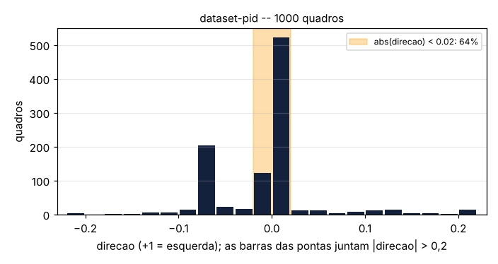
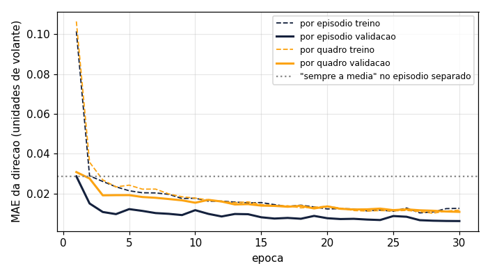
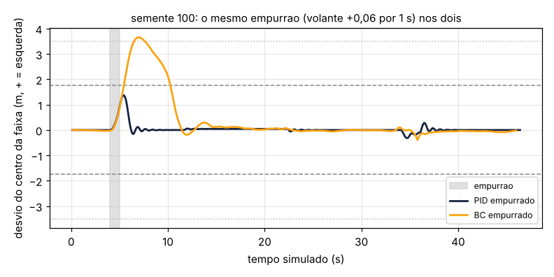

# Exemplo — `aula18-pid-bc`

**Aula 18 · Etapa 9.** O item 3 do TP5 diz, no enunciado: *"Behavioral Cloning vs PID — 1.000 frames de pilotagem humana no MetaDrive; CNN prevendo ação de direção; PID com simple-pid; comparação em 10 episódios (conclusão de rota, colisões, velocidade média)."* Os gates pedem três evidências: o dataset de ≥1000 quadros **com o histograma das ações** (G5.2), o PID medido com **métrica objetiva em ≥10 episódios** (G5.3) e o BC treinado e comparado com o PID **na mesma métrica**, numa tabela PID × BC (G5.4). Este exemplo monta as três peças em volta de uma só régua — o `avaliar.py` — e mede o que acontece quando a rede, que vai bem na validação, passa a dirigir.

> ## Leia isto antes de qualquer coisa
>
> **Os números desta página saíram de um container Linux sem GPU**, com 2 núcleos divididos com outros processos, renderização por software (Xvfb + llvmpipe). Sem câmera o MetaDrive é rápido (o PID roda 10 episódios em 13 s); **com câmera** foram cerca de 1 passo por segundo aqui (0,98 na gravação do dataset, 1,1 na régua do BC), contra 7–9 quadros por segundo medidos na máquina do professor (WSL2 + GPU). Tudo o que precisa de imagem — gravar o dataset, o BC dirigindo — foi dimensionado para caber nisso, e a seção **"O que foi e o que não foi verificado"** diz exatamente o que rodou.
>
> **O dataset desta página foi pilotado pelo PID, não por uma pessoa.** O enunciado pede **pilotagem humana**, e o `coletar.py` tem os dois modos humanos; o dataset do PID existe porque é o que se consegue gravar e repetir sem ninguém ao volante — serve para a aula mostrar a mecânica, **não serve para a entrega**.

```
aula18-pid-bc/
├── pid.py          # o PID de direcao (simple-pid) sobre o ESTADO do simulador; varre ganhos e velocidade
├── avaliar.py      # a REGUA: N episodios, sementes fixas, as mesmas colunas para PID, BC e constante
├── coletar.py      # grava quadro + direcao: humano (terminal ou janela) ou pid (com ou sem ruido)
├── histograma.py   # o histograma das acoes do dataset (dataset.md + PNG)
├── treinar_bc.py   # a CNN de regressao (venv da CNN); divisao por episodio; exporta os pesos
├── rede.py         # a mesma rede em NumPy puro: o que atravessa de um venv para o outro
├── dirigir_bc.py   # o BC dirigindo (venv do MetaDrive), medido pela regua
├── trajetorias.py  # o desvio lateral passo a passo (avaliar.py --trajetoria), em PNG
├── testar.py       # 9 grupos; o 8 e o 9 so rodam se acharem os venvs
└── amostra/        # 32 quadros do dataset, os pesos treinados, as tabelas e as figuras
```

São **dois venvs**, os mesmos da Aula 17, e eles não se misturam. O contrato entre eles é uma pasta de PNG com um `acoes.csv` ao lado, e um `pesos.npz` na volta:

```
   venv do MetaDrive (.venv-metadrive)                 venv da CNN (.venv-cnn)

   pid.py ---------------------------+
                                     |
   coletar.py  --> dataset/quadroNNNNN.png + acoes.csv --> treinar_bc.py --> modelo/pesos.npz
                                                                                   |
   dirigir_bc.py  <-- rede.py (NumPy) <-------------------------------------------+
        |
        +--> avaliar.py (a regua) <-- pid.py, constante
                    |
               resultados/*.csv + *-resumo.md  -->  a tabela PID x BC
```

## Baixar

O exemplo é autocontido: nenhum arquivo dele importa outra pasta. Ele usa os dois ambientes Python criados na Aula 17 — o do MetaDrive (`aula17-metadrive`) e o da CNN (`aula17-cnn`) —, que moram em `$PB_DIR`, **fora** das pastas dos exemplos. Tudo pende do `git clone` pelo `&&`: se o clone falhar, nenhum `rm -rf` roda.

```bash
# ── uma vez por terminal ──────────────────────────────
export PB_USER=seu-usuario-github          # ← troque pelo seu usuário do GitHub
export PB_DIR="$HOME/projeto-pb-$PB_USER"
export PB_WS="$PB_DIR/ros2_ws"

mkdir -p "$PB_DIR" && cd /tmp && rm -rf pb-a18 && \
  git clone --depth 1 https://github.com/Prof-Dacio-INFNET/PBRoboticos_prof_dacio.git pb-a18 && \
  rm -rf "$PB_DIR/aula18-pid-bc" && \
  cp -r pb-a18/exemplos/aula18-pid-bc "$PB_DIR/"
```

## O ambiente: dois venvs que já existem, e uma linha a mais

Se você ainda não tem os venvs, crie-os pelos READMEs da `aula17-metadrive` (seção "Instalar o MetaDrive") e da `aula17-cnn` (seção "O ambiente"). Confira que estão lá:

```bash
# ── herda as variáveis do bloco de download ──
: "${PB_WS:?defina PB_USER, PB_DIR e PB_WS — o bloco está no topo desta página}"
ls "$PB_DIR/.venv-metadrive/bin/python" "$PB_DIR/.venv-cnn/bin/python"
```

O que falta é o `simple-pid`, que o enunciado pede, e ele vai **no venv do MetaDrive** — é lá que o PID dirige:

```bash
# ── herda as variáveis do bloco de download ──
: "${PB_WS:?defina PB_USER, PB_DIR e PB_WS — o bloco está no topo desta página}"
uv pip install --python "$PB_DIR/.venv-metadrive/bin/python" simple-pid
"$PB_DIR/.venv-metadrive/bin/python" -c "from simple_pid import PID; print(PID(1, 0, 0, setpoint=0)(0.5, dt=0.1))"
```

Aqui a instalação levou 0,3 s e trouxe `simple-pid 2.0.1`, sem dependência nenhuma. A segunda linha tem de imprimir `-0.5`: com setpoint 0 e medida 0,5, o proporcional devolve `Kp × (setpoint − medida)`. **O sinal é esse**, e é a primeira coisa a conferir quando o carro vira para o lado errado.

**Por que a rede não roda com TensorFlow no venv do MetaDrive.** Os dois venvs não convivem: o da CNN é o único da disciplina criado **sem** `--system-site-packages` (a `aula17-cnn` explica por quê), e instalar o TensorFlow no do MetaDrive seria trazer 1,5 GB e uma segunda resolução de NumPy para dentro de um ambiente que funciona. A saída escolhida é a mais simples que existe: o `treinar_bc.py` exporta os pesos para um `.npz`, e o `rede.py` refaz a conta da rede — três convoluções, duas densas — em **NumPy puro**, umas 40 linhas. Nada a instalar, nenhum segundo processo, nenhum servidor. O `testar.py` confere que a saída do NumPy bate com a do Keras (aqui, diferença máxima de 1,2 × 10⁻⁷), e a inferência de um quadro leva 3,1 ms aqui — nada perto dos 900 ms que o MetaDrive gasta para desenhar o quadro. As alternativas foram consideradas e descartadas: um processo servidor de inferência por *pipe* ou *socket* resolve, mas acrescenta um segundo terminal e um protocolo para depurar; `onnxruntime` ou `tflite-runtime` no venv do MetaDrive é mais uma dependência binária com NumPy próprio — exatamente o tipo de coisa que quebra calada no WSL2.

## Conferir antes de confiar

```bash
# ── herda as variáveis do bloco de download ──
: "${PB_WS:?defina PB_USER, PB_DIR e PB_WS — o bloco está no topo desta página}"
cd "$PB_DIR/aula18-pid-bc"
python3 testar.py
```

Nove grupos. Os sete primeiros precisam só de NumPy e OpenCV (os do apt) e rodam em uns 3 s: os sinais do `pid.py` contra uma faixa falsa, as teclas do terminal (inclusive num pseudoterminal de verdade), a convolução do `rede.py` contra um laço ingênuo, a rede em NumPy contra a saída do **Keras** gravada em `amostra/modelo/referencia.npz`, as tabelas da `amostra/` contra os resumos, o dataset da amostra e a higiene dos `.py`. O grupo 8 só roda se achar o venv do MetaDrive, e o 9, o da CNN — em `$PB_DIR/.venv-metadrive` e `$PB_DIR/.venv-cnn`, ou pelos parâmetros:

```bash
# ── herda as variáveis do bloco de download ──
: "${PB_WS:?defina PB_USER, PB_DIR e PB_WS — o bloco está no topo desta página}"
cd "$PB_DIR/aula18-pid-bc"
python3 testar.py --metadrive "$PB_DIR/.venv-metadrive/bin/python" --cnn "$PB_DIR/.venv-cnn/bin/python"
```

Com os dois, aqui: **102 conferências em 2 min 7 s** — o PID em dois episódios, o `coletar.py` gravando 3 quadros, o BC da amostra dirigindo 5 passos com a câmera no venv do MetaDrive, o modo `humano-terminal` recebendo a tecla `a` por um pseudoterminal, e o `treinar_bc.py --epocas 1 --comparar-divisao` na amostra, com o `pesos.npz` recém-exportado conferido contra o Keras. Termina em `todos os testes passaram.` Os testes provam que as peças estão no lugar, não que o seu BC dirige: isso é a régua.

## 1. O PID: o controlador que vê o estado

```bash
# ── herda as variáveis do bloco de download ──
: "${PB_WS:?defina PB_USER, PB_DIR e PB_WS — o bloco está no topo desta página}"
cd "$PB_DIR/aula18-pid-bc"
"$PB_DIR/.venv-metadrive/bin/python" pid.py --saida resultados/pid
```

**O PID não olha a imagem.** Ele lê do simulador onde o carro está em relação à faixa — e é isso que faz dele a linha de base: é o que um controle clássico faz com percepção perfeita. A rede do BC, adiante, só tem a imagem. Os números saem destes lugares da API do MetaDrive 0.4.3 (conferidos no código instalado, não na documentação):

| no `pid.py` | de onde vem | o que é |
|---|---|---|
| faixa de referência | `carro.navigation.current_ref_lanes[1]` | as faixas da via em que a **rota** está agora; a do meio das três |
| `desvio` (m) | `−faixa.local_coordinates(carro.position)[1]` | o lateral do carro no referencial da faixa; o MetaDrive dá **positivo à direita** (medido: direção +0,3 leva o lateral a negativo), e o script inverte para "positivo = à esquerda" |
| `rumo` (rad) | `carro.heading_theta − faixa.heading_theta_at(longitudinal)` | o ângulo entre o carro e a faixa, ajustado para (−π, π] |
| velocidade | `carro.speed_km_h` | km/h |
| ação | `env.step([direcao, acelerador])` | as duas em [−1, 1]; direção **+1 = volante todo à esquerda** (40° nas rodas, `max_steering`) |

É o mesmo caminho que o motorista automático do próprio MetaDrive usa (`steering_control()` em `policy/idm_policy.py`, com dois PID somados). Aqui é **um PID só**, sobre um erro que junta os dois:

```
medida = desvio + OLHAR_M * sin(rumo)        # onde o carro estará, de lado, daqui a 5 m
direcao = PID(medida, dt=0.1)                # simple-pid, setpoint 0, saída limitada a [-1, 1]
acelerador = 0.1 * (40 - velocidade_kmh)      # proporcional, o MESMO para o PID e para o BC
```

Os ganhos estão no topo do arquivo, cada um com o porquê: `Kp = 0,5` (1 m de erro à frente pede metade do volante), `Ki = 0` (não há vento nem inclinação lateral para o integral corrigir, e o termo de rumo já tira o erro de regime da curva), **`Kd = 0`** (o termo de rumo já é o amortecimento — e a seção do Kd, abaixo, mostra o que um Kd "para amortecer" faz), `OLHAR_M = 5` m (uns 0,45 s a 40 km/h). O acelerador não é o assunto: ele é o mesmo para os dois controladores, e a comparação mede só a direção.

O resultado, nas sementes 100 a 109 (`amostra/resultados/pid-resumo.md`), em **13 s** de parede para os dez episódios:

| medida | PID, alvo 40 km/h |
|---|---|
| concluiu | 10 de 10 |
| colidiu | 0 de 10 |
| saiu_da_pista | 0 de 10 |
| vel_media (km/h) | 38,0 ± 0,3 |
| passos | 441 ± 80 |
| recompensa | 495,8 ± 92,7 |
| fracao_rota | 0,990 ± 0,002 |
| erro_lat_medio_m | 0,021 ± 0,004 |
| erro_lat_max_m | 0,244 ± 0,122 |
| var_direcao | 0,010 ± 0,004 |

A velocidade média fica 2 km/h abaixo do alvo porque o episódio começa parado (e o acelerador proporcional puro tem um pequeno erro de regime). A fração de rota para em 0,99 e não em 1: o MetaDrive declara `arrive_dest` a 5 m do fim da última faixa. A última linha, `var_direcao`, é a média de |direção(t) − direção(t−1)|: quanto o volante muda de um passo para o outro. Ela parece um detalhe, e é a coluna que decide se o PID serve de professor para o BC.

Todas as linhas desta seção estão em `amostra/resultados/varreduras.txt`, com o comando que as gerou.

### Ganho ruim: o sintoma visível

```bash
# ── herda as variáveis do bloco de download ──
: "${PB_WS:?defina PB_USER, PB_DIR e PB_WS — o bloco está no topo desta página}"
cd "$PB_DIR/aula18-pid-bc"
"$PB_DIR/.venv-metadrive/bin/python" pid.py --kp 0.05 0.2 0.5 1 3 --olhar 0
```

Sem o termo de rumo (`--olhar 0`) sobra um P puro sobre o desvio de agora, e **nenhum Kp funciona** — dez de dez fora da pista em todos:

```
controlador                          concluiu   saiu  bateu      vel km/h         rota     erro lat m  var dir
kp=0.05 ki=0 kd=0 olhar=0 v=40          0/10   10/10   0/10  36.1 +-  1.7 0.519+-0.176  0.739+- 0.396    0.004
kp=0.2 ki=0 kd=0 olhar=0 v=40           0/10   10/10   0/10  35.5 +-  0.6 0.455+-0.067  0.524+- 0.055    0.020
kp=0.5 ki=0 kd=0 olhar=0 v=40           0/10   10/10   0/10  34.3 +-  0.6 0.391+-0.055  0.376+- 0.107    0.034
kp=1 ki=0 kd=0 olhar=0 v=40             0/10   10/10   0/10  32.9 +-  0.5 0.372+-0.056  0.432+- 0.059    0.042
kp=3 ki=0 kd=0 olhar=0 v=40             0/10   10/10   0/10  30.2 +-  1.0 0.275+-0.056  0.488+- 0.088    0.057
```

O sintoma é a oscilação que cresce. Na semente 100, com `Kp = 0,5`, o desvio a cada segundo foi `0,00 … 0,00, 0,31, −0,03, 0,08, 0,70, 0,75, −1,60, 2,49` e, no segundo seguinte, `out_of_road`: o carro passa do centro, corrige tarde, passa do centro do outro lado com mais folga, até tocar a linha contínua. Na reta ele aguenta; quem dispara a oscilação é a entrada da curva. A razão é física, não de sintonia: o volante muda o **rumo**, e o rumo muda o desvio — um P sobre o desvio só descobre que passou do centro quando já passou. O termo de rumo enxerga o movimento antes.

Com o termo de rumo de volta, a varredura do Kp mostra os dois lados:

```bash
# ── herda as variáveis do bloco de download ──
: "${PB_WS:?defina PB_USER, PB_DIR e PB_WS — o bloco está no topo desta página}"
cd "$PB_DIR/aula18-pid-bc"
"$PB_DIR/.venv-metadrive/bin/python" pid.py --kp 0.05 0.2 0.5 1 3 6
```

```
controlador                          concluiu   saiu  bateu      vel km/h         rota     erro lat m  var dir
kp=0.05 ki=0 kd=0 olhar=5 v=40         10/10    0/10   0/10  38.1 +-  0.3 0.989+-0.003  0.559+- 0.053    0.003
kp=0.2 ki=0 kd=0 olhar=5 v=40          10/10    0/10   0/10  38.1 +-  0.3 0.990+-0.002  0.080+- 0.008    0.002
kp=0.5 ki=0 kd=0 olhar=5 v=40          10/10    0/10   0/10  38.0 +-  0.3 0.990+-0.002  0.021+- 0.004    0.010
kp=1 ki=0 kd=0 olhar=5 v=40            10/10    0/10   0/10  34.0 +-  0.4 0.990+-0.003  0.097+- 0.009    0.167
kp=3 ki=0 kd=0 olhar=5 v=40             0/10    0/10   0/10  10.9 +-  0.3 0.656+-0.119  0.107+- 0.011    0.339
kp=6 ki=0 kd=0 olhar=5 v=40             0/10    0/10   0/10   8.9 +-  0.8 0.534+-0.127  0.128+- 0.009    0.301
```

**Lento** (`Kp = 0,05`): chega, mas com erro lateral médio de 0,56 m — 27 vezes o do ganho escolhido — e o volante quase parado (0,003). **Bom** de 0,2 a 0,5. **Agressivo** de 1 para cima: o volante começa a bater (`var dir` de 0,17 com Kp 1), e com `Kp = 3` e `6` o carro **não sai da pista** — o erro lateral continua pequeno —, mas a velocidade média cai para 11 e 9 km/h e nenhum episódio chega antes do horizonte de 1000 passos (`motivo = max_step`). Com `Kp = 3`, nos primeiros 300 passos da semente 100, o volante ficou **saturado em 59%** do tempo, trocando de lado quase duas vezes por segundo: o carro anda arrastando as rodas. É a armadilha de olhar só a coluna `saiu_da_pista` — o controlador "nunca sai" e nunca chega. Por isso a régua tem `concluiu`, `vel_media`, `passos` e `var_direcao` lado a lado.

### O Kd que serrilha o volante

```bash
# ── herda as variáveis do bloco de download ──
: "${PB_WS:?defina PB_USER, PB_DIR e PB_WS — o bloco está no topo desta página}"
cd "$PB_DIR/aula18-pid-bc"
"$PB_DIR/.venv-metadrive/bin/python" pid.py --kd 0 0.05 0.1 0.3
```

```
controlador                          concluiu   saiu  bateu      vel km/h         rota     erro lat m  var dir
kp=0.5 ki=0 kd=0 olhar=5 v=40          10/10    0/10   0/10  38.0 +-  0.3 0.990+-0.002  0.021+- 0.004    0.010
kp=0.5 ki=0 kd=0.05 olhar=5 v=40       10/10    0/10   0/10  38.0 +-  0.4 0.990+-0.003  0.021+- 0.004    0.015
kp=0.5 ki=0 kd=0.1 olhar=5 v=40        10/10    0/10   0/10  37.0 +-  0.2 0.990+-0.002  0.046+- 0.007    0.123
kp=0.5 ki=0 kd=0.3 olhar=5 v=40        10/10    0/10   0/10  33.5 +-  0.3 0.990+-0.003  0.151+- 0.012    0.398
```

Esta tabela é a história de como este exemplo foi feito. A primeira versão do `pid.py` tinha `Kd = 0,3`, "para amortecer", e passou na régua com folga: 10 de 10, nenhuma saída. O dataset de 1000 quadros começou a ser gravado com ele. Só ao treinar a rede apareceu o problema: a saída do PID **alternava de sinal a cada passo** — na curva, `+0,50, −0,40, +0,50, −0,40…` em quadros consecutivos, quatro trocas de sinal por segundo —, quando o volante de que a curva precisa é uns 0,06. O carro filtra isso — a massa dele não acompanha uma troca de volante a cada 0,1 s —, e por isso a régua não acusa; mas o **rótulo** do dataset vira serra, e a rede treinada nele aprende a única coisa que dá para aprender de uma serra: a média (MAE 0,139 contra 0,143 da linha de base "sempre a média", nos 569 quadros gravados até ali, com a configuração de treino daquele momento). A causa é o derivativo: a 0,1 s por passo, a derivada da medida a 5 m à frente reage à própria resposta do carro ao último comando e a amplifica. Com `Kd = 0` o volante muda 0,010 por passo, o carro anda 4,5 km/h mais rápido e fica 7 vezes mais centrado. **O professor do BC tem de ser suave, não só correto** — e é a coluna `var_direcao` que mede isso.

### A velocidade em que o mesmo ganho deixa de servir

```bash
# ── herda as variáveis do bloco de download ──
: "${PB_WS:?defina PB_USER, PB_DIR e PB_WS — o bloco está no topo desta página}"
cd "$PB_DIR/aula18-pid-bc"
"$PB_DIR/.venv-metadrive/bin/python" pid.py --vel 30 40 50 60 70 80 100
```

```
controlador                          concluiu   saiu  bateu      vel km/h         rota     erro lat m  var dir
kp=0.5 ki=0 kd=0 olhar=5 v=30          10/10    0/10   0/10  29.1 +-  0.1 0.990+-0.002  0.013+- 0.001    0.004
kp=0.5 ki=0 kd=0 olhar=5 v=40          10/10    0/10   0/10  38.0 +-  0.3 0.990+-0.002  0.021+- 0.004    0.010
kp=0.5 ki=0 kd=0 olhar=5 v=50          10/10    0/10   0/10  45.6 +-  1.1 0.990+-0.003  0.098+- 0.073    0.045
kp=0.5 ki=0 kd=0 olhar=5 v=60           4/10    6/10   0/10  50.3 +-  4.1 0.771+-0.251  0.196+- 0.039    0.048
kp=0.5 ki=0 kd=0 olhar=5 v=70           1/10    9/10   0/10  53.1 +-  6.4 0.601+-0.265  0.210+- 0.053    0.036
kp=0.5 ki=0 kd=0 olhar=5 v=80           1/10    9/10   0/10  52.7 +-  6.6 0.512+-0.272  0.361+- 0.201    0.029
kp=0.5 ki=0 kd=0 olhar=5 v=100          0/10   10/10   0/10  49.3 +-  2.3 0.303+-0.034  0.259+- 0.115    0.010
```

Os ganhos sintonizados a 40 km/h aguentam 50; **a 60 km/h, 6 de 10 saem da pista**, e a 100, todos. O erro lateral médio quintuplica de 40 para 50 km/h antes de qualquer saída — é o aviso que vem antes do sintoma. Ganho de direção depende da velocidade porque o mesmo ângulo de volante muda o rumo mais depressa quando o carro anda mais; quem dirige em velocidades diferentes precisa de ganhos diferentes (*gain scheduling*) ou de um olhar à frente proporcional à velocidade. A velocidade média nunca passa de ~53 km/h nas linhas de baixo porque os episódios acabam cedo, ainda acelerando.

### A armadilha do `simple-pid`: o relógio

```bash
# ── herda as variáveis do bloco de download ──
: "${PB_WS:?defina PB_USER, PB_DIR e PB_WS — o bloco está no topo desta página}"
cd "$PB_DIR/aula18-pid-bc"
"$PB_DIR/.venv-metadrive/bin/python" pid.py --sem-dt
```

Os mesmos ganhos, a mesma estrada, e **1 de 10** chega: 9 saem da pista, em 293 ± 126 passos. A única diferença é a chamada: `pid(medida)` em vez de `pid(medida, dt=0.1)`. Sem `dt`, o `simple-pid` mede o tempo pelo **relógio do computador** (`time.monotonic()`), e tem um `sample_time` padrão de 0,01 s: chamado antes disso, ele **devolve a saída anterior sem recalcular**. Sem câmera o MetaDrive simula centenas de passos por segundo de parede, cada chamada chega 1–2 ms depois da anterior, e o volante fica congelado. Com câmera, o oposto: a 1 passo por segundo de parede, o `dt` vira 1 s, dez vezes o do simulador, e qualquer integral ou derivativo passa a ser calculado com o tempo errado. **O mesmo código dirige diferente em máquinas diferentes**, e nenhuma mensagem avisa. Em simulação, o tempo é o do simulador: passe `dt`.

## 2. A régua: a mesma medida para todos

```bash
# ── herda as variáveis do bloco de download ──
: "${PB_WS:?defina PB_USER, PB_DIR e PB_WS — o bloco está no topo desta página}"
cd "$PB_DIR/aula18-pid-bc"
"$PB_DIR/.venv-metadrive/bin/python" avaliar.py --controlador pid --saida resultados/pid
"$PB_DIR/.venv-metadrive/bin/python" avaliar.py --controlador constante --direcao -0.009 --saida resultados/constante
```

O `avaliar.py` é o único lugar que decide **como se mede**. O `pid.py` e o `dirigir_bc.py` só definem o controlador — um objeto com `reiniciar()` e `agir(env, obs) → [direção, acelerador]` — e chamam a mesma função `rodar()`. Mesmas sementes (100 a 109), mesmo mapa, mesma configuração, mesmas colunas. O `CSV` tem uma linha por episódio:

| coluna | o que é | de onde vem |
|---|---|---|
| `episodio`, `semente` | qual episódio | 0 a 9; sementes 100 a 109 |
| `concluiu` | 1 se chegou ao destino | `info["arrive_dest"]` no último passo |
| `colidiu` | 1 se **bateu** | `crash_vehicle`, `crash_object`, `crash_building` ou `crash_human` — **não** inclui sair da pista |
| `vel_media` | km/h | média de `carro.speed_km_h` em todos os passos |
| `passos` | passos de 0,1 s simulados | o laço |
| `recompensa` | a soma da recompensa do MetaDrive | ≈ metros andados na rota + bônus de velocidade; +10 ao chegar, −5 ao sair ou bater |
| `fracao_rota` | 0 a 1 | `info["route_completion"]` no último passo |
| `saiu_da_pista` | 1 se saiu | `info["out_of_road"]`: fora de qualquer faixa, **ou** sobre a linha contínua (amarela ou a branca da borda), **ou** na calçada — a regra de `_is_out_of_road()` em `metadrive_env.py` |
| `motivo` | por que acabou | a primeira chave verdadeira entre `arrive_dest`, `crash_*`, `out_of_road`, `max_step` |
| `erro_lat_medio_m`, `erro_lat_max_m` | o quanto se afastou do centro | `pid.erros_da_faixa()`, medido do **estado** para qualquer controlador |
| `var_direcao` | o quanto o volante muda de um passo para o outro | média de \|direção(t) − direção(t−1)\| |
| `tempo_parede_s` | quanto demorou aqui | relógio |

As sete primeiras colunas são as mesmas do exemplo do PPO, de propósito: a tabela final do TP5 junta as três linhas. O resumo (`*-resumo.md`) dá contagem para as colunas 0/1 e **média ± desvio-padrão amostral** (n − 1) para as outras.

**Saída de pista e batida são colunas separadas.** O MetaDrive encerra o episódio em qualquer dos dois, e a coluna `colidiu` do enunciado, se contasse a saída de pista, diria "o BC colidiu 2 vezes" quando ele não encostou em nada. Na régua, `colidiu` é batida em objeto; `saiu_da_pista` é sair. Diga no relatório como contou.

**As decisões do cenário**, declaradas no topo do `avaliar.py` antes de medir:

- **Sem tráfego** (`traffic_density = 0`, `accident_prob = 0`). Os dois controladores usam o mesmo acelerador proporcional, que **não freia** para o carro da frente. Com tráfego, a coluna `colidiu` mede a falta de um controle longitudinal — que nenhum dos dois tem —, e não a direção. Medido: o mesmo PID com `--trafego 0.1` **bate em 10 de 10** episódios (`crash_vehicle`, entre os passos 150 e 437), com o mesmo erro lateral de sem tráfego (0,02 m). Para a entrega você pode querer tráfego; então o controlador precisa frear, e o BC precisa aprender a frear também.
- **Mapa `SCSCS`**: reta, curva, reta, curva, reta. **Sem cruzamento**: no cruzamento a rota escolhe virar ou seguir, e uma câmera sozinha não sabe qual das duas a rota quer — o BC precisaria receber o comando de navegação, e isso é outro exemplo. A curva (raio, ângulo, para que lado) é sorteada pela semente, então cada semente é uma estrada diferente com a mesma estrutura.
- **Três faixas, o carro nasce na do meio** e o PID segue a do meio. Sair da pista, na prática, é **tocar a linha contínua** — a amarela à esquerda ou a branca da borda à direita: nas seis saídas examinadas, `on_lane` continuava verdadeiro e o que disparou foi `on_yellow_continuous_line` (5) ou `on_white_continuous_line` (1), com o centro do carro a 3,0–3,6 m do centro da faixa do meio, já inclinado.
- **Sementes separadas**: o dataset usa as sementes 0, 1, 2…; a régua, 100 a 109. O BC é medido em estradas que ele nunca viu.
- **Horizonte de 1000 passos** (100 s simulados). Com o PID, a rota leva de 334 a 611 passos (33 a 61 s simulados).

**A linha de base mais burra** é a `constante`: o volante parado num valor só — a média do dataset. É o equivalente, em malha fechada, da linha de base "prever sempre a média" do treino: se o BC não ganhar dela, a rede não aprendeu nada que sirva para dirigir.

## 3. O dataset: quadro + direção

O enunciado pede **pilotagem humana**, e é o que vai para a entrega. O `coletar.py` tem dois modos humanos e um modo PID; todos gravam a mesma coisa — `quadroNNNNN.png` (a câmera do carro, 160×120, BGR) e uma linha no `acoes.csv` por quadro:

| coluna | o que é |
|---|---|
| `indice`, `arquivo`, `episodio`, `semente`, `passo` | qual quadro, de qual episódio, em que passo |
| `direcao` | **o rótulo**: a direção que o piloto quis dar naquele quadro |
| `direcao_aplicada` | a que foi de fato aplicada ao carro (só difere com `--ruido`) |
| `acelerador` | o que foi aplicado |
| `desvio_m`, `rumo_rad`, `vel_kmh` | o estado, do `pid.erros_da_faixa()` — para conferência, a rede não vê |
| `piloto` | `pid`, `humano-terminal` ou `humano-janela` |

O par é **(quadro antes do passo, ação daquele passo)**: a imagem que o piloto via quando decidiu. Gravar a imagem depois do `env.step()` desalinha tudo de um quadro — e a rede aprende a reagir ao que já aconteceu. Por padrão grava-se um quadro a cada 2 passos (`--passo 2`, 0,2 s): quadros a 0,1 s um do outro são quase a mesma imagem. Os episódios usam as sementes 0, 1, 2… até completar `--quadros`.

### Pilotar você mesmo (o da entrega)

**Terminal A — dirigir pelo terminal** (o modo recomendado no WSL2: as teclas vêm do terminal onde o script roda, e a janela do MetaDrive só mostra a estrada):

```bash
# ── herda as variáveis do bloco de download ──
: "${PB_WS:?defina PB_USER, PB_DIR e PB_WS — o bloco está no topo desta página}"
cd "$PB_DIR/aula18-pid-bc"
"$PB_DIR/.venv-metadrive/bin/python" coletar.py --piloto humano-terminal --quadros 1000 --saida dataset
```

Teclas, com o **foco no terminal**: `a` ou seta esquerda gira o volante 0,02 para a esquerda; `d` ou seta direita, para a direita; `s` ou espaço centraliza; `w` e `x` sobem e descem a velocidade-alvo em 5 km/h; `q` ou Ctrl+C grava e sai. O volante **fica onde você deixou** — as curvas deste mapa pedem de 0,06 a 0,2 (três a dez toques; segurar a tecla repete), e na saída da curva, `s`. A linha que o script reescreve no terminal mostra o volante, a velocidade e o desvio do centro. O acelerador é o mesmo controle do `pid.py`: você só dirige. Cada passo é segurado em pelo menos 0,1 s (`--tempo-real`, o padrão nos modos humanos), para o carro andar no tempo em que você reage; se a sua máquina desenha mais devagar que isso, o carro anda em câmera lenta, o que só facilita.

A outra opção é o teclado **do próprio MetaDrive** (`manual_control=True`): W A S D com o **foco na janela** dele. O volante do MetaDrive volta sozinho ao centro quando você solta a tecla (0,25 por passo) e cresce 0,04 por passo com a tecla apertada, e o acelerador também é seu (W segurado). Não aperte espaço nem `t`: no MetaDrive eles passam o controle a um "especialista" que este cenário não suporta. O rótulo gravado é `info["steering"]`, o volante que o MetaDrive aplicou.

```bash
# ── herda as variáveis do bloco de download ──
: "${PB_WS:?defina PB_USER, PB_DIR e PB_WS — o bloco está no topo desta página}"
cd "$PB_DIR/aula18-pid-bc"
"$PB_DIR/.venv-metadrive/bin/python" coletar.py --piloto humano-janela --quadros 1000 --saida dataset
```

Os dois modos humanos abrem a janela do MetaDrive (480×360, com o painel de velocímetro) **e** gravam a câmera de 160×120 de sempre — o quadro gravado é igual ao do modo PID. Aqui, sem tela, os dois rodaram por baixo do Xvfb: o `humano-terminal` recebendo teclas por um pseudoterminal (é o grupo 8 do `testar.py`), o `humano-janela` abrindo, gravando 5 quadros com volante 0 e fechando. **Ninguém dirigiu nenhum dos dois olhando a janela** — leia "O que foi e o que não foi verificado".

### O PID dirigindo (o da aula)

```bash
# ── herda as variáveis do bloco de download ──
: "${PB_WS:?defina PB_USER, PB_DIR e PB_WS — o bloco está no topo desta página}"
cd "$PB_DIR/aula18-pid-bc"
"$PB_DIR/.venv-metadrive/bin/python" coletar.py --piloto pid --quadros 1000 --saida dataset-pid
python3 histograma.py --pasta dataset-pid --md dataset-pid.md --png histograma.png
```

Sem tela, a primeira linha vai por baixo do `xvfb-run -a -s "-screen 0 1280x1024x24"`, como na Aula 17.

Aqui, sem GPU, os 1000 quadros levaram **2042 s (34 min)**: 0,49 quadro/s, 0,98 passo/s, cinco episódios (sementes 0 a 4, o quinto cortado no milésimo quadro). O processo do MetaDrive com câmera ocupou **4,0 GB** de memória. Na máquina do professor a captura da Aula 17 mediu 7–9 quadros/s com um quadro a cada 3 passos, uns 20–26 passos/s; **por estimativa, não medida**, isso põe estes 2000 passos em 1,5 a 2 minutos. Pilotando com `--tempo-real`, o piso é 0,1 s por passo: **3 min 20 s de direção** para 1000 quadros a `--passo 2`, mais o tempo entre episódios.

O histograma (`amostra/dataset.md` e `amostra/histograma.png`, gerados pelo `histograma.py`). O `histograma.py` é **apoio, não veredito**: ele relata o que achou no `acoes.csv`, não diz se o dataset serve, não valida a entrega e não substitui o enunciado — e diz isso no cabeçalho do relatório que grava. Quem decide se a distribuição presta é você, olhando a sua pista:



```
| abs(direcao) < 0.02 | 644 quadros (64%) |
| esquerda (>= 0.02) / direita (<= -0.02) | 81 / 275 |

[-0.10, -0.08)    15 #
[-0.08, -0.06)   204 ####################
[-0.06, -0.04)    23 ##
[-0.04, -0.02)    17 ##
[-0.02, +0.00)   122 ############
[+0.00, +0.02)   522 ##################################################
[+0.02, +0.04)    12 #
```

Três coisas para ler nele, e as três são o problema clássico do BC:

1. **64% do dataset é "volante parado"** (|direção| < 0,02, menos de 1° de roda). Uma rede que respondesse sempre zero já acertaria quase dois terços dos quadros.
2. **A escala é pequena.** A curva deste mapa pede uns 0,06–0,08 de volante (2–3° de roda); quase nada passa de 0,2. O histograma em faixas de 0,1 juntaria tudo em duas barras — por isso o `histograma.py` usa faixas de 0,02.
3. **As curvas são quase todas para a direita**: 275 quadros virando à direita contra 81 à esquerda. As sementes 0 a 4 sortearam mais curvas à direita, e a rede vai ver pouca curva à esquerda. Nas sementes da régua, duas (102 e 108) são de curva à esquerda — o que acontece nelas está na seção 5.

Para a entrega, o `dataset.md` é a evidência do dataset: rode o `histograma.py --md` no **seu** dataset humano e leia as mesmas três coisas.


## 4. O treino: a rede que só vê a imagem

```bash
# ── herda as variáveis do bloco de download ──
: "${PB_WS:?defina PB_USER, PB_DIR e PB_WS — o bloco está no topo desta página}"
cd "$PB_DIR/aula18-pid-bc"
"$PB_DIR/.venv-cnn/bin/python" treinar_bc.py --pasta dataset-pid --saida modelo --comparar-divisao
```

Roda no **venv da CNN**. A rede é a da `aula17-cnn` virada regressão: três blocos `Conv2D 3×3 → BatchNormalization(momentum 0,9) → ReLU → MaxPooling`, `Flatten`, `Dense(64)`, `Dropout(0,3)` e **uma** saída linear — a direção. A perda é o erro quadrático médio; a métrica que se lê é o **MAE em unidades de volante** (0,01 = 0,4° de roda). O `momentum 0,9` é a mesma armadilha da Aula 17: com o 0,99 do Keras as médias móveis da BatchNormalization não chegam lá em treino curto.

**O preparo da imagem** é uma função só, `rede.preparar()`, usada pelo treino **e** pela direção: corta as 50 linhas de cima (céu; o horizonte fica em ~55 de 120) e pega um pixel a cada dois, de 160×120 para 80×35, sem mexer nos canais — **BGR**, como o MetaDrive entrega e o `cv2.imread` lê. Sem `cv2.resize`: a mesma conta, igual nos dois venvs.

Duas decisões que só apareceram medindo, e estão no topo do `treinar_bc.py`:

- **Saída linear, não `tanh`.** Com `tanh`, a primeira época levou a saída a +1 em todos os quadros, a `tanh` saturou, o gradiente zerou e a perda ficou parada em 1,19 da segunda época em diante. O recorte em [−1, 1] fica para a inferência.
- **A rede aprende a direção × 10, com taxa de aprendizado 3 × 10⁻⁴.** O volante de uma curva aqui é ~0,06, e a saída da rede recém-inicializada varia de várias unidades: sem a escala, o caminho mais curto para baixar a perda é responder ~0 sempre, e a rede para ali. Num ensaio com 567 quadros (3 episódios): MAE na curva de 0,088 com a configuração inicial (sem escala, 10⁻³), 0,040 com escala 10 e 3 × 10⁻⁴, contra 0,097 de "sempre a média". A escala vai no `pesos.npz`, e o `rede.py` divide de volta.

Os 1000 quadros treinaram em **38 s** por rodada, aqui, com um núcleo. A tabela (`amostra/modelo/tabela.txt`):

```
dados   : dataset-pid -- 1000 quadros, 5 episodios; |direcao| < 0.02 em 644 (64%)
validacao: episodio(s) dataset-pid:4 -- 105 quadros (64 de reta, 41 de curva)

linha de base "sempre a media do treino" (-0.007): MAE 0.029 no episodio separado
linha de base "sempre zero":                  MAE 0.027

divisao        MAE_treino  MAE_val(propria)  MAE_ep_separado   reta    curva   tempo
por episodio        0.008             0.006            0.006   0.002   0.012     38 s
por quadro          0.006             0.011            0.006   0.003   0.011     38 s
sempre media            -                 -            0.029   0.007   0.062
```



**A rede aprendeu**: no episódio que ela nunca viu, erra 0,006 de volante em média — cinco vezes menos que "sempre a média" — e 0,012 na curva, contra 0,062. Por qualquer número de validação, é um bom modelo. Treinar de novo com a mesma semente deu pesos **idênticos**, byte a byte (`enable_op_determinism`).

**A divisão por quadro, aqui, não inflou a validação** — e isso precisa ser dito, porque era o efeito esperado. A rodada "por quadro" sorteia 20% dos quadros dos quatro episódios de treino; a validação dela (0,011) saiu **pior** que a da divisão por episódio (0,006), e as duas redes erram igual no episódio separado. Duas razões prováveis, nenhuma medida: com um quadro a cada 0,2 s, os vizinhos já não são cópias; e o episódio separado é o quinto, **cortado** no milésimo quadro (105 quadros, só a primeira curva) — mais fácil que a média. A regra continua a mesma, pela razão de princípio: a validação tem de ser uma estrada que a rede não viu, e com a divisão por quadro você não tem como saber se viu. Com `--passo 1` ou com o dataset humano, rode `--comparar-divisao` e veja o seu número.

## 5. O BC dirigindo: a mesma régua

```bash
# ── herda as variáveis do bloco de download ──
: "${PB_WS:?defina PB_USER, PB_DIR e PB_WS — o bloco está no topo desta página}"
cd "$PB_DIR/aula18-pid-bc"
"$PB_DIR/.venv-metadrive/bin/python" dirigir_bc.py --modelo modelo/pesos.npz --saida resultados/bc
```

Roda no **venv do MetaDrive**, com a câmera ligada (sem tela: `xvfb-run` na frente). A cada passo, o `PilotoBC` pega o quadro da observação, passa por `rede.preparar()` e pela `rede.Rede` em NumPy, e devolve `[direção da rede, acelerador do PID]`. As sementes, o mapa, o horizonte e as colunas são os do `avaliar.py` — o `dirigir_bc.py` é só um atalho para `avaliar.py --controlador bc`.

**O que rodou**: os **10 episódios da régua** (sementes 100 a 109), em **58 min** de parede (5–7 min por episódio, a ~1,1 passo/s; a inferência em NumPy leva 3,1 ms por quadro, o resto é o MetaDrive desenhando). Depois, com o mesmo modelo e menos episódios — cada linha diz quantos —, o empurrão, as duas armadilhas e o modelo espelhado.

A tabela PID × BC, na mesma régua (`amostra/resultados/*-resumo.md`; média ± desvio-padrão amostral):

| medida | PID | BC | constante −0,009 | constante 0 |
|---|---|---|---|---|
| episódios | 10 | 10 | 10 | 10 |
| concluiu | **10 de 10** | **8 de 10** | 0 de 10 | 0 de 10 |
| colidiu | 0 de 10 | 0 de 10 | 0 de 10 | 0 de 10 |
| saiu_da_pista | 0 de 10 | 2 de 10 (sementes 103 e 107) | 10 de 10 | 10 de 10 |
| vel_media (km/h) | 38,0 ± 0,3 | 37,7 ± 1,3 | 28,9 ± 0,3 | 33,9 ± 0,4 |
| passos | 441 ± 80 | 400 ± 107 | 71 ± 1 | 132 ± 12 |
| recompensa | 495,8 ± 92,7 | 445,0 ± 127,8 | 52,5 ± 0,3 | 122,3 ± 13,6 |
| fracao_rota | 0,990 ± 0,002 | 0,896 ± 0,220 | 0,133 ± 0,026 | 0,273 ± 0,037 |
| erro_lat_medio_m | **0,021 ± 0,004** | **0,116 ± 0,068** | 1,031 ± 0,017 | 0,162 ± 0,029 |
| erro_lat_max_m | 0,244 ± 0,122 | 1,270 ± 1,370 | 4,034 ± 0,047 | 3,559 ± 0,172 |
| var_direcao | 0,010 ± 0,004 | 0,008 ± 0,001 | 0 | 0 |

E as variações, com o mesmo modelo:

| linha | episódios | concluiu | saiu | o que mais importa |
|---|---|---|---|---|
| PID com empurrão 0,06 | 10 (100–109) | 10 | 0 | erro máx. 1,38 ± 0,02 m, e volta ao centro uns 2 s depois do empurrão |
| **BC com empurrão 0,06** | 5 (100–104) | 4 | 1 (a 103, que sai também sem empurrão) | **erro máx. 3,64 a 3,90 m**: atravessa para a faixa vizinha; erro médio 0,40 a 0,79 m |
| BC com `--inverter-canais` (RGB) | 3 (100–102) | **0** | 3, nos passos 352, 226 e 145 | as três sementes que o BC normal completa |
| BC com `--sem-normalizar` | 3 (100–102) | 0 | 3, nos passos 21, 23 e 19 | volante em +1 desde o primeiro quadro |
| BC espelhado (`--espelhar`) | **2, só as sementes 103 e 107** — as duas em que o BC saiu | **2** | 0 | erro médio 0,078 e 0,067 m; **não** rodou nas outras 8: não é a régua inteira |


As linhas das variações saem destes comandos — um terminal, na ordem; com câmera, cada episódio do BC leva de 5 a 7 minutos aqui:

```bash
# ── herda as variáveis do bloco de download ──
: "${PB_WS:?defina PB_USER, PB_DIR e PB_WS — o bloco está no topo desta página}"
cd "$PB_DIR/aula18-pid-bc"
"$PB_DIR/.venv-metadrive/bin/python" avaliar.py --controlador pid --empurrao 0.06 --trajetoria resultados/traj-pid-empurrao.csv --saida resultados/pid-empurrao
"$PB_DIR/.venv-metadrive/bin/python" dirigir_bc.py --modelo modelo/pesos.npz --episodios 1 --empurrao 0.06 --trajetoria resultados/traj-bc-empurrao.csv --saida resultados/bc-empurrao
python3 trajetorias.py --csv resultados/traj-pid-empurrao.csv resultados/traj-bc-empurrao.csv --nome PID BC --empurrao --png resultados/empurrao.png
"$PB_DIR/.venv-metadrive/bin/python" dirigir_bc.py --modelo modelo/pesos.npz --episodios 3 --sem-normalizar --saida resultados/bc-sem255
"$PB_DIR/.venv-metadrive/bin/python" dirigir_bc.py --modelo modelo/pesos.npz --episodios 3 --inverter-canais --saida resultados/bc-rgb
```

**O que a tabela diz.** A rede que errava 0,006 de volante num episódio que nunca viu — cinco vezes menos que a linha de base — completa 8 das 10 estradas, quase na mesma velocidade do PID e com o volante até mais suave. Por "conclusão de rota, colisões, velocidade média", que é o que o enunciado pede, BC e PID ficam perto: 8 contra 10, 0 contra 0, 37,7 contra 38,0. **A coluna que separa os dois é a que o enunciado não pede**: o BC anda, em média, 5,5 vezes mais longe do centro (0,116 contra 0,021 m), e nos episódios em que chega passa por momentos a quase 1 m do centro (sementes 102 e 108, as de curva à esquerda — o lado que o dataset quase não tem). As duas saídas são na **saída de uma curva à direita**, o lado que o dataset mais tem: a 103 na segunda curva (72% da rota), a 107 na primeira (32%). As constantes mostram por que a régua precisa de linha de base: volante parado em −0,009, a média do dataset, sai da pista em 7 s, ainda na primeira reta.

**O achado que esta seção esperava — e como ele apareceu.** A ideia era ver um BC com erro de validação baixo saindo da pista em malha fechada, porque o piloto perfeito nunca mostra como voltar de um erro. Em malha fechada pura ele apareceu pela metade: 2 de 10. Para medir a ideia diretamente, a régua tem o **empurrão** (`--empurrao 0.06`): do passo 40 ao 49, a 4 s do início e ainda na primeira reta, o volante é forçado a +0,06, qualquer que seja o controlador. O PID sai 1,4 m do centro e volta uns 2 s depois do empurrão. O BC, empurrado igual, **não volta direto para a sua faixa**: segue para a esquerda até 3,6–3,9 m do centro — a faixa vizinha tem o centro a 3,5 m — e só segundos depois retorna. Dos 1000 quadros do dataset, **6** estão a mais de 0,25 m do centro, e **nenhum** a mais de 0,47 m: a rede nunca viu o carro torto na faixa, e para ela uma faixa vizinha parece tanto uma faixa quanto a dela. É a deriva de distribuição, medida: o MAE de validação diz como a rede imita o piloto **onde o piloto esteve**, e nada sobre onde o carro vai parar depois do primeiro erro.



A figura é a semente 100, passo a passo (`avaliar.py --trajetoria`, desenhada pelo `trajetorias.py`). O PID, empurrado, chega a 1,37 m e está de volta ao centro uns 2 s depois do fim do empurrão. O BC, com o **mesmo** empurrão, continua indo para a esquerda depois que o volante volta para ele: 2,9 m no segundo 6, **3,65 m no segundo 7** — em cima do centro da faixa vizinha —, e fica por lá até o segundo 10, quando volta. Ele chega ao fim da rota; a régua conta como "concluiu", com erro lateral médio de 0,40 m. É exatamente o comportamento de quem aprendeu "siga uma faixa" e nunca viu "volte para a **sua** faixa".

**Um remédio barato, sem gravar nada de novo.** O dataset tem três vezes mais curva à direita que à esquerda. O `treinar_bc.py --espelhar` junta ao treino cada quadro espelhado na horizontal, com a direção trocada de sinal — uma curva à direita espelhada é uma curva à esquerda. Fora da malha, nada mudou: MAE 0,006 no episódio separado, 0,014 na curva (0,012 sem espelhar). Na malha, as duas sementes em que o BC tinha saído — 103 e 107 — foram **concluídas**, com erro lateral médio de 0,078 e 0,067 m. É pouco para afirmar que o espelhamento resolve (dois episódios, escolhidos depois de ver a falha, e as outras 8 sementes não rodaram com ele); é bastante para mostrar, mais uma vez, que **o número fora da malha não previu o que aconteceu dentro dela**. O preço do espelhamento está na docstring: a faixa amarela, que fica sempre à esquerda, aparece à direita em metade do treino.

```bash
# ── herda as variáveis do bloco de download ──
: "${PB_WS:?defina PB_USER, PB_DIR e PB_WS — o bloco está no topo desta página}"
cd "$PB_DIR/aula18-pid-bc"
"$PB_DIR/.venv-cnn/bin/python" treinar_bc.py --pasta dataset-pid --saida modelo-espelho --espelhar
"$PB_DIR/.venv-metadrive/bin/python" dirigir_bc.py --modelo modelo-espelho/pesos.npz --saida resultados/bc-espelho
```

O segundo comando roda os 10 episódios da régua, que é o que falta medir.

**O remédio clássico**, que não coube no tempo deste ensaio, é mostrar à rede como voltar: gravar com o piloto perturbado e o rótulo do piloto sem perturbação (`coletar.py --piloto pid --ruido 0.2`, uma versão automática e simplificada da ideia do DAgger), ou, com piloto humano, sair do centro de propósito e voltar. A seção "O que foi e o que não foi verificado" diz o que disso foi medido.

## As armadilhas, com o sintoma literal

Cada uma foi reproduzida aqui, de propósito, e o sintoma é o que aparece na tela — que quase nunca nomeia a causa.

| armadilha | como reproduzir | o sintoma medido | por que engana |
|---|---|---|---|
| **o professor serrilhado** — `Kd` no PID | `pid.py --kd 0.3` | 10 de 10 concluídos, mas `var_direcao` 0,398 contra 0,010; o rótulo na curva alterna `+0,50, −0,40, +0,50…`; a rede treinada nele fica em MAE 0,139 contra 0,143 de "sempre a média" | a régua passa; quem paga é o dataset, uma etapa depois |
| **o relógio do `simple-pid`** | `pid.py --sem-dt` | 1 de 10 concluídos, 9 fora da pista, mesmos ganhos | o mesmo código dirige diferente em máquinas diferentes |
| **esquecer o /255** na direção | `dirigir_bc.py --sem-normalizar` (ou a linha `sem o /255` da tabela do treino) | offline: a rede responde **+1,000 em todos os quadros** (MAE 1,027); em malha fechada, fora da pista em 19 a 23 passos (2 s), com o volante todo à esquerda, nas 3 sementes | a rede "funciona" — devolve um número —, e o número é sempre o mesmo |
| **BGR × RGB** entre a coleta e a direção | `dirigir_bc.py --inverter-canais` | offline: MAE 0,012 contra 0,006 — **ainda melhor que a linha de base** (0,029); em malha fechada, **0 de 3** — fora da pista nos passos 352, 226 e 145, nas três sementes que o BC certo completa | o número da validação continua bom, e a pista é cinza nos dois espaços de cor |
| **o dataset de reta** | o histograma do seu dataset | 64% dos quadros com \|direção\| < 0,02; a constante "sempre a média" (−0,009) sai da pista em **7 s**, na primeira reta | o MAE baixo vem de acertar o zero, que é a maioria |
| **dividir por quadro** | `treinar_bc.py --comparar-divisao` | **não reproduzida** aqui: a validação por quadro (0,011) saiu pior que a por episódio (0,006) — leia a seção 4 | quando acontece, a validação mede memória, e você só descobre na pista |

A mais provável para o aluno é a do **BGR × RGB**, porque ela nasce de uma boa intenção: o tutorial de visão computacional manda converter para RGB, o matplotlib mostra a imagem com o céu laranja e alguém acrescenta um `cv2.cvtColor(..., cv2.COLOR_BGR2RGB)` "para corrigir" — num lado só. A regra deste exemplo é que o preparo é **uma função só** (`rede.preparar`), importada pelos dois lados; se você mexer na cor, mexa ali.

## O que foi e o que não foi verificado

Esta seção existe porque a diferença importa: material de aula que finge ter sido testado custa caro na hora da entrega.

**Rodou neste container** — Linux sem GPU, 2 núcleos divididos com outros processos de treino durante todo o trabalho, Python 3.10.20 do `uv`, Mesa `llvmpipe` por baixo do Xvfb; `metadrive-simulator 0.4.3` com NumPy 2.2.6 no venv do MetaDrive (o mesmo da `aula17-metadrive`), `simple-pid 2.0.1` instalado nele com `uv pip install --python`; `tensorflow-cpu 2.21.0`, `keras 3.12`, NumPy 2.2.6 no venv da CNN (o da `aula17-cnn`):

- o `pid.py` com os ganhos do topo em 10 episódios, e todas as varreduras de `amostra/resultados/varreduras.txt` (Kp, Kd, sem o termo de rumo, velocidade, `--sem-dt`, `--trafego 0.1`), cada linha com 10 episódios; o empurrão com o PID (10 episódios);
- as duas constantes (−0,009 e 0) em 10 episódios cada;
- a investigação do que dispara o `out_of_road` (seis saídas, `on_yellow_continuous_line`/`on_white_continuous_line` com `on_lane` verdadeiro), e os sinais da API (direção +0,3 leva o lateral a negativo);
- o `coletar.py --piloto pid` gravando os 1000 quadros (2042 s, 4,0 GB de memória), e a primeira gravação, com `Kd = 0,3`, interrompida perto do quadro 700 quando o rótulo serrilhado apareceu no treino (o ensaio usou os 569 que já estavam no CSV);
- o `histograma.py` nos dois datasets; o `treinar_bc.py` com e sem `--comparar-divisao` e com `--espelhar`; o determinismo do treino (pesos idênticos em duas execuções); as variantes de treino que levaram à saída linear, à escala 10 e à taxa 3 × 10⁻⁴ (com `tanh`; sem escala; 10⁻³; com peso nas curvas);
- o `rede.py` contra o Keras (diferença máxima de 9 × 10⁻⁹ no modelo da página; 1,2 × 10⁻⁷ num modelo aleatório), rodando **no venv do MetaDrive**, com NumPy 2.2.6, a 3,1 ms por quadro;
- o `dirigir_bc.py` em malha fechada: os 10 episódios da régua (58 min); o empurrão em 5 episódios e, de novo, só na semente 100 com a trajetória passo a passo — os números do episódio repetido saíram **idênticos** aos da primeira vez (460 passos, erro médio 0,399 m, máximo 3,654 m), então a malha fechada com câmera é determinística aqui; `--inverter-canais` e `--sem-normalizar` em 3 episódios cada; o modelo espelhado nas sementes 103 e 107;
- o `coletar.py --piloto humano-terminal` sob Xvfb, com a janela do MetaDrive aberta e as teclas chegando por um pseudoterminal (8 quadros, a tecla `a` virando direção positiva no CSV); o `--piloto humano-janela` sob Xvfb, abrindo a janela com `manual_control=True` e gravando 5 quadros sem tecla nenhuma (direção 0,0001, o que o MetaDrive aplicou); os quadros dos modos humanos têm a mesma forma e a mesma aparência dos do modo PID;
- o `testar.py` inteiro, inclusive os grupos 8 e 9 com os dois venvs (102 conferências, 2 min 7 s), e os conferidores `conferir-caminhos.py` e `conferir-comandos.py` do repositório.

**Não rodou, e é o que você vai encontrar:**

- **pilotagem humana de verdade**, com uma pessoa ao teclado. O `humano-terminal` foi conferido com teclas mandadas por um pseudoterminal; o `humano-janela` foi aberto sob Xvfb e gravou sem tecla nenhuma — **nenhuma tecla W A S D chegou à janela dele**, porque aqui não havia como mandá-las. Nenhum dos dois foi dirigido por alguém olhando a janela. Se uma tecla não responder no WSLg, o modo terminal é o plano B.
- **o WSL2 com GPU**. A velocidade de lá (7–9 quadros/s na Aula 17) é a base das estimativas desta página, não uma medida deste exemplo. A renderização por GPU muda os pixels — a Aula 17 mediu isso nas faixas —, então **um modelo treinado com quadros daqui pode dirigir diferente com quadros de lá**, e vice-versa. Treine e meça na mesma máquina.
- **os 10 episódios para as armadilhas e para o espelhamento**: o BC normal rodou os 10 da régua; as variações rodaram menos (a tabela da seção 5 diz quantos), porque cada episódio com câmera leva 5–7 minutos aqui.
- **o dataset com ruído** (`coletar.py --ruido 0.2`), o remédio clássico para a deriva. O modo foi calibrado sem câmera, com os ganhos finais, nas sementes 0 a 5: com escala 0,2 o PID perturbado se afasta até 1,1–1,8 m do centro e conclui 6 de 6; com 0,3, conclui 6 de 6 mas chega a 3,4 m numa delas; com 0,5, sai da pista em 5 de 6. A gravação dos 1000 quadros com câmera foi começada e interrompida para liberar memória (4 GB por processo) para a régua do BC, e não foi refeita: **nenhum BC treinado com ruído foi medido**.
- **tráfego** com o BC.

## Socorro rápido

| Sintoma | Causa provável |
|---|---|
| `No module named 'simple_pid'` | o `simple-pid` não foi instalado no venv do MetaDrive, ou rodou com `python3` em vez de `"$PB_DIR/.venv-metadrive/bin/python"` |
| `ERRO: metadrive nao instalado neste Python` | idem: o `pid.py`, o `avaliar.py`, o `coletar.py` e o `dirigir_bc.py` rodam no venv do MetaDrive |
| `No module named tensorflow` ao treinar | o `treinar_bc.py` roda no venv **da CNN**: `"$PB_DIR/.venv-cnn/bin/python"` |
| `ERRO: nao ha DISPLAY` | a câmera do MetaDrive 0.4.3 precisa de um X. No WSL2, confira o WSLg (`echo $DISPLAY` dá `:0`); sem X, `xvfb-run -a -s "-screen 0 1280x1024x24"` na frente do comando. O PID e a constante **não** precisam |
| `AttributeError: 'NoneType' object has no attribute 'set_shader'` | o mesmo, vindo do MetaDrive, quando a câmera é pedida sem X |
| o carro vira para o lado errado e sai em 1–2 s | sinal trocado: o `simple-pid` devolve `Kp × (setpoint − medida)`, e a direção +1 do MetaDrive é **esquerda**. Confira com a linha do `PID(1,0,0)(0.5, dt=0.1)` = `-0.5` |
| o PID funciona sem câmera e oscila com câmera (ou o contrário) | chamou `pid(medida)` sem `dt=`: o `simple-pid` usa o relógio do computador. Passe `dt=0.1` (`--sem-dt` reproduz) |
| `saiu_da_pista` 0 de 10, mas `concluiu` também baixo e velocidade de 7–15 km/h | ganho alto demais: o volante satura e troca de lado várias vezes por segundo, o carro se arrasta e estoura o horizonte. Olhe `vel_media` e `motivo` = `max_step` |
| todos os episódios terminam com `crash_vehicle` | rodou com `--trafego` maior que 0: o acelerador não freia para o carro da frente |
| `AssertionError: scenario_index (seed) should be in [...]` | `env.reset(seed=N)` fora de `[start_seed, start_seed + num_scenarios)`; use as funções do `avaliar.py`, que já acertam isso |
| `humano-terminal precisa de um terminal` | rodou com a entrada redirecionada (`< arquivo`, `nohup`, IDE): rode num terminal de verdade |
| as teclas não fazem nada no `humano-terminal` | o foco está na janela do MetaDrive; o modo terminal lê o **terminal**. Clique no terminal (a janela continua mostrando) |
| as teclas não fazem nada no `humano-janela` | o foco está no terminal; esse modo lê a **janela** do MetaDrive (W A S D) |
| `um episodio so: nao da para dividir por episodio` | o dataset tem um episódio só: grave com `--max-por-episodio` ou mais quadros, para ter pelo menos dois |
| `val_mae` muito baixo e o carro sai da pista mesmo assim | é o assunto da seção 5. Confira primeiro se a divisão foi por episódio (o `divisao.csv` diz) |
| o BC entra direto na grama ou fica parado no volante | canais trocados (BGR × RGB) ou normalização diferente entre treino e direção: a seção das armadilhas tem os sintomas medidos |
| o MetaDrive usa 4 GB de memória e o computador trava | é o tamanho do processo com câmera, medido aqui (4,0 GB residentes). Não rode dois ao mesmo tempo num notebook de 8 GB |
| `You are using too large buffer!` | aviso do MetaDrive para RL com milhões de quadros; ignore |

## Como adequar ao seu projeto

**Pilote você mesmo os 1000 quadros, e diga como.** O modo `humano-terminal` é o mais robusto no WSL2 (as teclas vêm do terminal, a janela só mostra); o `humano-janela` é o teclado do próprio MetaDrive. Grave com `--tempo-real` (o padrão nos modos humanos) para o carro andar na velocidade em que você reage. Vários episódios curtos valem mais que um longo: são estradas diferentes, e a divisão por episódio precisa de pelo menos duas.

**Mostre como voltar.** O motorista humano erra e corrige, e esses quadros são os que o BC mais precisa. Se o seu dataset for "perfeito", saia do centro de propósito em alguns trechos e volte — e conte no relatório que fez isso e em quantos quadros. É a versão manual do `--ruido` do PID.

**Olhe o histograma antes de treinar.** O `dataset.md` que o `histograma.py` grava é a evidência do dataset, e ele diz quanto do seu dataset é "volante parado". Se for quase tudo, a sua rede vai aprender a não virar.

**Meça os dois na mesma régua, e só mude o controlador.** Se mexer no mapa, no tráfego, nas sementes ou no horizonte, mexa no topo do `avaliar.py` e rode os dois de novo. Uma tabela PID × BC com cenários diferentes não compara nada. Se o BC não couber em 10 episódios na sua máquina, diga quantos rodou — o enunciado pede 10, e o relatório honesto diz o que fez.

**Se o seu projeto tiver tráfego**, o PID precisa de um controle longitudinal (frear para o carro da frente) antes de ser linha de base, e o BC precisa ver frenagens no dataset.

## O que cada arquivo faz

| Arquivo | Papel | Roda com |
|---|---|---|
| `pid.py` | o `PilotoPID` (simple-pid sobre desvio + rumo), `erros_da_faixa()`, `acelerador()`; os ganhos no topo. `--kp` (vários), `--ki`, `--kd` (vários), `--olhar`, `--vel` (várias), `--sem-dt`, `--episodios`, `--saida` | venv do MetaDrive |
| `avaliar.py` | a régua: `config_cenario()` (o cenário de tudo), `rodar()`, o resumo e o CSV; a `Constante`. `--controlador pid\|bc\|constante`, `--episodios`, `--semente-inicial`, `--vel`, `--trafego`, `--modelo`, `--direcao`, `--inverter-canais`, `--sem-normalizar`, `--empurrao`, `--trajetoria`, `--horizonte`, `--saida` | venv do MetaDrive |
| `coletar.py` | grava `quadroNNNNN.png` + `acoes.csv`. `--piloto humano-terminal\|humano-janela\|pid`, `--quadros`, `--saida`, `--passo`, `--semente-inicial`, `--max-por-episodio`, `--vel`, `--ruido`, `--tempo-real` | venv do MetaDrive |
| `histograma.py` | relata o que achou no `acoes.csv`: contagens, faixas de 0,02, fração perto de zero, esquerda × direita, por episódio. Apoio, não veredito: não diz se o dataset serve. `--pasta`, `--md`, `--png` | `python3` do sistema (NumPy; matplotlib para o PNG) |
| `treinar_bc.py` | lê o dataset, divide por episódio, treina a CNN de regressão, exporta `pesos.npz`; `--comparar-divisao` treina também por quadro; `--espelhar` junta os quadros espelhados. `--pasta` (várias), `--saida`, `--epocas`, `--semente`, `--lote`, `--bn-momento` | venv da CNN |
| `rede.py` | `preparar()` (corte + subamostragem, BGR) e `Rede` (a inferência em NumPy). Só importa NumPy: é usado pelos dois venvs | os dois |
| `dirigir_bc.py` | o `PilotoBC` e um atalho para `avaliar.py --controlador bc`. `--modelo`, `--episodios`, `--semente-inicial`, `--inverter-canais`, `--sem-normalizar`, `--empurrao`, `--trajetoria`, `--saida` | venv do MetaDrive |
| `trajetorias.py` | desenha o desvio lateral passo a passo dos CSV de `--trajetoria`. `--csv` (vários), `--nome`, `--png`, `--empurrao`, `--titulo` | `python3` do sistema (matplotlib) |
| `testar.py` | 9 grupos; sai com 0 ou 1. `--metadrive`, `--cnn` | `python3` do sistema |
| `amostra/dataset/` | 32 quadros do dataset do PID (8 de cada um dos 4 episódios) e o `acoes.csv` deles | — |
| `amostra/dataset.md`, `amostra/histograma.png` | o histograma do dataset inteiro de 1000 quadros | — |
| `amostra/modelo/` | `pesos.npz` (o modelo das seções 4 e 5, 0,7 MB), `referencia.npz`, `tabela.txt`, `curvas.png` | — |
| `amostra/resultados/` | um CSV (e o `-resumo.md`) por linha das tabelas desta página — `pid`, `bc`, `constante`, `constante-zero`, `pid-empurrao`, `bc-empurrao`, `bc-rgb`, `bc-sem255`, `bc-espelho-103`, `bc-espelho-107` —, as duas trajetórias da figura e o `varreduras.txt` com todas as varreduras do PID | — |
| `amostra/figuras/empurrao.png` | o desvio lateral do PID e do BC empurrados igual, semente 100 | — |

O dataset inteiro (1000 PNG, 26 MB) e o `modelo.keras` não estão no repositório: refazem-se com os comandos acima.

## Licença

MIT, como todo o diretório `exemplos/`.
