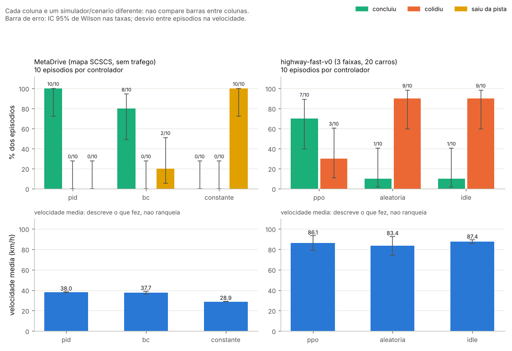

# Exemplo — `aula19-comparativo`

**Apoio, não veredito.** O `comparar.py` relata o que achou nos seus CSVs — `achei`, `não achei`, `olhe:`. Ele não decide quem ganhou, não valida a entrega, não antecipa nota e **não substitui o enunciado**.

**Aula 19 · Etapa 10.** Os itens 3 e 4 do TP5 dizem, no enunciado: *"Behavioral Cloning vs PID — 1.000 frames de pilotagem humana no MetaDrive; CNN prevendo ação de direção; PID com simple-pid; comparação em 10 episódios (conclusão de rota, colisões, velocidade média)."* e *"PPO — Stable Baselines3 em highway-env, 300k steps (≈30 min CPU); comparação com BC; gráfico de barras e análise crítica PID × BC × PPO no relatório final."* A correção cobra *"Comparação experimental com métricas quantitativas consistentes; análise crítica (limitações e trade-offs)."* Os exemplos [`aula18-pid-bc`](../aula18-pid-bc/index.md) e [`aula18-ppo`](../aula18-ppo/index.md) produzem as medidas; este junta os CSVs deles — ou os **seus** — numa tabela com intervalos, no **gráfico de barras** que o enunciado pede e num **esqueleto** de análise crítica, com as perguntas e sem as respostas.

> ## Leia isto antes de qualquer coisa
>
> **Os dois simuladores são diferentes, e o gráfico mostra isso em vez de esconder.** O PID e o BC rodam no MetaDrive, numa estrada com curvas e **sem tráfego**; o PPO roda no `highway-fast-v0`, numa autoestrada reta de 3 faixas com **20 carros**. Cada simulador vira uma **coluna** da figura, com o nome e o tráfego no título, e o script não compara uma coluna com a outra. A recompensa só aparece se você pedir (`--recompensa`), e só dentro da coluna dela.
>
> **Com 10 episódios, o intervalo de uma taxa é enorme.** 8 de 10 é "algo entre 49% e 94%". A tabela mostra o intervalo ao lado de cada taxa justamente para que ninguém leia 80% contra 100% como se fosse uma diferença medida.

```
aula19-comparativo/
├── comparar.py   # le N CSVs de avaliacao -> tabela com IC de Wilson, barras.png, analise.md (esqueleto)
├── testar.py     # 7 grupos: Wilson contra valores publicados, os dois formatos, cada "olhe:", a figura
└── amostra/      # os CSVs dos dois exemplos da Aula 18, a figura, a tabela e o esqueleto gerados
    ├── metadrive/    # pid.csv, bc.csv, constante.csv  (do aula18-pid-bc, nuvem, sementes 100-109)
    ├── highway/      # avaliacao_{ppo,aleatoria,idle}.csv  (do aula18-ppo, sementes 1000-1009)
    ├── highway-50/   # as mesmas tres politicas em 50 episodios (sementes 1000-1049)
    ├── saida.txt     # o que o comando da amostra imprime
    ├── barras.png    # a figura
    └── analise.md    # o esqueleto gerado
```

## Baixar

O exemplo é autocontido e **não precisa de venv**: só do `python3` do sistema com o matplotlib e o NumPy do apt — os mesmos que o `histograma.py` e o `trajetorias.py` da Aula 18 já usam. Tudo pende do `git clone` pelo `&&`: se o clone falhar, nenhum `rm -rf` roda.

```bash
# ── uma vez por terminal ──────────────────────────────
export PB_USER=seu-usuario-github          # ← troque pelo seu usuário do GitHub
export PB_DIR="$HOME/projeto-pb-$PB_USER"
export PB_WS="$PB_DIR/ros2_ws"

mkdir -p "$PB_DIR" && cd /tmp && rm -rf pb-a19 && \
  git clone --depth 1 https://github.com/Prof-Dacio-INFNET/PBRoboticos_prof_dacio.git pb-a19 && \
  rm -rf "$PB_DIR/aula19-comparativo" && \
  cp -r pb-a19/exemplos/aula19-comparativo "$PB_DIR/"
```

**Cuidado:** o bloco apaga e recria `aula19-comparativo/`. Não escreva a sua análise dentro dessa pasta; os comandos abaixo gravam em `$PB_DIR/docs/evidencias/tp5/`.

O matplotlib e o NumPy, se ainda não estiverem lá (no Ubuntu 22.04, o apt traz o matplotlib 3.5.1 e o NumPy 1.21.5):

```bash
sudo apt install -y python3-matplotlib python3-numpy
python3 -c "import matplotlib, numpy; print(matplotlib.__version__, numpy.__version__)"
```

A segunda linha tem de imprimir duas versões, por exemplo `3.5.1 1.21.5`.

## Conferir antes de confiar

```bash
# ── herda as variáveis do bloco de download ──
: "${PB_WS:?defina PB_USER, PB_DIR e PB_WS — o bloco está no topo desta página}"
cd "$PB_DIR/aula19-comparativo"
python3 testar.py
```

Sete grupos, menos de 5 s. Termina em `todos os testes passaram.` O que eles provam: o intervalo de Wilson bate com os valores publicados por Newcombe (1998) e com os casos de 10 episódios que a aula usa; os dois formatos de CSV são lidos (e o `resumo.csv` do PPO é recusado, porque não tem os episódios); cada linha `olhe:` aparece no caso feito para ela e fica calada quando não cabe; a recompensa entre simuladores é recusada; o PNG existe, não está vazio e tem desenho; o `analise.md` diz no topo que é esqueleto e não é regravado por cima do que você escreveu; a `amostra/` é o que o comando abaixo produz. Os testes provam que as peças estão no lugar, não que a sua comparação está certa.

## A amostra: o que sai

```bash
# ── herda as variáveis do bloco de download ──
: "${PB_WS:?defina PB_USER, PB_DIR e PB_WS — o bloco está no topo desta página}"
cd "$PB_DIR/aula19-comparativo"
python3 comparar.py \
  --csv pid=amostra/metadrive/pid.csv bc=amostra/metadrive/bc.csv \
        constante=amostra/metadrive/constante.csv \
        ppo=amostra/highway/avaliacao_ppo.csv aleatoria=amostra/highway/avaliacao_aleatoria.csv \
        idle=amostra/highway/avaliacao_idle.csv \
  --grupo "pid,bc,constante=MetaDrive (mapa SCSCS, sem trafego)" \
          "ppo,aleatoria,idle=highway-fast-v0 (3 faixas, 20 carros)" \
  --png /tmp/barras.png --md /tmp/analise.md
```

**O que são esses CSVs, exatamente.** Os três do MetaDrive são os da `amostra/resultados/` do `aula18-pid-bc`: PID, BC e a constante −0,009 (a média do dataset), **medidos na nuvem** (container sem GPU), 10 episódios cada, sementes 100 a 109. O BC deles é o que concluiu **8 de 10**. O BC da máquina do professor concluiu **10 de 10** em duas execuções completas — o README do `aula18-pid-bc` dá os números —, mas aquele CSV **não está** no repositório, e por isso não está aqui. Os três do highway-env são os da `amostra/avaliacao/` do `aula18-ppo`: o modelo de 300 288 passos, a aleatória e o IDLE nos mesmos 10 episódios (sementes 1000 a 1009); a `highway-50/` tem as mesmas três em 50 episódios.

A tabela (`amostra/saida.txt`):

```
| grupo                                 | controlador | n  | concluiu | IC 95%     | colidiu | IC 95%    | saiu da pista | IC 95%     | vel. media km/h | sementes    |
|---------------------------------------|-------------|----|----------|------------|---------|-----------|---------------|------------|-----------------|-------------|
| MetaDrive (mapa SCSCS, sem trafego)   | pid         | 10 | 10/10    | 72% a 100% | 0/10    | 0% a 28%  | 0/10          | 0% a 28%   | 38.0 +- 0.3     | 100 a 109   |
| MetaDrive (mapa SCSCS, sem trafego)   | bc          | 10 | 8/10     | 49% a 94%  | 0/10    | 0% a 28%  | 2/10          | 6% a 51%   | 37.7 +- 1.3     | 100 a 109   |
| MetaDrive (mapa SCSCS, sem trafego)   | constante   | 10 | 0/10     | 0% a 28%   | 0/10    | 0% a 28%  | 10/10         | 72% a 100% | 28.9 +- 0.3     | 100 a 109   |
| highway-fast-v0 (3 faixas, 20 carros) | ppo         | 10 | 7/10     | 40% a 89%  | 3/10    | 11% a 60% | -             | -          | 86.1 +- 7.1     | 1000 a 1009 |
| highway-fast-v0 (3 faixas, 20 carros) | aleatoria   | 10 | 1/10     | 2% a 40%   | 9/10    | 60% a 98% | -             | -          | 83.4 +- 9.1     | 1000 a 1009 |
| highway-fast-v0 (3 faixas, 20 carros) | idle        | 10 | 1/10     | 2% a 40%   | 9/10    | 60% a 98% | -             | -          | 87.4 +- 1.8     | 1000 a 1009 |
```

E o que ele achou — as linhas `olhe:` são as que pedem a sua atenção:

```
olhe: 2 grupos diferentes. Colidiu, velocidade e recompensa nao querem dizer a mesma coisa entre eles; nao comparo barras de grupos diferentes
olhe: pid 10/10 (72% a 100%) e bc 8/10 (49% a 94%) em 'concluiu': os intervalos se sobrepoem -- estes dois nao estao separados por estes numeros
olhe: pid 0/10 (0% a 28%) e bc 2/10 (6% a 51%) em 'saiu da pista': os intervalos se sobrepoem -- estes dois nao estao separados por estes numeros
olhe: ppo 7/10 (40% a 89%) e aleatoria 1/10 (2% a 40%) em 'concluiu': os intervalos se sobrepoem -- estes dois nao estao separados por estes numeros
olhe: ppo 3/10 (11% a 60%) e aleatoria 9/10 (60% a 98%) em 'colidiu': os intervalos se sobrepoem -- estes dois nao estao separados por estes numeros
olhe: ppo 7/10 (40% a 89%) e idle 1/10 (2% a 40%) em 'concluiu': os intervalos se sobrepoem -- estes dois nao estao separados por estes numeros
olhe: ppo 3/10 (11% a 60%) e idle 9/10 (60% a 98%) em 'colidiu': os intervalos se sobrepoem -- estes dois nao estao separados por estes numeros
```

Duas leituras, e as duas são o assunto da aula:

- **PID 10/10 contra BC 8/10 não separa os dois.** Os intervalos vão de 72% a 100% e de 49% a 94%: com 10 episódios, estes números são compatíveis com os dois controladores concluindo igual. O que separa o PID do BC no `aula18-pid-bc` não é a coluna `concluiu`, é o **erro lateral** (0,021 contra 0,116 m) e o **empurrão** — medidas que o enunciado não pede e que a análise crítica pode usar.
- **Até o PPO contra o IDLE encosta.** 7/10 contra 1/10 parece uma diferença enorme, e os intervalos ainda se tocam por um fio (40% e 40%). Sobreposição de intervalos é um critério **conservador**: intervalos que não se tocam indicam uma diferença que estes `n` sustentam; intervalos que se tocam **não provam que os dois são iguais** — dizem que estes números, sozinhos, não bastam. O `aula18-ppo` mostra o resto da evidência: com **50** episódios (`amostra/highway-50/`), o PPO conclui 34/50 (54% a 79%) e o IDLE 4/50 (3% a 19%), e aí os intervalos ficam bem longe um do outro.

**As linhas `achei`** dizem o que está em ordem: o mesmo número de episódios em todos, as mesmas sementes dentro de cada simulador, uma linha de base em cada grupo (`constante` num, `aleatoria` e `idle` no outro), e os pares cujos intervalos não se tocam (PID e BC contra a constante). Nenhuma linha diz quem é o melhor, de propósito.

## Como ler a figura



- **Cada coluna é um simulador**, com o nome e o tráfego no título. As barras de uma coluna se comparam entre si; as de colunas diferentes, não — a frase de cima da figura diz isso, para quem vir a figura fora do relatório.
- **Em cima, as taxas**: concluiu (verde), colidiu (laranja) e saiu da pista (amarelo, só onde a coluna existe — no highway-env sair da pista não é um desfecho medido). O número em cima de cada barra é a contagem (`8/10`), e a barra de erro é o **intervalo de 95% de Wilson**. Uma barra de altura zero ainda tem barra de erro: 0 de 10 é "entre 0% e 28%", não "nunca".
- **Embaixo, a velocidade média**, com o desvio entre episódios. Ela está em km/h nos dois simuladores, e mesmo assim **descreve, não ranqueia**: no MetaDrive o alvo do acelerador é 40 km/h numa estrada com curvas; no highway-env o carro escolhe entre 72, 90 e 108 km/h numa reta. Ninguém "foi mais rápido" que ninguém entre as colunas.
- **Por que Wilson e não o desvio-padrão?** O desvio de uma coluna de zeros e uns daria, para 8 de 10, uma barra de 80% ± 42% — que passa de 100%. O intervalo de Wilson fica dentro de [0, 1], não vira um ponto quando a contagem é 0 ou 10, e é o que o `curva.py` do `aula18-ppo` já usa.
- **Com `--recompensa`**, aparece uma terceira linha de painéis, um por coluna, cada um com o **seu** eixo e o aviso em vermelho "SO dentro deste grupo". A recompensa do MetaDrive (≈ metros andados na rota) e a do highway-env (0 a 1 por passo, 30 passos) não estão na mesma escala nem na mesma unidade: o script **recusa** pô-las no mesmo eixo, e recusa desenhá-la quando os grupos não foram declarados.

## Com os SEUS CSVs

Os caminhos abaixo são os que os comandos do [`aula18-pid-bc`](../aula18-pid-bc/index.md) e do [`aula18-ppo`](../aula18-ppo/index.md) gravam. Se você mediu com outros nomes, troque só os caminhos depois do `=`. Rode **depois** de ter os CSVs: o PID, o BC e a constante pela régua do `avaliar.py`; o PPO, a aleatória e o IDLE pelo `avaliar.py` do PPO.

```bash
# ── herda as variáveis do bloco de download ──
: "${PB_WS:?defina PB_USER, PB_DIR e PB_WS — o bloco está no topo desta página}"
cd "$PB_DIR/aula19-comparativo"
mkdir -p "$PB_DIR/docs/evidencias/tp5"
python3 comparar.py \
  --csv pid="$PB_DIR/aula18-pid-bc/resultados/pid.csv" \
        bc="$PB_DIR/aula18-pid-bc/resultados/bc.csv" \
        constante="$PB_DIR/aula18-pid-bc/resultados/constante.csv" \
        ppo="$PB_DIR/ppo-treino/avaliacao/avaliacao_ppo.csv" \
        aleatoria="$PB_DIR/ppo-treino/avaliacao/avaliacao_aleatoria.csv" \
        idle="$PB_DIR/ppo-treino/avaliacao/avaliacao_idle.csv" \
  --grupo "pid,bc,constante=MetaDrive (mapa SCSCS, sem trafego)" \
          "ppo,aleatoria,idle=highway-fast-v0 (3 faixas, 20 carros)" \
  --png "$PB_DIR/docs/evidencias/tp5/barras.png" \
  --md "$PB_DIR/docs/evidencias/tp5/analise-esqueleto.md"
```

As regras dos argumentos:

- `--csv rotulo=caminho`, um por controlador. Sem `rotulo=`, o rótulo é o nome do arquivo (`avaliacao_ppo.csv` vira `ppo`). O CSV precisa ter uma linha por episódio e as colunas `episodio,semente,concluiu,colidiu,vel_media` — as dos dois `avaliar.py`. `saiu_da_pista` entra quando existe; `recompensa`, só com `--recompensa`. O `resumo.csv` do PPO **não** serve: ele tem uma linha por política, sem os episódios, e o script diz isso.
- `--grupo rotulos=nome`: à esquerda do primeiro `=`, um ou mais rótulos separados por vírgula; à direita, o nome do simulador como você quer que apareça na figura — **ponha o tráfego no nome**. Se o seu MetaDrive tiver tráfego, o nome diz isso. Rótulo sem grupo vai para uma coluna "(grupo nao declarado)" e ganha uma linha `olhe:`.
- **Linha de base**: o script procura, em cada grupo, um rótulo que **comece** com `aleatoria`, `idle` ou `constante` (`constante-zero` conta). Se o seu se chama de outro jeito, renomeie no `--csv`.
- `--md` grava o **esqueleto** da análise: a tabela, as linhas `achei`/`olhe:` e seis seções de perguntas com `_escreva aqui_` no lugar das respostas. Rodar de novo regrava o esqueleto; mas se você já escreveu nele, o script **se recusa** a regravar (`nao sobrescrevo ...`). Mesmo assim, escreva a análise no seu relatório, não no arquivo gerado.

O que o esqueleto pergunta — sem responder: **o que cada controlador vê** (o estado do simulador, a imagem, a observação cinemática dos carros vizinhos); **o que cada um custou** (ganhos sintonizados à mão, 1000 quadros pilotados, os passos de PPO que você de fato treinou, a quantos passos/s); **onde cada um quebra** (o BC empurrado para fora do centro, o PPO que aprendeu a ficar na faixa da direita e frear, o PID que depende do estado que o simulador entrega e de ganhos que valem para uma velocidade); **o que estes números deixam e não deixam dizer**; **o que não dá para concluir** entre simuladores diferentes; e as limitações e trade-offs.

## O que este exemplo NÃO faz

- **Não decide quem ganhou.** Nenhuma linha diz "o melhor é X", e nenhuma deveria: a tabela é a medida, a frase é sua — e precisa vir com o intervalo e com o cenário.
- **Não torna comparáveis dois simuladores.** Pôr os seis controladores na mesma figura não os põe na mesma tarefa. O que se sustenta é a posição de cada um em relação à linha de base **do próprio simulador** ("o PPO reduziu a colisão de 9/10, do IDLE, para 3/10 no highway-env; o BC ficou a 2 episódios do PID no MetaDrive, com intervalos que se sobrepõem"). "O PPO bateu menos que o BC" não se sustenta.
- **Não confere se a régua foi a mesma.** Ele vê as sementes e o número de episódios; não vê se o mapa, o tráfego, o horizonte ou a velocidade-alvo mudaram entre um CSV e outro. Isso é você quem garante, e o relatório quem declara.
- **Não faz teste de hipótese.** A sobreposição de intervalos é um critério simples e conservador, escolhido porque se lê numa figura. Um teste de duas proporções (Fisher, por exemplo) pode separar pares que os intervalos não separam; se você usar um, diga qual e por quê.
- **Não lê o seu relatório.** O que pesa na nota — se a análise fala do seu projeto, se as limitações estão ditas, se as frases batem com a tabela — fica fora do alcance de um script. Lista sem `olhe:` quer dizer "esgotei o que um script enxerga num CSV", não "entrega pronta".

## O que foi e o que não foi verificado

**Rodou aqui** — container Linux, Python 3.13 com matplotlib 3.11 e NumPy 2.5; e, para conferir a compatibilidade com o Ubuntu 22.04, num venv criado com `uv` com **Python 3.10, matplotlib 3.5.1, NumPy 1.21.5 e pyparsing 2.4.7** (as versões do apt no 22.04): o `testar.py` inteiro nos dois ambientes (`todos os testes passaram.`), o comando da amostra com e sem `--recompensa`, e o mesmo comando com `-W error` no ambiente antigo, sem nenhum aviso. A figura foi aberta e conferida nos dois. Os CSVs da amostra são cópias byte a byte das amostras dos dois exemplos da Aula 18.

**Não rodou:**

- o `python3-matplotlib` **do apt de verdade** num Ubuntu 22.04: o ambiente antigo daqui tem as mesmas versões, instaladas de outra forma;
- os CSVs de um aluno — em particular um BC treinado com pilotagem humana, ou um PPO com menos de 300 mil passos. O formato é o dos dois `avaliar.py`; um CSV feito à mão com outras colunas é recusado com o nome da coluna que falta;
- o BC 10/10 da máquina do professor: o CSV dele não está no repositório (veja "A amostra: o que sai").

## Socorro rápido

| Sintoma | Causa provável |
|---|---|
| `No module named 'matplotlib'` | falta o `python3-matplotlib` do apt — ou rodou com o Python de um venv sem ele. Este exemplo roda com o `python3` do sistema |
| `nao consegui ler: ... e um resumo (uma linha por politica)` | passou o `resumo.csv` do PPO. Passe os `avaliacao_ppo.csv`, `avaliacao_aleatoria.csv`, `avaliacao_idle.csv` |
| `nao consegui ler: ...: faltam as colunas ...` | o CSV não é de um dos dois `avaliar.py`, ou foi editado. A mensagem lista as colunas que ele tem |
| `nao consegui ler: [Errno 2] No such file or directory` | caminho errado depois do `=`. `ls` no caminho antes de rodar |
| `rotulo repetido em --csv` | dois CSVs com o mesmo rótulo (por exemplo, dois `avaliacao_ppo.csv` sem `rotulo=`). Dê nomes: `ppo10=... ppo50=...` |
| `--grupo cita rotulos que nao estao em --csv` | erro de digitação no rótulo do `--grupo` |
| `recuso: sem --grupo nao sei se estes controladores rodaram no mesmo simulador` | pediu `--recompensa` sem declarar os grupos. Declare com `--grupo` |
| `nao sobrescrevo ...: parece que voce ja escreveu nele` | o `--md` aponta para um arquivo que você já editou. Grave o esqueleto com outro nome |
| todas as taxas com "olhe: ... se sobrepoem" | é o que 10 episódios dão. Mais episódios estreitam o intervalo; dizer isso no relatório é parte da análise crítica |
| a figura fica estreita e os rótulos se encostam | rótulos longos demais no `--csv`. Use rótulos curtos (`bc`, `bc-esp`) e ponha o detalhe no relatório |

## O que cada arquivo faz

| Arquivo | Papel | Roda com |
|---|---|---|
| `comparar.py` | lê os CSVs, conta as taxas com o intervalo de Wilson, média ± desvio da velocidade, imprime a tabela e as linhas `achei`/`olhe:`, desenha as barras por simulador, grava o esqueleto. `--csv`, `--grupo`, `--png`, `--md`, `--recompensa` | `python3` do sistema (matplotlib só para o `--png`) |
| `testar.py` | 7 grupos; sai com 0 ou 1 | `python3` do sistema |
| `amostra/metadrive/` | `pid.csv`, `bc.csv`, `constante.csv` do `aula18-pid-bc` (nuvem, 10 episódios, sementes 100–109) | — |
| `amostra/highway/`, `amostra/highway-50/` | `avaliacao_{ppo,aleatoria,idle}.csv` do `aula18-ppo`, em 10 e em 50 episódios | — |
| `amostra/saida.txt`, `barras.png`, `analise.md` | o que o comando da amostra imprime, desenha e grava | — |

## Licença

MIT, como todo o diretório `exemplos/`.
